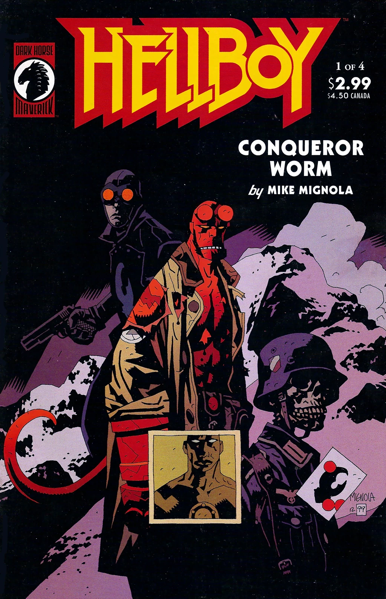
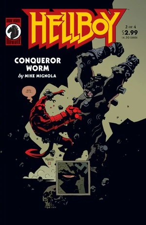
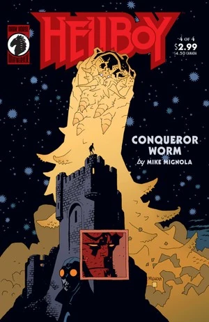

在《**征服之虫**》（Conqueror Worm）中，[地狱男爵](/entry/Hellboy_%28character%29) 与 [罗杰](/entry/Roger) 在奥地利与 [赫尔曼·冯·克勒姆普特](/entry/Herman_von_Klempt) 以及一个来自异世界的威胁正面对抗。

## 出版历史

《征服之虫》最初于 2001 年 5 月至 8 月以四期限定迷你系列的形式出版。该故事后来于 2002 年 2 月在 [《地狱男爵——第 5 卷：征服之虫》](/entry/Trade_Collections) 中重印，并新增了一个九页的尾声。

## 剧情简介

### 第一部

故事以一段闪回开场：**“1939 年。奥地利，洪特城堡。”** [龙虾人约翰逊](/entry/Lobster_Johnson) 率领一队美国士兵袭击纳粹的秘密太空计划。美国人赶到时，纳粹正准备发射一枚搭载 [恩斯特·厄明](/entry/Ernst_Oeming) 的火箭。士兵们射杀了纳粹科学家，城堡燃起大火。

61 年后，[托马斯·曼宁](/entry/Thomas_Manning) 向 [地狱男爵](/entry/Hellboy_%28character%29) 和 [罗杰](/entry/Roger) 简报了多年前那一夜发生的事件。厄明是纳粹的首席科学家之一，于 1939 年 1 月 1 日被杀，他的尸体被运往洪特城堡。美军的袭击发生在 1939 年 3 月 20 日。地狱男爵提到，他听说这是龙虾人约翰逊的最后一次任务，但曼宁回答说“龙虾人”只是一个虚构人物。当地狱男爵问这与他们当前的任务有什么关系时，曼宁向他们展示了一张由 NASA 拍摄的卫星照片：厄明的太空舱正在返回航线上，将降落在洪特城堡。

曼宁把他们的当地向导劳拉·卡恩施泰因介绍给他们，并支开劳拉和罗杰，以便单独和地狱男爵谈话。曼宁告诉地狱男爵，罗杰体内被安装了一枚小炸弹，威力刚好足以杀死他。地狱男爵极为震惊，但曼宁说绝不能让罗杰再杀死其他探员，必要时地狱男爵必须引爆罗杰。

劳拉、地狱男爵和罗杰开始向城堡进发。途中他们遇到一位老人。老人说城堡闹鬼，并解开外套，露出里面的纳粹制服。地狱男爵打了老人，但劳拉告诉他们她会处理他。地狱男爵和罗杰离开后，她开枪打死老人，把他推下附近的悬崖。老人又站了起来，被炸开的外套下露出了龙虾钳。劳拉走进城堡走在前面，随后大声呼救。地狱男爵和罗杰靠近时遭到狙击手射击，罗杰被击落下悬崖。地狱男爵抓住了他，但罗杰自己松手坠下，好让地狱男爵去救劳拉。地狱男爵冲向狙击手的位置，却只发现遥控操作的机枪。他从地板的一扇活板门跌落，发现自己身处一间地下室。一名美国士兵的鬼魂告诉他城堡是个陷阱，但地狱男爵刚爬出洞口就被 [赫尔曼·冯·克勒姆普特](/entry/Herman_von_Klempt) 和他的一只 [战争猿](/entry/Kriegaffe) 击昏。“劳拉”——实际上是冯·克勒姆普特的孙女 [英格](/entry/Inger_von_Klempt)——站在他身旁，问自己做得好不好。

### 第二部

地狱男爵在一套电击束具中醒来，冯·克勒姆普特、英格和战争猿站在他面前。冯·克勒姆普特提醒地狱男爵 [他们上次在南美洲的交手](/entry/World%27s_Greatest_Paranormal_Investigator_%28CBG%29)，以及他在 [弗拉基米尔·久列斯库](/entry/Vladimir_Giurescu) [复活](/entry/Wake_the_Devil) 余波中扮演的小角色。

外面，[罗杰](/entry/Roger) 见到了龙虾人约翰逊。约翰逊揭露了英格的真实身份，以及赫尔曼是洪特城堡灾难的唯一幸存者。两人进入城堡下方的洞穴，发现一个房间里满是纳粹制造的人形机器。感受到罗杰的电力后，机器开始苏醒。罗杰吸收了纳粹发电机的能量，使机器失去动力，城堡也因此断电。

束具失去电力后，地狱男爵得以制服战争猿。他走开时看到一个被锁在墙上的男人，胸口有三处枪伤。地狱男爵问那人怎么还活着，那人说他根本不是人类，只是伪装成人的样子。那人说他曾出现在 [地狱男爵诞生](/entry/Seed_of_Destruction) 之时，并在 [圣伦纳德森林](/entry/The_Nature_of_the_Beast) 中注视过他。那人解释说，战争期间纳粹设法与太空中的 [远古邪恶存在](/entry/Ogdru_Hem) 取得了联系，其中一个已经附在恩斯特·厄明的尸体上，将乘纳粹太空舱返回地球。他给了地狱男爵一个能够困住那生物的小装置，随后伤重而死，变回了自己的真实形态。罗杰与地狱男爵会合，但龙虾人已不见踪影。

### 第三部

纳粹太空船降落在城堡中时，冯·克勒姆普特让英格戴上防毒面具。气体从船中涌出，把英格的手下变成了没有心智的 [青蛙怪物](/entry/Frog_monster)。英格意识到正在发生什么，逃离发射台，却被美国士兵的鬼魂拦住。冯·克勒姆普特袭击地狱男爵，留下 [罗杰](/entry/Roger) 去对付太空舱。龙虾人约翰逊出现，告诉罗杰他必须独自面对怪物。一些青蛙怪物扑向罗杰。

地狱男爵打掉了冯·克勒姆普特的机械头颅，露出他真正的头颅保存在机器人躯体胸腔内的一个罐子里。那颗头开枪击中地狱男爵并飞走，地狱男爵则穿过地板跌落到下方的地下室。[征服之虫](/entry/Conqueror_Worm) 从飞船中现身，吞食了那些被变形的人。

在城堡的地下室里，地狱男爵找到了纳粹用来与太空中的奥格德鲁·赫姆联系的无线电设备，操作员的尸体仍坐在控制台前。地狱男爵打开一个柜子，发现几颗被砍下的圣徒头颅连接在天线上——这是纳粹用来复制古代仪式的粗糙手段，那些仪式曾让古人能够与奥格德鲁·赫姆对话。地狱男爵不知是对谁说道：*“这是地球上最糟糕的地方。”*

英格与赫尔曼对质，问他要如何控制那怪物。赫尔曼回答说，没有任何东西能控制那条虫子。第三帝国覆灭之后，在他无数计划和项目失败之后，他已经厌倦了追逐权力，如今只想毁灭世界。虫子将完成这一切，并告知它的同类。369 个 [奥格德鲁·赫姆](/entry/Ogdru_Hem) 将随之苏醒，随后是 [奥格德鲁·贾哈德](/entry/Ogdru_Jahad)。它们将把世界化为 *“一块烧焦的煤渣”*。英格惊恐地问，赫尔曼为什么保护她，却只是为了让她目睹世界末日。赫尔曼说他并没有保护她——她的面具并没有保护她免受虫子气体的侵害，只是延\*\*\*\*\*\*\*了气体发作。他只是想要身边有个人足够清醒，能听到他做了什么并亲眼见证。

英格摘下防毒面具，露出她也已经变成了青蛙怪物，唯一的区别是她还勉强能够思考和说话。

### 第四部

征服之虫试图吃掉罗杰，但又把他吐了出来，落在地狱男爵附近。地狱男爵试图用那个外星装置击败虫子，但冯·克勒姆普特的机器人躯体从地狱男爵手中夺走装置并将其捏碎。

变形后的英格在城堡深处见到 [格里高利·拉斯普京](/entry/Grigori_Rasputin)。英格绝望地感到，在虫子面前，她重建第三帝国的梦想已然落空。拉斯普京确认虫子将毁灭世界，但毁灭之后一个新世界和新人类种族将会诞生，而她就是那个新种族的第一人。

地狱男爵和罗杰试图阻止虫子，起初没有成功，但他们意识到虫子不喜欢电。罗杰释放了他从发电机吸收的能量电击虫子。虫子开始控制罗杰的心智，罗杰叫地狱男爵毁掉他。但地狱男爵不肯，冯·克勒姆普特飞着的头颅过来嘲笑他们。罗杰抓住玻璃罐纵身跃下悬崖，罐子摔碎，冯·克勒姆普特毙命。

龙虾人约翰逊找到英格并杀了她，无视她抗议说自己是 *“未来！”*。龙虾人和地狱男爵冲下山，找到了罗杰。龙虾人把一根金属棒插入罗杰的胸膛，引来闪电，闪电摧毁了虫子。地狱男爵和罗杰回头望去，看到龙虾人约翰逊早已死去的尸体。

地狱男爵厌恶 [B.P.R.D.](/entry/B.P.R.D.) 对罗杰的所作所为，退出了调查局。他告诉 [凯特·科里根](/entry/Kate_Corrigan)，他打算去非洲，之后便 *“随风而去。”*

### 尾声

仍留在城堡里的拉斯普京迎来了 [赫卡忒](/entry/Hecate)。她叫他休息，两人回顾了她在久列斯库城堡的所作所为（见《[唤醒恶魔](/entry/Wake_the_Devil)》）。她说当末日来临时，要么她和地狱男爵在新世界中一同统治，要么两人一同死去。赫卡忒嘲笑拉斯普京过去对地狱男爵的屡屡失败，说他永远都会失败，因为他不过是一个鬼魂。拉斯普京大怒，说自己是被 [奥格德鲁·贾哈德](/entry/Ogdru_Jahad) 选中的人，他会解放它们。但赫卡忒说只有 [地狱男爵的手](/entry/The_Right_Hand_of_Doom) 才能解放它们（因为当初正是这股力量将它们囚禁），而拉斯普京无法控制他。拉斯普京抗声尖叫说，是他把地狱男爵带到这个世界，他仍然是地狱男爵的主人，但他的话在自己和赫卡忒耳中都显得空洞无力。

拉斯普京碎成白骨，化为尘土。[芭芭雅嘎](/entry/Baba_Yaga_%28character%29) 取走剩下的一点火星，放进一颗空心橡子里，挂在脖子上。

## 故事年表

《征服之虫》发生的确切日期可能是 **2000** 年或 **2001** 年。故事开头交代，故事发生在 1939 年开场闪回的 61 年后，照此推算故事应发生在 2000 年；但根据《The Companion》[1]，对城堡的进攻发生在 1939 年 3 月 20 日，而征服之虫事件发生在 2001 年 2 月 5 日，相隔 61 年零十个半月。这是 Jason Hall 为《The Companion》所作的时间线解释，他没有说明月和日。因此 2000 年和 2001 年都是成立的日期。

故事很可能发生在 [丽兹·谢尔曼](/entry/Liz_Sherman) 离开 [B.P.R.D.](/entry/Bureau_for_Paranormal_Research_and_Defense) 之后（见《[B.P.R.D.：中空地球](/entry/Hollow_Earth)》），因为 [地狱男爵](/entry/Hellboy_%28character%29) 只请 [凯特](/entry/%E5%87%AF%E7%89%B9%C2%B7%E8%80%83%E7%91%9E%E6%A0%B9)) 代他向 [亚伯](/entry/Abraham_Sapien) 告别，而没有提到丽兹。紧接其前的故事是《[地狱男爵：生而为人](/entry/Being_Human)》，其后是《[B.P.R.D.：灵质人](/entry/The_Ectoplasmic_Man)》。

## 内容

### 角色

#### [B.P.R.D.](/entry/Bureau_for_Paranormal_Research_and_Defense)

- [凯瑟琳·科里根](/entry/%E5%87%AF%E7%89%B9%C2%B7%E8%80%83%E7%91%9E%E6%A0%B9))
- [托马斯·曼宁](/entry/Thomas_Manning)
- [地狱男爵](/entry/Hellboy_%28character%29)
- [罗杰](/entry/Roger)
- [亚伯拉罕·萨平](/entry/Abraham_Sapien)（闪回）
- [罗杰的兄弟](/entry/Roger%27s_brother)（闪回）
- [伊丽莎白·谢尔曼](/entry/Elizabeth_Sherman)（闪回）
- 其他 B.P.R.D. 探员

#### [纳粹](/entry/%3ACategory%3ANazi)

- [恩斯特·厄明](/entry/Ernst_Oeming)
- [英格·冯·克勒姆普特](/entry/Inger_von_Klempt)（又名劳拉·卡恩施泰因）
- [战争猿](/entry/Kriegaffe) 第 10 号
- [赫尔曼·冯·克勒姆普特](/entry/Herman_von_Klempt)
- [利奥波德·库尔茨](/entry/Leopold_Kurtz)（闪回）
- [卡尔·鲁普雷希特·克勒南](/entry/Karl_Ruprect_Kroenen)（闪回）
- [伊尔莎·豪普施泰因](/entry/Ilsa_Haupstein)（闪回）
- 纳粹士兵与科学家（变为 [青蛙怪物](/entry/Frog_monster)）
- [阿道夫·希特勒](/entry/Adolf_Hitler)（画像）
- 不死改造人

#### 龙虾人约翰逊相关闪回

- [龙虾人](/entry/The_Lobster)
- 美国士兵
- 《幻影丛林》系列电影
  - 维克·威廉姆斯（闪回）
  - 女演员（闪回）
- 黑帮分子
  - “绳子”文尼（照片）
  - “瘦子”乔·林肯（照片）
  - 祖科·巴纳纳（照片）
- [斯坦利·科恩](/entry/Stanley_Corn)的大脑（闪回）

#### 其他

- [外星人](/entry/Aliens)
  - [访客](/entry/The_Visitor_%28character%29)
- [奥格德鲁·赫姆](/entry/Ogdru_Hem)
  - [征服之虫](/entry/Conqueror_Worm_%28Ogdru_Hem%29)
- [女巫与巫师](/entry/Witches)
  - [格里高利·拉斯普京](/entry/Grigori_Rasputin)
  - [赫卡忒](/entry/Hecate)
  - [芭芭雅嘎](/entry/Baba_Yaga_%28character%29)
- [奥格德鲁·贾哈德](/entry/Ogdru_Jahad)
- [弗拉基米尔·久列斯库](/entry/Vladimir_Giurescu)（闪回）

### 地点

-
- 奥地利
  - 洪特城堡
  - [B.P.R.D.](/entry/Bureau_for_Paranormal_Research_and_Defense) 第四野外总部
- 美国（闪回）
  - [斯坦利·科恩](/entry/Stanley_Corn)的公寓（纽约）（闪回）
  - [B.P.R.D.](/entry/Bureau_for_Paranormal_Research_and_Defense) 总部（康涅狄格州费尔菲尔德）（闪回）
  - [卡文迪什庄园](/entry/Cavendish_Hall)（纽约州北部）（闪回）
- 罗马尼亚（闪回）
  - 切泽格城堡（弗尔蒂切尼）（闪回）
    - [埃德尔·米施拉瑟](/entry/Edel_Mischrasse)的工坊（闪回）
  - 毛焦尔南多尔（闪回）
  - 沃尔研究所（特尔戈维什泰）（闪回）
  - [久列斯库](/entry/Vladimir_Giurescu)城堡（闪回）
- 挪威（闪回）
  - [诸神黄昏计划](/entry/Project_Ragna_Rok)的城堡（闪回）

- 巴西（闪回）
- 南美洲（闪回）

- 德国（闪回）
  - [赫尔曼·冯·克勒姆普特](/entry/Herman_von_Klempt)的工坊（闪回）
- 英国（闪回）
  - 东布罗姆维奇教堂废墟（闪回）
  - 圣伦纳德森林（闪回）
- [地狱](/entry/Hell)（幻象）
  - [深渊](/entry/Abyss)（幻象）
- [希柏里尔](/entry/Hyperboreans)（幻象）
- 苏格兰（闪回）
  - 塔马甘特岛（闪回）
- [世界之树](/entry/Yggdrasil)

### 重要物件

- [厄明](/entry/Ernst_Oeming)太空舱
- [龙虾人](/entry/The_Lobster)的名片
- [罗杰](/entry/Roger)的炸弹装置
- [津科公司](/entry/Zinco_Corporation)电击束具
- [外星](/entry/Aliens)棱镜
- [赫卡忒](/entry/Hecate)的铁处女
- [毁灭之右手](/entry/Right_Hand_of_Doom)（与地狱男爵分离）
- 坚果壳中的 [格里高利·拉斯普京](/entry/Grigori_Rasputin)

## 画廊

封面由 [迈克·米格诺拉](/entry/Mike_Mignola) 绘制。

第 1 期

第 2 期

第 3 期

第 4 期

## 注释

[1] 《Hellboy: The Companion》，Dark Horse 出版：2008 年 5 月 21 日。[1](https://www.darkhorse.com/Books/12-367/Hellboy-The-Companion-TPB)
