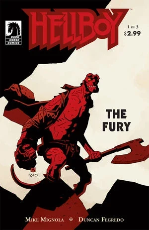
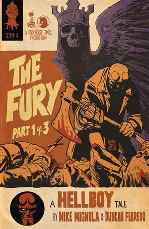
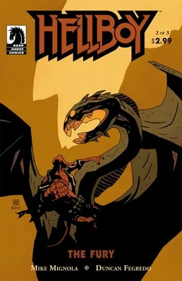
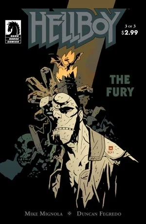

在《**怒火燎原**》（The Fury）中，[地狱男爵](/entry/Hellboy_%28character%29) 在 [妮穆艾](/entry/Nimue) 变身为巨龙 [奥格德鲁·贾哈德](/entry/Ogdru_Jahad) 时与她正面对抗。乔治·沃什布鲁克与妮穆艾的大军交战，地狱男爵则直面死亡。

## 出版历史

《怒火燎原》是《风暴与怒火》的第二部分，后者是“《狂猎》三部曲”的终章，这一系列是 [《地狱男爵》](/entry/Hellboy_%28series%29) 故事，由 [邓肯·费格雷多](/entry/Duncan_Fegredo) 绘画。由于《[狂猎](/entry/The_Wild_Hunt)》连载中途延期引起了反响，终章部分决定以两个各三期的系列、使用不同标题分别出版。

## 剧情简介

### 第一部

《[黑暗召唤](/entry/Darkness_Calls)》中的三个女巫逃离了妮穆艾寝宫中正在展开的场面，站在她的塔外，争论她们对眼前这场大灾变应负的责任。她们看到地狱男爵走近塔下她们所在的位置，因为他锤子般的石手和缺失的眼睛，先把他错认成奥丁，又错认成托尔。她们指引他登上塔顶的寝宫，妮穆艾正在寝宫窗口狂怒地否认自己正在发生的变形，并将加内达扔下（落到她士兵的长矛上）。地狱男爵进入塔底时，艾丽丝正在英格兰的酒馆里悲伤，酒保提醒艾丽丝，亚瑟王在摩根的城堡里对她说过的话——艾丽丝的生命与圣剑誓约胜利之剑相连，她将是第一个看到新王戴上王冠的人。地狱男爵面对挤满哥布林士兵的楼梯时，酒保告诉艾丽丝，这家酒馆属于 **乔治·沃什布鲁克**（米格诺拉的 [《爱德华·格雷爵士：猎巫人》](/entry/Hellboy_Comics) 漫画系列中反复提到的两名维多利亚时代叛徒女巫的侄孙），他为寻求救赎，曾在第一次世界大战的战壕中献出自己，却被一个身穿长袍、幽灵般的女子用一只金圣杯救了性命。回到英格兰后，他花了一年时间走遍全国，然后买下了这家酒馆，在酒馆里他以不可思议的速度衰老，感觉自己“在等待什么……那东西正向他走来”。地狱男爵解决最后几名士兵对手时，瘦骨嶙峋、衰老不堪的乔治·沃什布鲁克被一个幽灵般的长袍女子引着走下酒馆的楼梯。地狱男爵丢掉一把落在地上的剑，改抄起一把斧头；艾丽丝跪倒在地，将誓约胜利之剑奉给沃什布鲁克。地狱男爵冲进妮穆艾的寝宫，把斧头朝她脸上掷去，将妮穆艾那顶三鸦头盔从她头上打落。与此同时，沃什布鲁克接过誓约胜利之剑，长袍女子用亚瑟的王冠为他加冕时，他显现为一个威严、身披王甲的年轻男子，浑身散发着美与力量的光辉。妮穆艾的头盔落到寝宫地板上，又飞起化作三只活乌鸦；地狱男爵面前这个正在变异的生物宣布自己已不再是妮穆艾。艾丽丝侍立在侧，沃什布鲁克作为新王，从一圈身披光辉长袍的女子手中接过圣杯。妮穆艾的两只乌鸦从塔窗飞出时，曾是妮穆艾的存在解释说，它就是奥格德鲁·贾哈德，多亏 [格里高利·拉斯普京](/entry/Grigori_Rasputin) 在 [第一个地狱男爵故事](/entry/Seed_of_Destruction) 中劈开其牢狱墙壁的壮举，它才得以归来；自那以后，世界（就像地狱男爵的人生一样）再无光明，也再无希望。在圣杯酒馆门口，沃什布鲁克从他的圣杯里倾出一道光流，使不死大军恢复成年轻而充满活力的生命。妮穆艾塔外雷电风暴积聚之时，奥格德鲁·贾哈德单手把地狱男爵的头颅按在它此刻布满鳞片、拉长了的脸上，告诉地狱男爵他来得太晚了，并让他听：窗外，两只逃脱的乌鸦传达巨龙的命令，命大军进军、灭绝人类。

### 第二部

在英格兰酒馆的门口，艾丽丝听到妮穆艾逼近的大军的诵念声，酒保告诉他，天启四骑士骑马或潜行在大军前锋，那些在战争以及随之而来的瘟疫和饥荒中活下来的人类，随后也将死去，成为奥格德鲁·赫姆及其造物的食物。妮穆艾塔外的战场上，战争骑士及其率领的大军与沃什布鲁克及其军队交锋，沃什布鲁克发誓他们永远踏不进英格兰。艾丽丝不顾酒保在身后追赶劝阻，冲出去寻找地狱男爵；巨龙（此时看上去已经非常像一条龙）赐地狱男爵速死，但地狱男爵向他进攻时他反而高兴：“鉴于你活过的这一生，我还怕你会选择一种轻易的死法。”巨龙喷出一股烈焰把地狱男爵轰出塔窗，但地狱男爵抓住窗框再次攻上。巨龙提醒地狱男爵，它从世界诞生之初便已存在，并谜一般地宣告：“我即是时间，毁灭者：在这一点上我们被绑在一起。”地狱男爵开始反复痛击巨龙时，无数道闪电降临英格兰，摧毁地标、地貌与城市。艾丽丝和酒保在湖边遇到妮穆艾手下最后一个女巫，她道歉之后也投水自尽。沃尔德王率他的狂猎穿林而过，高喊“末日！”，艾丽丝逃上战场，那里已是一片血海，散落着一座座尸体与火焰的小岛。她在战场上徘徊，看到三个头戴冠冕的女人收回誓约胜利之剑，安慰死去的沃什布鲁克——他获得了胜利，又一次变回老人。加内达从那根长矛上（大概是在战斗中被人举起的）对艾丽丝说话——她被扔出妮穆艾塔窗时就被穿在这根矛上；她说，沃什布鲁克和他的士兵命中注定要光荣战死、赢下这场战役，把更卑微的人留下来面对“诸神黄昏”，即末日天启。她问，玛布女王为什么还没有告诉艾丽丝，这片战场就是维格里德，预言中诸神黄昏将在此发生，一场龙与人类捍卫者之间的战斗标志着“终结”。

### 第三部

地狱男爵在塔顶废墟中与巨龙搏斗时，雷电风暴摧毁了英格兰，使其人口灭绝。地狱男爵被摔倒、被钉在巨龙怪爪之下时，风暴仍在继续。巨龙默默沉浸在自己力量的狂喜中，艾丽丝与酒保对质，她此刻（从加内达的问话中）意识到酒保就是死去的玛布女王。玛布女王确认自己已死，确认这条龙就是其战斗标志着世界终结的那同一条龙；如果不加阻止，此刻蹂躏不列颠的风暴将蔓延到全世界，让世界被怪物统治，直到（如《[恐惧之王](/entry/King_of_Fear_%28story%29)》中所见）“一切烧尽”。随后，她带着感激坚称，一个新世界将会升起。地狱男爵若想拯救这个世界是赢不了的：“这个世界已经走到尽头，但重要的不是它**会**终结——而是它**如何**终结。巨龙提前逃出了牢狱”，地狱男爵奋战是为给这个世界再多争取一点时间……争取足够的时间让他的朋友们（画面为 BPRD 的 [亚伯·萨平](/entry/Abe_Sapien)、[丽兹·谢尔曼](/entry/Liz_Sherman) 和 [罗杰](/entry/Roger)）去做他们必须做的事……这样当新世界来临时，至少人类的 **精神** 能够存续。”抗议着的艾丽丝走到塔脚下时，经过 [爱德华·格雷爵士](/entry/Sir_Edward_Grey) 身边，他叫她快点。在塔顶，仍被狂喜的巨龙钉在爪下的地狱男爵看到了瓦西丽莎，那个曾在《[黑暗召唤](/entry/Darkness_Calls)》中帮助过他、在《[狂猎](/entry/The_Wild_Hunt)》中给过他忠告的俄罗斯民间传说中的少女。她手里捧着妮穆艾头盔上最后一只活乌鸦。她问地狱男爵感觉如何，他确认说，正如她曾告诉他的，死去并不疼。她哭着问他准备好了没有，他说：“我想是吧。”她把乌鸦变回铁，又把铁乌鸦变成一把铁剑，剑首有一个鸟头饰物，与《[三个愿望](/entry/The_Third_Wish)》中奥洛米手杖上的饰物相似。地狱男爵接过剑，他的血顺着剑流下时，剑变成了金色。随后他一剑砍入巨龙的腿，砍开一半。巨龙抽搐时，艾丽丝蜷缩在房间外的楼梯上，地狱男爵用石制的右手攀住巨龙，另一只手从巨龙腹部放出一股股浑浊的金色血液。地狱男爵爬高一些、刺中巨龙胸膛时，巨龙喷出一股火焰，躯体毫无生气地瘫倒在塔上。艾丽丝冲进房间，一团云从巨龙胸腔中涌出，化作身穿长袍的妮穆艾的形态；她报告说，英格兰溺死女巫们的鬼魂正把她拖入地狱，但她要把地狱男爵一起带走。她把手探入地狱男爵的胸膛，从一个此刻燃烧起来的腔洞中取出他燃烧的心脏。地狱男爵的躯体说出“狗娘养的”便向后倒下，散成灰烬或尘土。我们看到妮穆艾被一座女巫之塔拽入地狱，她抛出仍在燃烧的心脏，让它坠入黑暗。地狱男爵的枪带落在一堆尘土里；摩根那盘凌乱的棋盘上（死神正站在棋盘旁注视）的红色棋子成了瓦砾。艾丽丝哭着睁开眼睛，发现自己回到了酒馆，而酒馆显然已多年无人居住——沃什布鲁克一战时期的照片被换成了酒馆真正前任店主们的照片（其中一人长得很像化身酒保的玛布女王）。玛布的王冠放在柜台上。艾丽丝倒在楼梯上哭泣。外面的树林里，摩根勒菲遇到格劳阿赫，（不顾梅林墓中传出的嚎叫抗议）解除了他身上的诅咒，欢快地带他一起进入来世，因为他们俩都不想活着看到即将到来的世界。英格兰的幸存者们走入烟尘与瓦砾时，百合花（酷似地狱男爵与 [圣伦纳德之虫](/entry/The_Nature_of_the_Beast) 战斗后从他的血中长出的那些）在一根伦敦残柱的阴影中生长。

## 内容

注：包含仅收录于合集版本中的尾声

### 角色

#### 一般

- 奥丁（提及）
- [托尔](/entry/Thor)（提及）
- [地狱男爵](/entry/Hellboy_%28character%29)
  - 其他女巫
- [艾丽丝·莫纳汉](/entry/Alice_Monaghan)
- [亚瑟王](/entry/King_Arthur)
- [奥格德鲁·贾哈德](/entry/Ogdru_Jahad)
- 乔治·沃什布鲁克（闪回）
- [维多利亚女王](/entry/Queen_Victoria)（提及）
- 救下乔治·沃什布鲁克的女子
- [达奥因·希](/entry/Daoine_Sidhe) 及其他 [仙灵](/entry/Fairies)
  - [玛布女王](/entry/Queen_Mab)
  - [格劳阿赫](/entry/Gruagach)
- 天启四骑士
- 蝙蝠脸怪物（幻象）
- [沃尔德王](/entry/King_Vold_%28Story%29)和他的群狼
- 俄罗斯式的死神形象[1]
- [奥格德鲁·赫姆](/entry/Ogdru_Hem)（幻象）
- [B.P.R.D](/entry/Bureau_for_Paranormal_Research_and_Defense)（幻象）
  - [亚伯拉罕·萨平](/entry/Abraham_Sapien)（幻象）
  - [伊丽莎白·谢尔曼](/entry/Elizabeth_Sherman)（幻象）
  - [罗杰](/entry/Roger)（幻象）
- [爱德华·格雷](/entry/Edward_Grey)
- [瓦西丽莎](/entry/Vasilisa)
- [赫利奥波斯拉兄弟会](/entry/Heliopic_Brotherhood_of_Ra)成员（尾声）

#### [女巫与巫师](/entry/Witches)

- [妮穆艾](/entry/Nimue)
- [芭芭雅嘎](/entry/Baba_Yaga_%28character%29)
- [摩根勒菲](/entry/Morgan_Le_Fay)
- [梅林](/entry/Merlin)（画面外）

### 地点

- 英格兰
  - [妮穆艾](/entry/Nimue)的城堡
  - 乔治·沃什布鲁克的酒馆
  - 多座英格兰城市
- 美国（幻象）
- [世界之树](/entry/Yggdrasil)

### 重要物件

- [誓约胜利之剑](/entry/Excalibur)
- [妮穆艾](/entry/Nimue)的头盔
  - 由头盔打造的匕首

## 画廊

标准版封面由 [迈克·米格诺拉](/entry/Mike_Mignola) 绘制。

第 1 期变体封面，作者 [弗朗切斯科·弗兰卡维拉](/entry/Francesco_Francavilla)

第 3 期变体封面

[pt-br:The Fury](/entry/pt-br%3AThe_Fury)

[1] *据 Duncan Fegredo 所述（Hellboy Book Club 第 21 集 - Hellboy: Darkness Calls，1:48:05）*
