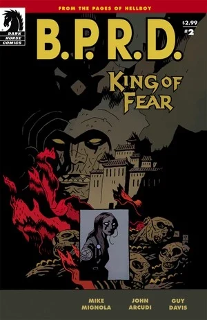
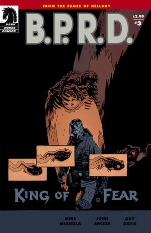
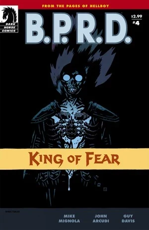
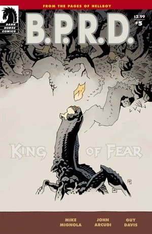
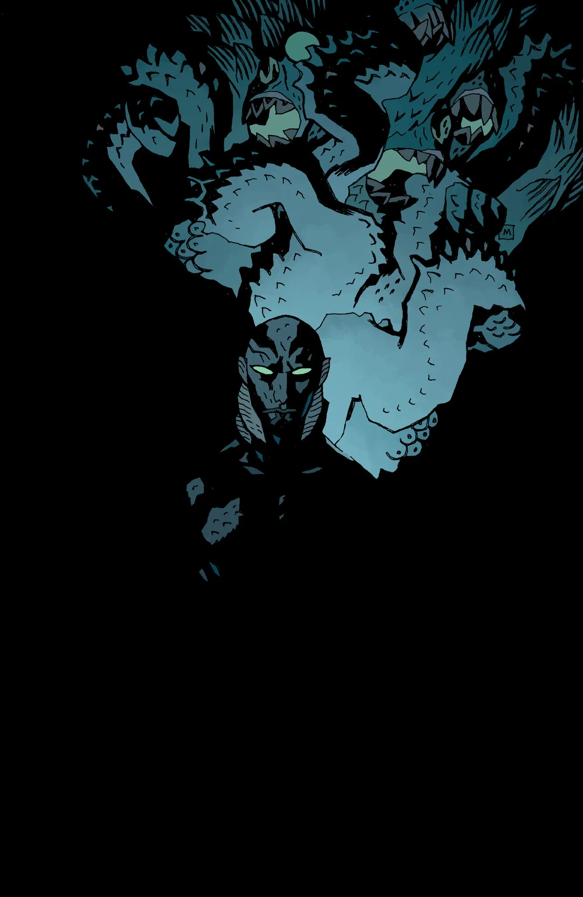

《**恐惧之王**》（King of Fear）是一部五期限定迷你系列，是[焦土三部曲](/entry/Scorched_Earth_Trilogy)的第三部，也是[蛙族瘟疫故事环](/entry/Plague_of_Frogs_%28story_cycle%29)的最终故事弧。

## 出版历史

这部五期限定迷你系列于 2010 年 1 月至 5 月出版。故事于 2010 年 11 月被收录进平装合订本 *[B.P.R.D.: King of Fear](/entry/Trade_Collections)*。这是[蛙族瘟疫故事线](/entry/Plague_of_Frogs_%28story_cycle%29)的最后一部系列。Mike Mignola 在第四期中绘制了两页。

## 剧情简介

### 第一部

神秘术士姆姆南·萨（Memnan Saa）被击败后，因浴血营救丽兹·舍曼而与美国政府关系紧张的超自然调查防御署，启程前往乌拉尔山脉——《B.P.R.D.：空心地球》事件的发生地——以求一劳永逸地解决蛙族威胁。

与此同时，[凯特·考瑞根](/entry/Kate_Corrigan)前往奥地利的亨特城堡——[地狱男爵](/entry/Hellboy_%28character%29)曾在那里杀死[征服之虫](/entry/Conqueror_Worm_%28Ogdru_Hem%29)——执行她自己的营救任务：拯救灵体特勤探员[约翰·克劳斯](/entry/Johann_Kraus)——他已被 [Lobster Johnson](/entry/Lobster_Johnson_%28character%29)的鬼魂附身。

### 第二部

丽兹和亚伯率领一队探员与士兵进入空心地球，凯特·考瑞根则试图在工作与恋情之间两头兼顾。她前往奥地利探查亨特城堡的废墟——那座闹鬼的纳粹堡垒既是义警 Lobster Johnson 丧生之地，也是地狱男爵大战征服之虫的地方——她希望在那里让 Lobster Johnson 的鬼魂安息，使他释放约翰·克劳斯的灵魂。

### 第三部

丽兹和亚伯在西藏的洞穴群中搜剿、力图彻底铲除可怖的蛙族殖民地时，与恐惧之王狭路相逢——后者在毁灭地表世界的征途上找到了一位强大的新盟友。

恐惧之王被揭露已与[黑焰](/entry/The_Black_Flame_%28character%29)结盟；黑焰上次出现时，正被蛙人拖入地下。他显然已经改变了心意：如今他乐意为蛙族的更大利益效力，而不再试图控制它们。

### 第四部

在[极北族人](/entry/Hyperboreans)神殿的废墟之下，丽兹看到了迄今为止最惊心动魄的世界末日幻象——亚伯则发现了自己与蛙怪之间的联系，从而明白了自己在末日中扮演的角色。

### 第五部

一场深入地心的擅自行动让 B.P.R.D. 面临重重追责——而他们最可怕的敌人们，命运也变得扑朔迷离。

## 内容

### 角色

#### [B.P.R.D.](/entry/Bureau_for_Paranormal_Research_and_Defense)

- [丽兹·舍曼](/entry/Elizabeth_Sherman)
- [汤姆·曼宁](/entry/Thomas_Manning)
- [亚伯拉罕·塞皮恩](/entry/Abraham_Sapien)
- [凯特·考瑞根](/entry/%E5%87%AF%E7%89%B9%C2%B7%E8%80%83%E7%91%9E%E6%A0%B9))
- [约翰·克劳斯](/entry/Johann_Kraus)
- [安德鲁·德文](/entry/Andrew_Devon)
- [潘雅](/entry/Panya_%28character%29)
  - Olly
  - 变异动物
- 多丽丝（潘雅的看护人）
- [罗杰](/entry/Roger)（闪回）
- [地狱男爵](/entry/Hellboy_%28character%29)（闪回）
- [卡拉·贾罗科](/entry/Carla_Giarocco)（尸体、幻象）
- 其他探员与工作人员

#### 亨特城堡

- [布鲁诺·卡尔胡](/entry/Bruno_Karhu)
- 鬼魂
  - [大螯虾](/entry/The_Lobster)
  - 中世纪鬼魂
  - 美军士兵
  - [纳粹](/entry/%3ACategory%3ANazi)
- [战猿](/entry/Kriegaffe) \#10（尸体）

#### 其他

- 军方高层
- 阿加尔塔居民
  - Gheghen 大师（闪回）
  - 僧侣（尸体）
- [左手仆从](/entry/Servants_of_the_Left_Hand)
- [恐惧之王](/entry/King_of_Fear_%28character%29)
- [姆姆南·萨](/entry/Memnan_Saa)（幻象）
- [奥格德鲁·赫姆](/entry/Ogdru_Hem)
  - 丽兹幻象中显现的存在
  - 与[极北族人](/entry/Hyperboreans)战争机器融合的存在
  - [索尔顿湖怪物](/entry/Salton_Sea_Monster)
- [蛙怪](/entry/Frog_monster)
- [兰迪斯·波普](/entry/Landis_Pope)（[黑焰](/entry/The_Black_Flame_%28character%29)）
- [奥古·桀哈](/entry/Ogdru_Jahad)（仅被提及）
- [雄钦](/entry/Shonchin)
- [赫卡特](/entry/Hecate)（幻象）
- 联合国代表
- 新闻主播
- [金科公司](/entry/Zinco_Corporation)
  - [Isaiah Marsten](/entry/Isaiah_Marsten)
- [奥安尼斯学会](/entry/Oannes_Society)
  - McWhirter

### 地点

- 美国
  - 华盛顿特区军事设施
  - [B.P.R.D.](/entry/Bureau_for_Paranormal_Research_and_Defense) 总部（科罗拉多州）
  - 联合国总部（纽约州纽约市）
  - 索尔顿湖（加利福尼亚州）
- 奥地利
  - [B.P.R.D.](/entry/Bureau_for_Paranormal_Research_and_Defense) 第四外勤总部
  - 亨特城堡
- 俄罗斯
  - 阿加尔塔（乌拉尔山脉，北极圈以北）
- 地下洞穴系统
- 印度尼西亚
  - 婆罗洲（提及，已毁灭）
  - 苏拉威西（提及，已毁灭）
- 泰国
  - 曼谷的酒吧

### 重要器物

- [极北族人](/entry/Hyperboreans)之剑
- [极北族人](/entry/Hyperboreans)战争机器
- [黑焰](/entry/The_Black_Flame_%28character%29)的防护服（已与波普的身体融合）
- [奥安尼斯学会](/entry/Oannes_Society)
  - 机械躯体
  - 潜艇

## 画廊

 \#1

 \#2

 \#3

 \#4

 \#5

 \#5
（未采用封面）
