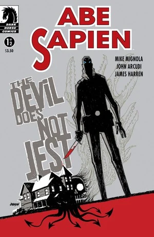
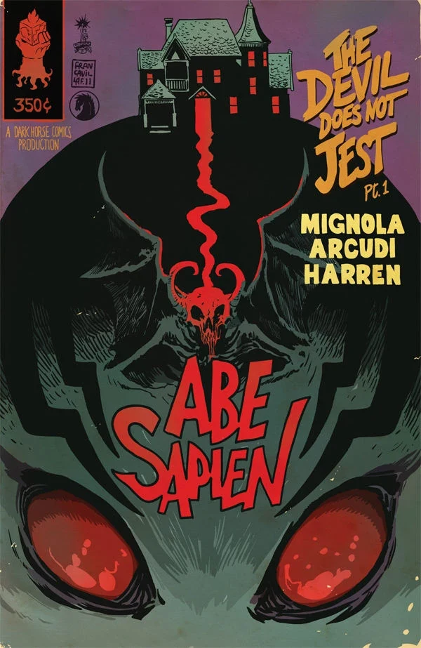

《**恶魔不说笑**》（The Devil Does Not Jest）是一篇两期的《[亚伯·塞皮恩](/entry/Abe_Sapien_%28series%29)》故事，由 [Mike Mignola](/entry/Mike_Mignola) 和 [John Arcudi](/entry/John_Arcudi) 编剧。这也是画师 [James Harren](/entry/James_Harren) 在地狱男爵宇宙中的首秀。

## 出版历史

《亚伯·塞皮恩：恶魔不说笑》（Abe Sapien: The Devil Does Not Jest）于 2011 年 9 月至 10 月作为两期限定迷你系列出版。本故事与《[闹鬼男孩](/entry/The_Haunted_Boy)》、《[深海平原](/entry/The_Abyssal_Plain)》一同收入合订本《[亚伯·塞皮恩——第 2 卷：恶魔不说笑及其他故事](/entry/Trade_Collections)》。

## 剧情简介

### 第一部分

一位恶魔学家的地下室里埋藏着一个幽深黑暗的家族秘密；那里骇人听闻的秘术仪式，将让亚伯·塞皮恩命悬一线。

### 第二部分

亚伯·塞皮恩对一位恶魔学家的调查变得血腥起来：在一头畸形野兽的摆布下，他无意中撞破了一棵腐朽家族树的秘密——而这棵树的根，他或许永远无法挣脱。

## 画廊

除特别注明外，封面均由 [Dave Johnson](/entry/Dave_Johnson) 绘制。

 \#1

 \#1 变体封面，作者 [Francesco Francavilla](/entry/Francesco_Francavilla)

 \#2
