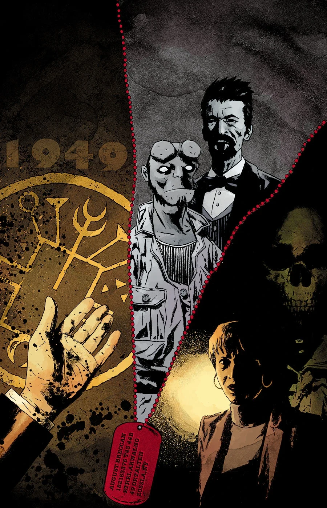
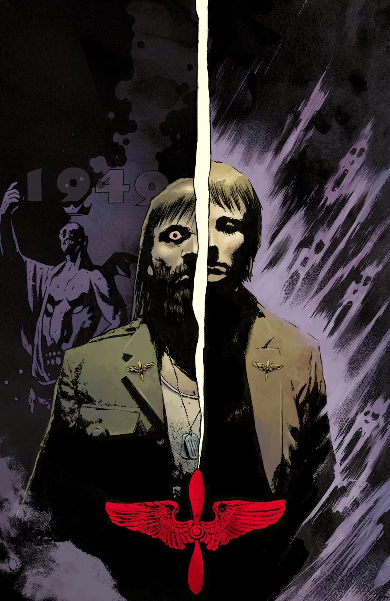

《**恶魔之翼**》（*The Devil's Wings*）是一个分为两部分的故事弧，主线聚焦当下的 [凯特·考瑞根](/entry/%E5%87%AF%E7%89%B9%C2%B7%E8%80%83%E7%91%9E%E6%A0%B9)，以及闪回中 1949 年的[地狱男爵](/entry/Hellboy_%28character%29)。

## 剧情梗概

### 第一部分

一场停电在 B.P.R.D. 总部引发恐慌，凯特也与一名崇拜撒旦的老兵的鬼魂正面相遇。

### 第二部分

大规模停电令 B.P.R.D. 总部彻底停摆，我们的英雄们面临一项任务：为凯特·考瑞根以及附在她身上的那名死去的老兵驱魔。

## 画廊

