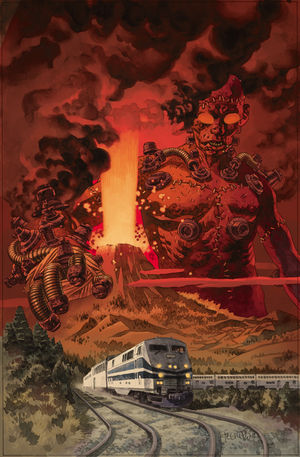
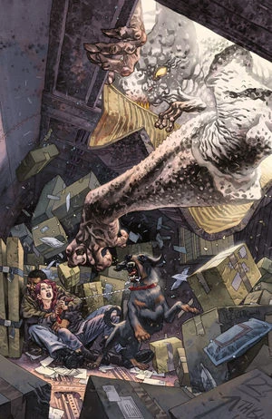
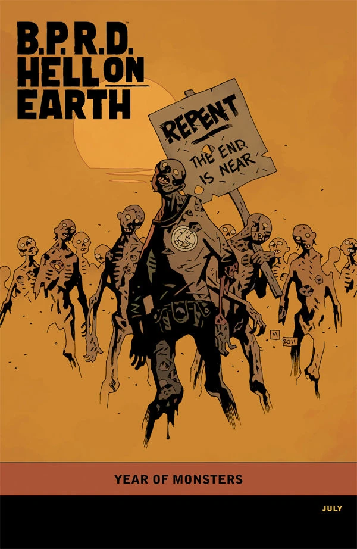

《**恶魔引擎**》（The Devil's Engine）是一部三期限定迷你系列，于 2012 年 5 月至 7 月出版。

## 出版历史

《恶魔引擎》属于 [*Hell on Earth* 故事大系](/entry/BPRD%3F%E4%BA%BA%E9%97%B4%E5%9C%B0%E7%8B%B1)，延续了《[Russia](/entry/Russia)》的主线剧情。各期封面由 [Duncan Fegredo](/entry/Duncan_Fegredo) 绘制，第三期另附有一张「[怪兽之年](/entry/Year_of_Monsters)」变体封面，由 [Mike Mignola](/entry/Mike_Mignola) 绘制。

在合订本中，《恶魔引擎》被安排在 *The Long Death* 之前。

## 剧情梗概

### 第一部分

[金科](/entry/Zinco_Corporation)疯狂的科学实验、蝙蝠脸怪物与一场毁灭性地震将[德文](/entry/Andrew_Devon)和[菲尼克斯](/entry/Fenix)困在其间，为求逃生，二人结成了勉强的同盟。

### 第二部分

一名 B.P.R.D. 探员与一位玩 crust-punk 的灵能者联手，在地狱全面失控之际对抗巨型蝙蝠脸怪物。

### 第三部分

随着金科的最新阴谋以灾难收场，菲尼克斯和德文逃出了蝙蝠脸怪物的魔爪，并道出了亚伯为何必须死的原因。

## 画廊

 \#1

 \#2

 \#3

 \#3 变体封面
