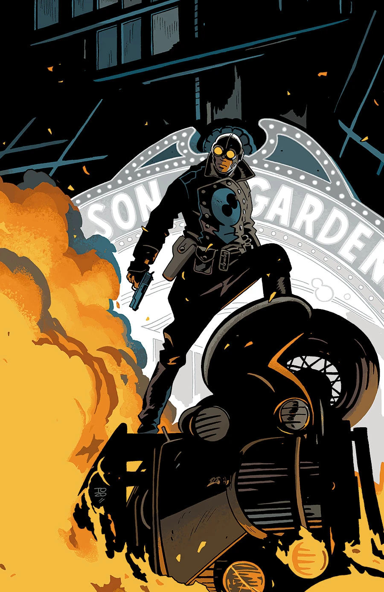
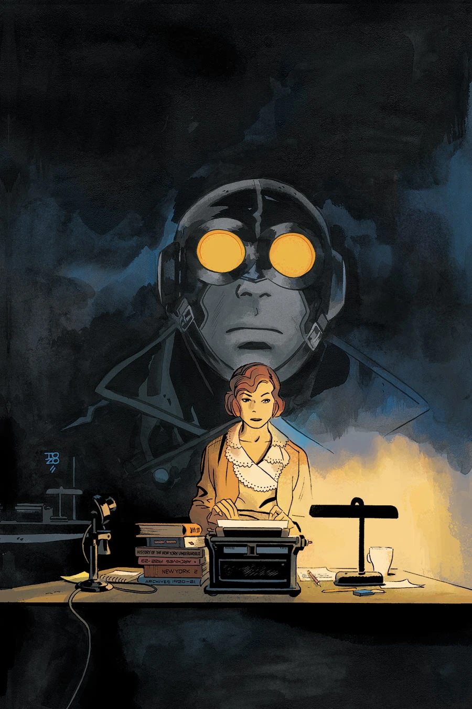
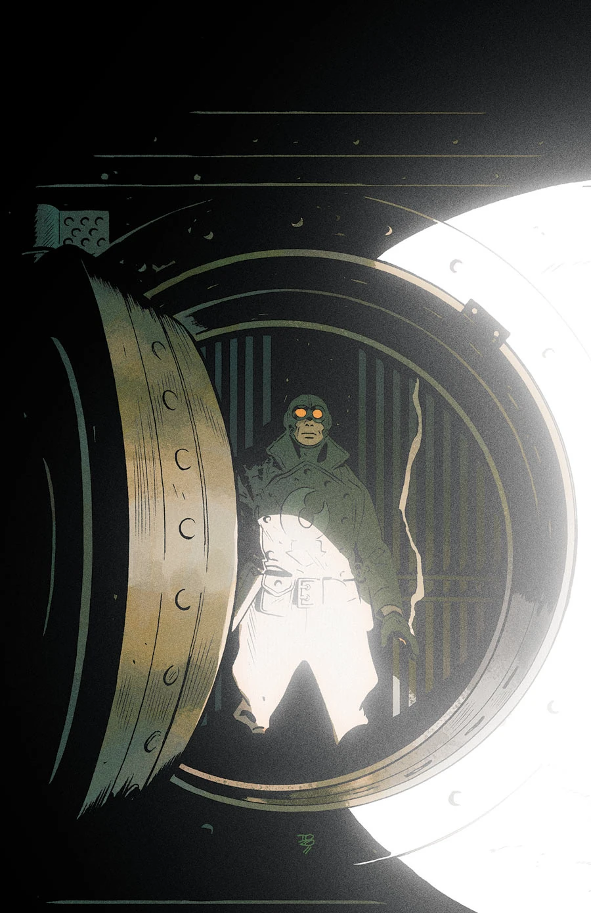
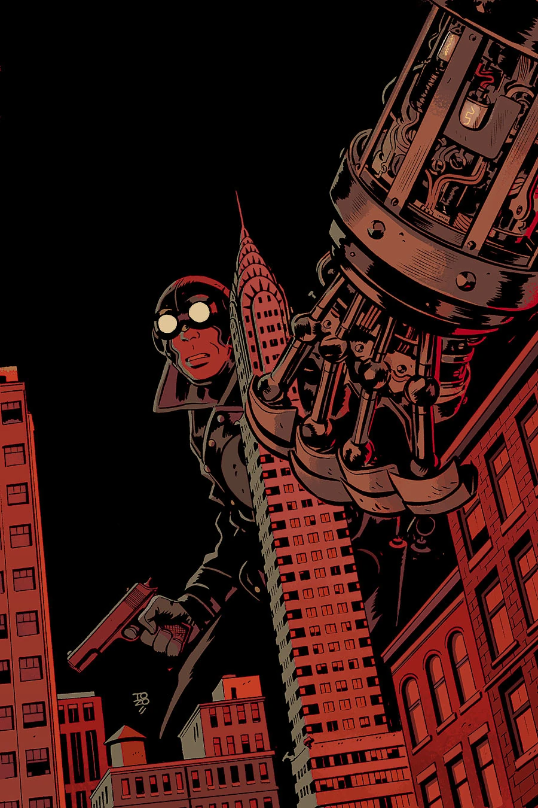
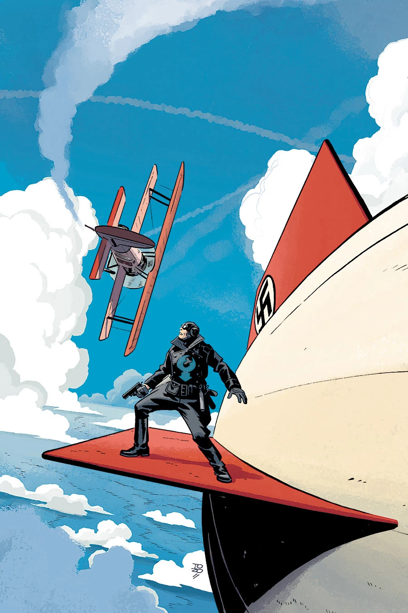

《**搞掂鳌虾**》（Get the Lobster!）是一个发生在20世纪30年代[龙虾人](/entry/The_Lobster)作为犯罪斗士生涯早期的故事。这部五期限定迷你连载将于2014年初出版，作画与封面均由 [Tonči Zonjić](/entry/Ton%C4%8Di_Zonji%C4%87) 担纲。

## 剧情简介

### 第一部

曼哈顿的一场体育赛事出了可怕的差错——裁判在现场观众面前被两名疯狂、而且似乎刀枪不入的摔跤手杀害。这场新一轮恐怖统治的幕后黑手是谁？

### 第二部

在与两名叛变摔跤手的一场手榴弹交锋之后，纽约警察局宣布龙虾人·约翰逊为头号公敌。在警察紧追不舍的情况下，我们的英雄能否查清这场摔跤手狂暴事件的幕后主使？

### 第三部

在纽约街头发生一场恶性手榴弹交火之后，所有警力都被调去抓捕龙虾人·约翰逊。与此同时，全城各处的银行金库接连爆炸。龙虾人知道这是一个陷阱，但正义从不惧怕陷阱。

### 第四部

在一枪正中射穿一名劲头十足的纽约警察局局长的脑袋之后，龙虾人前往反派们的巨型实验室，在那里他遭到了两个巨大的蒸汽朋克半机械人的袭击！

### 第五部

龙虾人在一艘齐柏林飞艇的顶部，与一名驾驶双翼飞机的疯子展开了一场交火！

## 画廊

