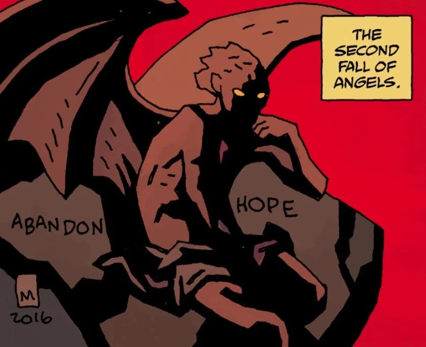

**撒旦**（Satan），或称**魔鬼**（the Devil），是[上帝](/entry/God)的头号敌人。作为叛逆精灵之首，他目睹了人类的降临。他和追随者拒绝向上帝跪拜，因傲慢之罪被掷入深渊，永远在锁链与烈火中受刑。

然而，撒旦拒绝被命运束缚，他自立为王，着手建造自己的城市[万魔殿](/entry/Pandemonium)；此前他击败了以[普鲁托](/entry/Pluto)为首、来自第一次天使坠落的堕落天使。

出于未知的原因，撒旦最终放弃了唯一统治者的地位，把地狱的治理交给了低等生物。据 [Astaroth](/entry/Astaroth) 所说，他退隐到万魔殿下方的一处地下密室，两千年来一直在那里沉睡。

## 死亡

在《[*地狱男爵在地狱* 第 2 期](/entry/Hellboy_in_Hell_%28first_story_arc%29)》中，[地狱男爵](/entry/Hellboy)得知除了一位之外，所有恶魔大公及其精锐都已逃离万魔殿。地狱男爵的[向导](/entry/Phlegethon)解释说，撒旦仍独自睡在一处地下巢穴中，无人看守，任何人下去杀他都易如反掌。他递给地狱男爵一把刀，给他讲了莎士比亚笔下麦克白的故事——麦克白也是谋杀了熟睡中的国王。这一幕结尾，地狱男爵手中的刀跌落在地，刀刃上沾满鲜血。

剧中显示，有人走近了撒旦，撒旦问是谁在那里，来人的回答是割断了他的喉咙。地狱男爵对自己做过此事毫无记忆，但他的向导[爱德华·格雷](/entry/Edward_Grey)告诉他："你不会想记起来的。你也不必记得。重要的是事情已经做了。"

## 能力

除了对万魔殿的政治权力之外，撒旦真正的力量尚不得而知，但他很可能比任何其他恶魔都更加强大。撒旦的力量与地狱的存在绑定在一起，如今他的王位空悬，地狱正在慢慢崩塌。然而，他的血液中似乎蕴含着力量，束缚在杀死他的那把匕首上；[Yomyael](/entry/Yomyael) 在整个《*[B.P.R.D.：魔鬼旧相识](/entry/The_Devil_You_Know_%28story_cycle%29)*》中一直带着它。

## 误解的受害者

各个系列中有许多人曾（或据说曾）与魔鬼做交易。事实是，他们大多是与低等恶魔打交道，而非撒旦本人。

[Igor Bromhead](/entry/Igor_Bromhead) 之流利用了这一传闻，哄骗那些想把灵魂卖给魔鬼的蠢人与这些低等恶魔立约，使得撒旦至少在某种程度上背上了名不副实的名声。

[Jeremiah Witkins](/entry/Jeremiah_Witkins) 也曾被暗示与魔鬼做过交易，但事实证明并非如此。

猎巫人 [Henry Hood](/entry/Henry_Hood) 据说被魔鬼诅咒成不死之身，但更有可能是他杀死的某个女巫所为。

## 画廊

|Satan shortly after the second fall of angels.
## 趣闻

- 撒旦过去两千年一直沉睡的原因，可能与[耶稣基督](/entry/Jesus_Christ)被钉十字架有关，不过这一点尚未得到证实。

## 登场

- [*Hellboy in Hell*（首个故事线）](/entry/Hellboy_in_Hell_%28first_story_arc%29)
- [*B.P.R.D.: Hell on Earth—End of Days*](/entry/End_of_Days)（尸体）
