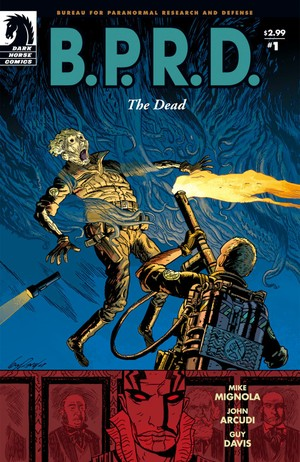
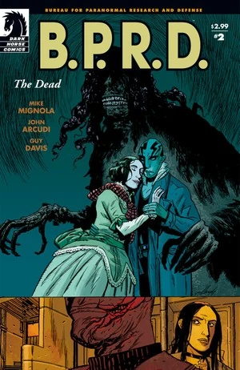
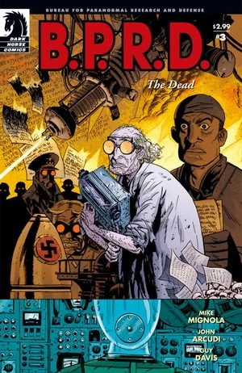
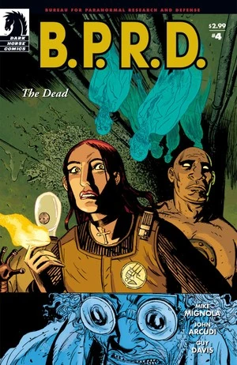
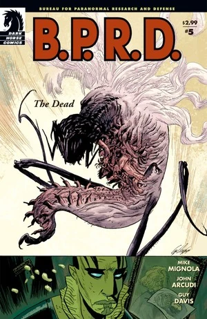

在《**斯人已逝**》（The Dead）中，[本·达米奥](/entry/Benjamin_Daimio)加入了团队，并把队伍转移到科罗拉多州的一处新总部。[约翰·克劳斯](/entry/Johann_Kraus)探查这座新基地，揭开了旧日的危险。与此同时，[亚伯·塞皮恩](/entry/Abraham_Sapien)与[凯特·考瑞根](/entry/%E5%87%AF%E7%89%B9%C2%B7%E8%80%83%E7%91%9E%E6%A0%B9))一同调查亚伯新近被揭开的过去。自始至终，[蛙怪](/entry/Frog_monster)都在不断蔓延。

## 出版历史

继《[蛙族瘟疫](/entry/Plague_of_Frogs_%28story%29)》之后，[Mike Mignola](/entry/Mike_Mignola)请来了 [John Arcudi](/entry/John_Arcudi)，担任 [*B.P.R.D.*](/entry/B.P.R.D._%28series%29)产品线的常驻联合编剧。

这部五期满完的迷你系列于 2004 年 11 月至 2005 年 3 月出版。2005 年 9 月，该故事被收录进平装合订本《[B.P.R.D.：斯人已逝](/entry/Trade_Collections)》。

## 剧情简介

### 第一部分

在北达科他州，一座被[蛙怪](/entry/Frog_monster)利用的谷仓正遭到 [B.P.R.D.](/entry/Bureau_for_Paranormal_Research_and_Defense) 特工的调查。一个小小的卵状物体裂开，一只蛞蝓模样的生物爬了出来。那生物迅速长大，撑满了整座谷仓，特工们慌忙反击。

[亚伯·塞皮恩](/entry/Abraham_Sapien)与[凯特·考瑞根](/entry/%E5%87%AF%E7%89%B9%C2%B7%E8%80%83%E7%91%9E%E6%A0%B9))前往罗得岛州的利特尔波特，调查亚伯遥远的过去。亚伯得知，[兰登·埃弗雷特·考尔](/entry/Langdon_Everett_Caul)（Langdon Everett Caul）曾是伊莱休·卡文迪什（Elihu Cavendish）手下的一名水手，后来在利特尔波特定居，娶了伊迪丝·霍华德（Edith Howard）。考尔于 1865 年离开，再未归来；他的妻子无法承受失去之痛，结束了自己的生命。

回到总部，团队观看一段录像：停尸房里的一个死人起身说话。[汤姆·曼宁](/entry/Thomas_Manning)告诉团队，他们将迁往科罗拉多州一处旧政府设施，而录像中的那个死人——[本·达米奥](/entry/Benjamin_Daimio)——将出任新的外勤小队指挥官。达米奥笨拙地向团队做了自我介绍。

一个身穿实验服的老人照料着一屋子的蘑菇。

团队飞往他们在科罗拉多州的新基地，亚伯则走向考尔在利特尔波特的旧居。

### 第二部分

亚伯·塞皮恩走进考尔的房子。他回忆起自己目睹考尔变形的幻象（见《[蛙族瘟疫 #5](/entry/Plague_of_Frogs_%28story%29)》）。

团队开始搬进科罗拉多州的新基地。其他人都在安顿下来，约翰·克劳斯却显得心不在焉。

老人坐在一间暗室里，不停地打字。

伊迪丝·考尔的鬼魂造访了亚伯。她把他拉进一个房子仍崭新如初的世界，试图让亚伯留下来陪她。

[丽兹](/entry/Elizabeth_Sherman)醒来，看见约翰在建筑群中游荡。他听到了说话声，循声走进一部老旧电梯。他发现了一面墙，试图把它撞开。丽兹和罗杰带他去见本·达米奥。达米奥说他们应当把精力集中在蛙怪问题上，但还是允许他们破门进入那个封闭的隔间——结果只发现了那个受惊的老人。

### 第三部分

丽兹和本·达米奥试图从老人口中问出情报。

在地下层，约翰发现了一个满是上锁档案的房间。其中一个抽屉自行打开，一本书从里面伸了出来。

老人自我介绍说他是京特·艾斯（Gunter Eiss）博士。1939 年太空计划失败后（见《[征服之虫 #1](/entry/Conqueror_Worm_%28story%29)》），他在德国以物理学家身份被招募。他曾是一个团体的成员，该团体试图在战争中驾驭天国的力量。然而，[拉格纳洛克计划](/entry/Project_Ragna_Rok)最终胜出。战后他来到美国，继续[基里亚科斯·加拉加斯教授](/entry/Kyriakos_Gallaragas)的工作。1958 年，一场事故夺去了大多数研究人员的性命，只有艾斯幸存。他被封在那个房间里，靠蘑菇和蜘蛛活了下来。

约翰翻看着那本书，在一页 30、40 年代的影像前停下。这些影像包括[黑焰](/entry/The_Black_Flame_%28character%29)、[绯红莲花](/entry/Yumiko_Daimio)，她带着一只[能面猿](/entry/Noh_monkey)、一个身份不明的男人（后来证实是[姆姆南·萨](/entry/Memnan_Saa)）、钢鹰（The Steel Hawk），以及一套[重锤装甲](/entry/Vril_Energy_Suit)。本告诉约翰，他们早上会把艾斯送进医院，但约翰心里没那么确定。

艾斯在建筑群中游荡，打开了一个旧储物柜。

特工们搬走艾斯所说的引发爆炸的装置时，发现这装置没有任何活动部件，看上去不过是某种道具。

约翰在一个房间里修理一些老旧电子设备。他在其中一台监视器里看到了五个科学家的鬼魂，并用德语与他们交谈。他向他们伸出手，他们的灵体形态便飞过整个基地。

画面回到利特尔波特，凯特·考瑞根试图找到亚伯。她询问去考尔家的路，却被告知必须等暴风雨过去。

在考尔宅内，伊迪丝拥着亚伯，对他说她爱他。

### 第四部分

五个鬼魂飞过基地，达米奥试图阻止他们。

艾斯走进一部电梯，一群昆虫随即涌了出来。

[罗杰](/entry/Roger)和达米奥看见了约翰，但约翰没有理睬他们，只顾摆弄某种电子设备，用德语喃喃自语。本召集特工们，向地下层进发。

伊迪丝·考尔请求亚伯·塞皮恩永远留在她身边。

达米奥和特工们在地下层追上了艾斯。艾斯戴着一个电子装置，手持朗基努斯之枪（Spear of Longinus）。他从枪中射出电流，击倒了大多数特工。艾斯解释说，他一直在继续研究驾驭天国之力，但他的科学家同侪起了疑心。他们试图拆解他的工作，结果引发了爆炸，炸死了那些科学家，也把他封在了里面。艾斯声称他将打开一扇通往天国的大门。他启动机器时，身体骤然裂开，一头怪物从他体内生长而出。

### 第五部分

达米奥手忙脚乱地寻找一件能用的武器来对抗那怪物。

约翰背着一套大型装置，朝地下层、朝那怪物走去。他一进房间，怪物便发起攻击。搜寻中，达米奥在一个罐子里发现了一只小小的能面猿。约翰操纵机器关闭了那扇允许怪物进入我们世界的大门，引发了一场大爆炸。五个鬼魂离开了约翰的收容服——他们已经完成了击败艾斯的任务。为防备再生事端，达米奥朝艾斯残存的部分开了枪。

回到利特尔波特，亚伯仍处在伊迪丝·考尔创造的世界里。屋中有一面被布遮住的镜子。在此地以考尔形态出现的亚伯知道，镜子里映出的将是他的真实形态。他说服伊迪丝去看、去面对真相。她照做了，随即化作雾气消散。

## 内容

注：关于平装合订本与合订全集版所收录序幕的内容，见《[重生](/entry/Born_Again)》（Born Again）

### 角色

#### 主线故事

- 北达科他州警长
- [B.P.R.D.](/entry/Bureau_for_Paranormal_Research_and_Defense)
  - 弗金斯特工
  - [罗杰](/entry/Roger)
  - [约翰·克劳斯](/entry/Johann_Kraus)
  - [丽兹·舍曼](/entry/Elizabeth_Sherman)
  - [汤姆·曼宁](/entry/Thomas_Manning)
  - [本·达米奥](/entry/Benjamin_Daimio)
  - 其他人员
- Roland Wilson（录像中）
- 京特·艾斯（变成了一个「炽天使」）
- [蛙怪](/entry/Frog_monster)
- [纳粹分子](/entry/%3ACategory%3ANazi)
  - [拉格纳洛克计划](/entry/Project_Ragna_Rok)（闪回）
    - [拉斯普廷](/entry/Rasputin)（闪回）
    - [克焰人](/entry/Karl_Ruprect_Kroenen)（闪回）
    - [利奥波德·克茨](/entry/Leopold_Kurtz)（闪回）
- 德美两国科学家（闪回及灵魂形态）
- [基里亚科斯·加拉加斯](/entry/Kyriakos_Gallaragas)（被提及）
- 二战档案（均为照片）
  - [拉伊蒙德·迪斯特尔](/entry/Raimund_Diestel)（[黑焰](/entry/The_Black_Flame_%28character%29)）
  - [由美子·达米奥（绯红莲花）](/entry/Yumiko_Daimio)
  - [姆姆南·萨](/entry/Memnan_Saa)
  - [Rudolf Bergen（钢鹰）](/entry/Rudolf_Bergen)
  - Patrick Redding
- [能面猿](/entry/Noh_monkey)（尸体及照片）

#### 亚伯的故事

- [B.P.R.D.](/entry/Bureau_for_Paranormal_Research_and_Defense)
  - [凯特·考瑞根](/entry/%E5%87%AF%E7%89%B9%C2%B7%E8%80%83%E7%91%9E%E6%A0%B9))
  - [亚伯·塞皮恩](/entry/Abraham_Sapien)
  - [斯科特·克拉克](/entry/Scott_Clark)（尸体）（闪回）
- 惠特利庄园图书管理员
- [奥安尼斯学会](/entry/Oannes_Society)
  - [伊莱休·卡文迪什](/entry/Elihu_Cavendish)（闪回）
  - [兰登·埃弗雷特·考尔](/entry/Abraham_Sapien)（闪回）
  - 其他成员（闪回）
- Edith Howard
- [水灵](/entry/Water_Spirit)（闪回）
- 尼古拉斯神父（被斩下的头颅）（闪回）
- [地狱男爵](/entry/Hellboy_%28character%29)（闪回）
- Humbert T. Jones（闪回）

### 地点

- 美国
  - 北达科他州的农场
  - [B.P.R.D.](/entry/Bureau_for_Paranormal_Research_and_Defense)总部（康涅狄格州 Farfield）
  - 罗得岛州利特尔波特
    - 惠特利庄园
    - 废弃的考尔宅
  - [卡文迪什庄园](/entry/Cavendish_Hall)（纽约州上州）（闪回）
  - Peterson 空军基地（科罗拉多州科罗拉多斯普林斯）
  - B.P.R.D. 新[总部](/entry/Bureau_for_Paranormal_Research_and_Defense)（科罗拉多州）
  - 圣特里尼安医院（华盛顿特区）（闪回）
    - [奥安尼斯学会](/entry/Oannes_Society)集会地（闪回）
  - 纽约市军械库（纽约州纽约市）（闪回）
- 罗马尼亚（闪回）
  - 圣巴多罗买修道院（闪回）
- 苏格兰（闪回）
  - Guarino 宅邸（LockMaben）（闪回）
- 大西洋（闪回）
- 俄罗斯（照片）
  - 莫斯科郊外（照片）
- 比利时（照片）
  - Melines（照片）

### 值得注意的器物

- [奥安尼斯学会](/entry/Oannes_Society)
  - 潜水服（闪回）
  - 潜艇（闪回）
- [重锤装甲](/entry/Vril_Energy_Suit)（照片）
- 基督圣袍
- 朗基努斯之枪

## 画廊

封面作者 Guy Davis

 \#1

 \#2

 \#3

 \#4

 \#5
