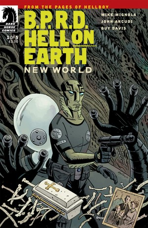
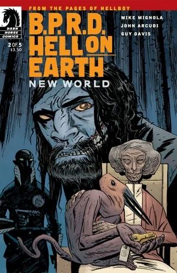
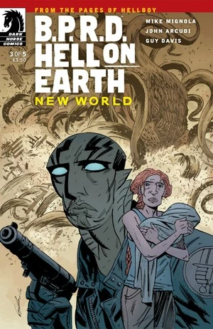
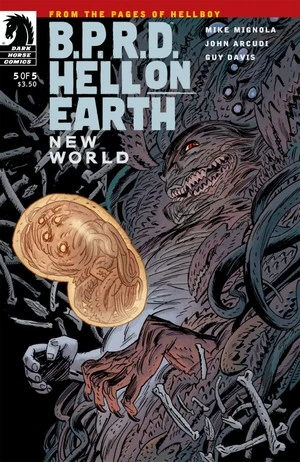
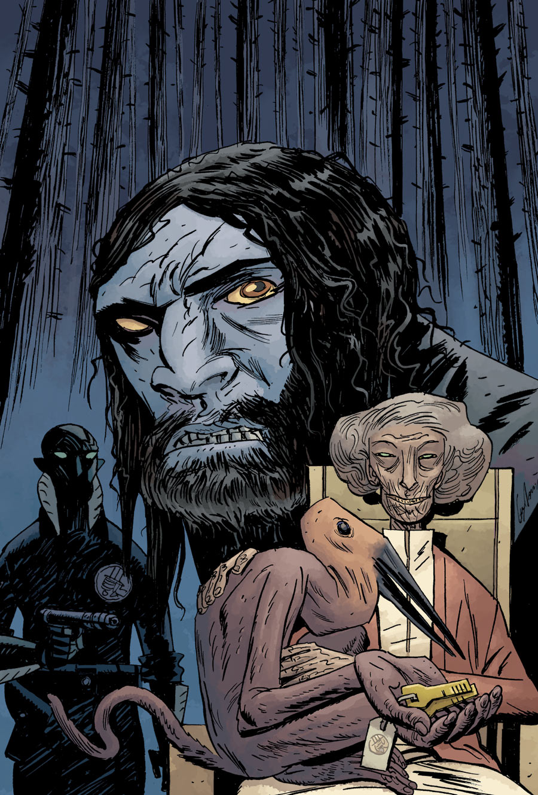

《**新世界**》（New World）是一部五期限定迷你系列，于 2010 年 8 月至 12 月出版。它是[《人间地狱》系列](/entry/BPRD%3A%E4%BA%BA%E9%97%B4%E5%9C%B0%E7%8B%B1)的第一个故事弧。

## 出版历史

在《[B.P.R.D.: King of Fear](/entry/King_of_Fear_%28story%29)》（恐惧之王）完结之后，[《B.P.R.D.》产品线](/entry/Hellboy_Comics)休刊了两个月，随后以《[B.P.R.D.: Hell on Earth](/entry/BPRD%3A%E4%BA%BA%E9%97%B4%E5%9C%B0%E7%8B%B1)》（BPRD：人间地狱）之名重新推出。《新世界》是更换品牌标题后的第一部迷你系列。

## 剧情概要

### 第一部分

在不列颠哥伦比亚省的 Marekeos，人们正无影无踪地消失。[亚伯·塞皮恩](/entry/Abe_Sapien)正在读一篇报道，内容关于该地区有人目击一头巨大的白色生物；这时他接到了[凯特·考瑞根](/entry/Kate_Corrigan)的视频通话。她和亚伯讨论了对抗怪物的线索搜寻情况。亚伯抱怨[安德鲁·德文](/entry/Andrew_Devon)对他的种种指控，并提议把他开除。通话结束后，德文走进凯特的办公室，让她盯紧亚伯，而她唯一的回应是满心懊恼。

两人走到一间监控室，[约翰·克劳斯](/entry/Johann_Kraus)正坐在那里观看加利福尼亚州索尔顿湖那头生物的视频画面（见《[King of Fear](/entry/King_of_Fear_%28story%29)》#5）。一名如今在 B.P.R.D. 任职的官僚告诉凯特，法国出现了一起湖怪目击事件，她决定派德文前去调查。

在他们身后，一名电视记者正在采访一个男人。那名男子批评联合国插手美国本土的事务，主张让「人类」而非「怪物」来处理这些问题。

凯特接到探员[卡拉·贾罗科](/entry/Carla_Giarocco)的电话。卡拉说最新的线索一无所获。她还告诉凯特，亚伯开了一辆悍马往北去了。

亚伯站在如今已空无一人的 Marekeos 镇上。

与此同时，一个男人在墓地里掘出了一口小小的棺材。

那位戴眼镜的联合国安理会代表翻阅了几份档案，找到了一张 [Daryl Tynon](/entry/Daryl_Tynon) 及其家人的照片。他向凯特问起此事，她却岔开了话题。

约翰顺路查看那具从[奥安尼斯学会](/entry/Oannes_Society)寻回、仍未完工的身体，[潘雅](/entry/Panya_%28character%29)的一只宠物在一旁看着。

亚伯进入不列颠哥伦比亚省的森林，追查那头白色怪物最后一次被目击的线索。正当他独自徘徊时，一个面目狰狞、满脸胡须的男人突然跳出来，厉声质问亚伯在做什么。

### 第二部分

凯特在安排 BPRD 探员值班时遇到了困难，约翰声称自己没空顶班。他一直把时间花在观看培养槽中那具合成身体上。潘雅的一只宠物偷走了这个房间的钥匙。约翰追着它来到潘雅处。这件事最终闹到凯特那里，约翰指控潘雅偷钥匙，是为了放出从她岛上寻回的所有生物。

电视上，Nedin 牧师声称正在展开的地狱般事件是罪孽的恶果，是罪恶横行、无人遏制所致。两个男人——Jeb 和 Todd——在一处拖车活动房屋区看着这个节目。Todd 被节目激怒，开始对着电视机大吼大叫，但 Jeb 警告他小声点，免得吵醒另一间屋里的女人。Todd 怒气冲冲地摔门而出。

亚伯和[本·达米奥](/entry/Ben_Daimio)（上一期结尾那个大胡子男人）围坐在林中的篝火旁。亚伯试图说服他回到 BPRD.，可达米奥宁愿留在这片林子里，因为这里没有任何人会受到伤害。他们入睡时，温迪戈 Daryl 正注视着他们。

清晨，达米奥把亚伯带到一处名叫 Hell's Kettle（地狱壶）的湖边，湖水漆黑。达米奥认为它与那些失踪事件有着某种关联。亚伯决定调查一番，潜入水中。水里满是腐烂的尸体。

### 第三部分

在不列颠哥伦比亚省的 Lynne，一个女人抱着用毯子裹住、紧贴在胸前的婴儿，和一名治安官一同走进一家餐厅。当女招待想看一看婴儿时，那女人变得激动而焦躁。另一名食客突然开始窒息，呕出绿色黏液。正当其他人冲过去救助这个垂死的男人时，那女人和治安官却站在吧台边毫无反应。当她紧抱着自己的孩子时，镜头揭示那名治安官的双眼已完全变黑，神情呆滞。

在 B.P.R.D. 总部，凯特、约翰和那名联合国联络官惊恐地看着新闻报道：一座火山在得克萨斯州休斯敦地下凭空出现并喷发，摧毁了整座城市，数百万人丧生。他们很快从恐惧与震惊中回过神来，意识到需要在该地区部署 B.P.R.D. 人员以应对媒体，同时由联邦应急管理局（FEMA）处理灾损。凯特主动请缨前往，让约翰留下负责。

在加拿大荒野中，亚伯和本从 Hell's Kettle 里打捞尸体。在意识到死者正是 Marekeos 的居民后，他们决定前往离 Marekeos 最近的镇子 Lynne。抵达后，他们发现居民都已消失，只剩三人——开头出现的那个女人和她的婴儿，以及另一个正准备走进一栋房子的男人。当本走近他们时，正好看见那男人全黑的双眼——对方随即将门朝他们关上；本意识到了危险。他跑回汽车，大喊让亚伯开车，就在此时一头巨大的怪物破屋而出，紧追不舍。

在 B.P.R.D. 总部，联合国联络官惊讶地发现待在控制中心查看监视器的是潘雅而非约翰；约翰已回去凝视那具剩余的奥安尼斯学会身体，同时升级房间的安保措施。

亚伯继续以最快速度驾车逃离怪物，本用尽手边一切武器和炸药阻挡它逼近。最终，在损失一辆车、又火线接通另一辆车之后，他们成功摆脱了那头怪物。那个女人抱着孩子从房屋残骸中安然无恙地走出来，沿着公路离去。

当亚伯和本返回营地重新武装、筹划下一步行动时，发现一个男人正坐在篝火边等他们；他身旁放着一口孩童的棺材。

### 第四部分

那男人讲述道，自己曾是一名美军士兵，他抛下怀孕的妻子 Nessa 远赴海外服役。他受了伤，在他离家期间儿子出生了。等他归来，却发现妻子变得古怪而疏远，禁止他见儿子，声称孩子病了。她寸步不离孩子身边，他很快起了疑心，联系妻子的家人，才得知她在他离家期间已经失去了那个婴儿。他被这一真相震惊，试图弄清在儿子婴儿房里睡着的究竟是什么东西，可 Nessa 把他打晕，没等他查明真相就带着那个「孩子」逃走了。

如今他在荒野中一路追寻，拖着他们真正的婴儿的尸体和棺材同行，拼命想让她相信儿子已经死了——也想让她摆脱那个如今已附在她身上的某种生物。就在此时，曾在 Lynne 追赶他们的同一头怪物穿过树林袭来，攻击他们的营地。

在 B.P.R.D. 总部，联合国联络官向凯特抱怨说，由于人手不足、约翰又未到岗，他不得不亲自盯监视器。她让他改叫卡拉·贾罗科来顶班。

约翰继续坐着观察那具奥安尼斯学会的身体，这时他探测到脑波活动，那具身体动了，把手掌按在玻璃上。看到这一动静约翰欣喜若狂，而潘雅正带着一抹狡黠的微笑在门口看着。

亚伯、本和那名士兵继续与怪物搏斗。本开始感到自己正化身为豹人，而那名士兵则被怪物的触手杀死。正当亚伯弹药耗尽之际，温迪戈 Daryl 从林中现身，与亚伯并肩攻击怪物。本意识到怪物追的并不是他们，而是那个女人 Nessa，于是冲进林子找她，确信她就在附近。Nessa 用棍棒击打本，但他成功夺下她的武器，并看见她一直抱着的那个「孩子」原来是一只长着许多触手的小怪物，和他们一直在搏斗的那头颇为相似。正当他站在她上方、准备给出致命一击时，那生物的灵体在他身后升起。

### 第五部分

亚伯逃离怪物之际，本遭到那生物灵体的袭击，对方试图控制他。就在那一刻，他们的意识相触，他看见了它的思想——当 Nessa 孤身一人、丈夫不在身边、哀悼着夭折的婴儿时，它是如何穿越到这个世界的。他看见它如何使她的子宫受孕，并开始与它的「孪生体」一同生长。本最终凝聚起足够强的意志制服了那生物，开枪射中 Nessa。随着灵体消散，她悲叹上帝为何不肯赐她一个孩子，随后与两头怪物一同死去。

亚伯和本挖坑安葬这一家人时，本讲述了自己得知的一切：那头怪物是[奥格德鲁·赫姆](/entry/Ogdru_Hem)之一，原本没有形体。它被 Nessa 的悲痛所吸引，利用她作为锚点使自己获得实体。它借助她的卵巢孕育自身，分裂出一块，造出一个「孪生体」。这个孪生体长成为他们与之搏斗的那头巨大怪物，靠吞食动物血肉长成庞然巨物，充当保护者；不过它能够伪装成人类（Lynne 的治安官；屋里的那个男人）。另一头怪物——也就是本体——体型较小，只吞食灵魂，所有失踪的人归根结底都因它而消失。尽管如此，正是 Nessa 的生命把它们维系在这个世界上，随着她的死亡，那生物的灵体也消散了——两头「孪生体」随之俱亡。

亚伯被这一真相震惊，奇怪这种事为何此前没有发生过。本表示，他相信世界已经到达一个临界点，直到现在这些恐怖之物才得以溜进他们的世界。亚伯请求本回到调查防御署，但本拒绝了，并警告亚伯：最大的危险是对人们心灵与思想的入侵；这比任何一头像从索尔顿湖升起的那种怪物都更具威胁。不过，他确实请亚伯帮他从总部取几样东西。

在 B.P.R.D. 总部，亚伯与德文探员、约翰、凯特·考瑞根一同听取关于失踪人口的简报。德文对亚伯充满敌意，质问他当初为何要跑去不列颠哥伦比亚。亚伯为自己的行动辩护，怒气冲冲地正要夺门而出，一名技术助理走进来报告说，亚伯的笔记本电脑被人装了间谍软件。暴怒的亚伯指控德文监视他，德文则连声喊冤说自己毫不知情。凯特试图平息事态，却无济于事。

在办公室里，剧情揭示间谍软件正是约翰所为。他分析着亚伯笔记本电脑上的数据，看到报纸关于不列颠哥伦比亚出现温迪戈目击事件的报道，随即拉开抽屉，看着他在《[Killing Ground](/entry/Killing_Ground)》（杀戮之地）中从查韦斯那里拿走的那把刀——那把能够毁灭豹人的刀。

在一片林地里，亚伯秘密与本会面，给他送来一些补给，包括雪茄和一张过塑的 Daryl 全家福。两人互祝好运，随后分道扬镳。

## 画廊

 \#1

 \#2

 \#3

 \#4

 \#5

### 第 2 期备选封面

 在前期征订宣传中，第 2 期的封面经过修改，以便让达米奥的回归保持秘密。第 1 期出版后不久，真正的封面才被公开。
