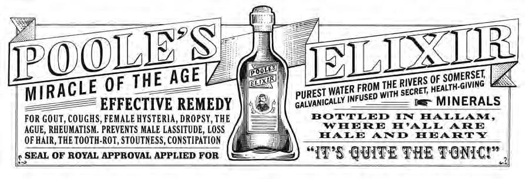
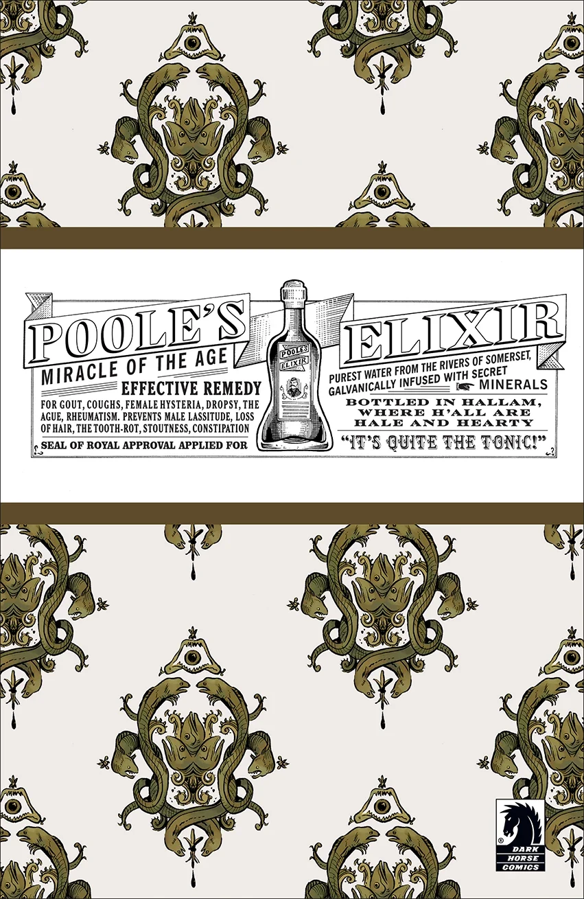
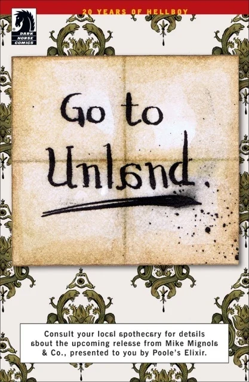
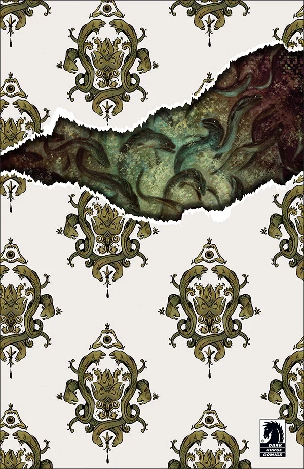
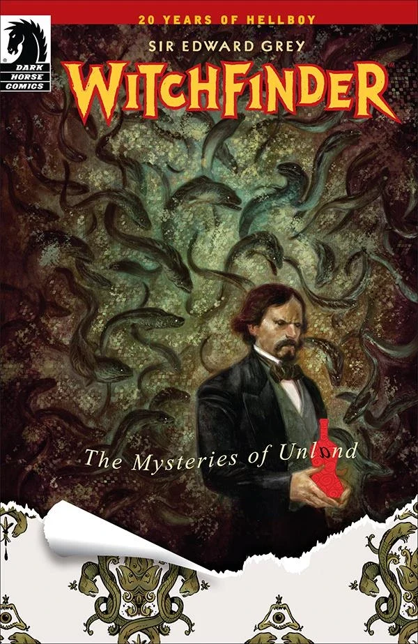
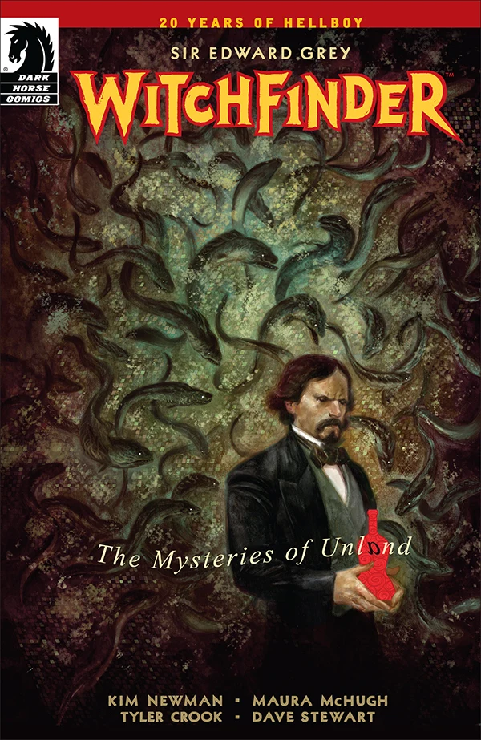
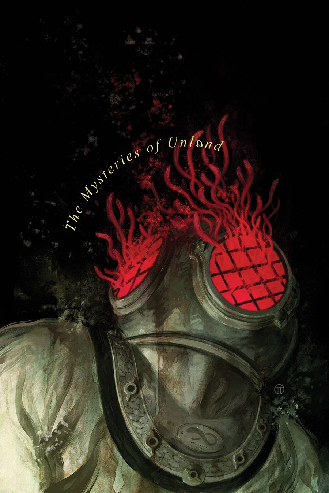
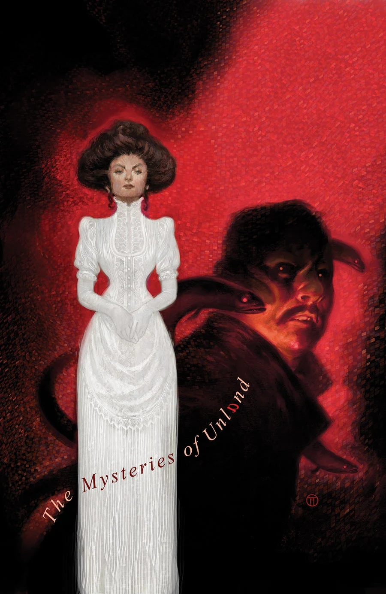
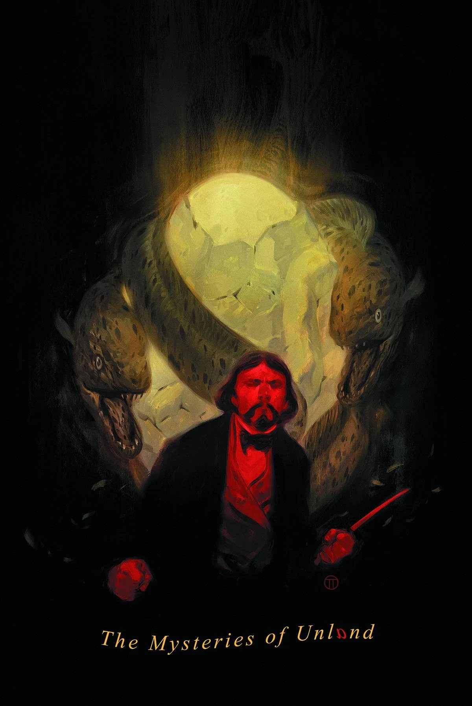

《**无土之地之谜**》（The Mysteries of Unland）是一部五期限定连载，由 [Kim Newman](/entry/Kim_Newman) 与 [Maura McHugh](/entry/Maura_McHugh) 编剧，[Tyler Crook](/entry/Tyler_Crook) 担任作画，Julián Totino Tedesco 绘制封面。

## 出版历史

### 预热宣传活动

2014 年 1 月，Dark Horse 开始在其读者来信栏中刊登一则"普尔长生不老药"（Poole's Elixir）的广告，对其出现没有任何解释。2014 年 2 月 13 日，第一个预热广告出现在各个社交媒体平台上，把来信栏中的广告重新包装，但配上了一张神秘的壁纸。

第二个预热广告表明，这个企划属于[地狱男爵](/entry/Hellboy_%28character%29)宇宙——其顶部有一条红色色带，写着"地狱男爵 20 周年"。这一广告还推出了"前往无土之地"（Go to Unland）这句话，其中字母 a 是反向的。第四个预热广告揭示 Tyler Crook 是本系列的画师，并展示了一些鳗鱼，作为他概念创作的一部分。

第五个预热广告终于公布了封面与标题。

《Baltimore: Chapel of Bones 第 2 期》读者来信栏

2014 年 2 月

2014 年 2 月

2014 年 2 月

2014 年 2 月

2014 年 2 月

这部五期限定连载最终于 3 月 7 日在 [Comic Book Resources](http://www.comicbookresources.com/?page=article&id=51311) 上正式公布。编剧为 Kim Newman 与 Maura McHugh 这对创作组合，作画由 Tyler Crook 担任，上色由 Dave Stewart 负责，封面由 Julian Totino Tedesco 绘制。此后不久，[Kim Newman 的博客](http://johnnyalucard.com/2014/03/07/the-mysteries-of-unland/)与 [Maura McHugh 的博客](http://splinister.com/post/2014/03/07)上也发布了相关公告。

## 剧情简介

### 第一部

[爱德华·格雷](/entry/Edward_Grey)被派往哈勒姆调查一起神秘的死亡事件。一到那里，他就听到了关于神秘的无土之地、城镇周围的湿地以及栖息其中的生物的种种传言。当格雷遭遇无土之地的怪物时，他的怀疑烟消云散，他意识到哈勒姆是一个充满秘密的地方。

### 第二部

在与巨型鳗鱼怪物发生一场危险的冲突之后，爱德华·格雷爵士断定，有关哈勒姆种种秘密的一切线索都指向普尔长生不老药工厂。

### 第三部

当地官员摆出一副一切如常的假象，但猎巫人知道无土之地的居民有些不对劲，而且他开始查明，这一切与该镇奄奄一息的创始人、以及他所发明的、让这座城镇声名鹊起的那种长生不老药有何关联……

### 第四部

在与当地警察的搏斗中，猎巫人被制服；但就在他们要把他溺死在不断上涨的水中之前，一个奇怪的鱼形女人收留了他，并向他揭示了无土之地的秘密。

### 第五部

就在城市被上涨的洪水淹没之际，爱德华·格雷爵士更加深入地挖掘有关无土之地的惊人真相。在一个神秘女人的帮助下，格雷直面汹涌的洪水，以及一路纠缠着他的鳗鱼刺客！

## 画廊

第 1 期

第 2 期

第 3 期

第 4 期

第 5 期
