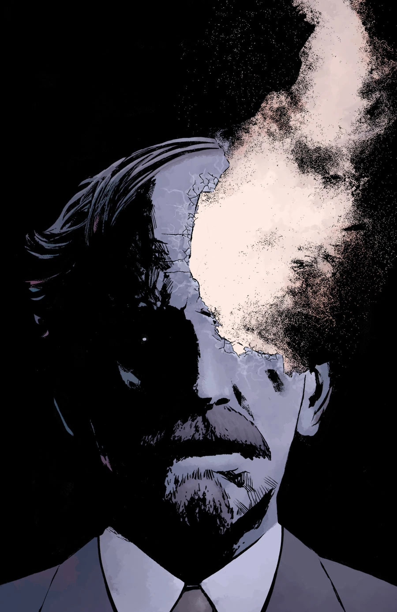
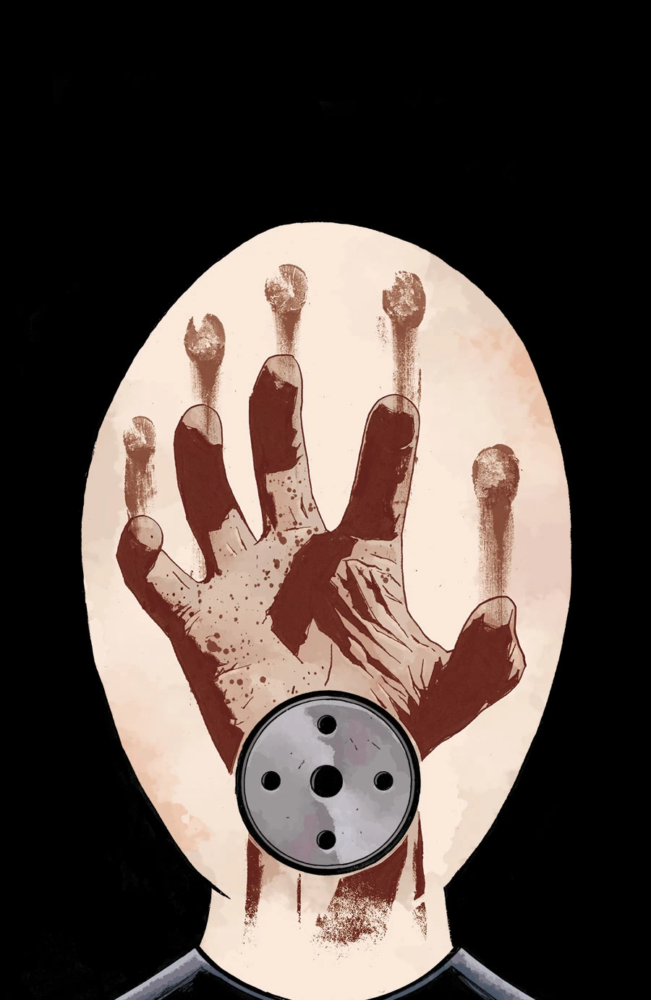
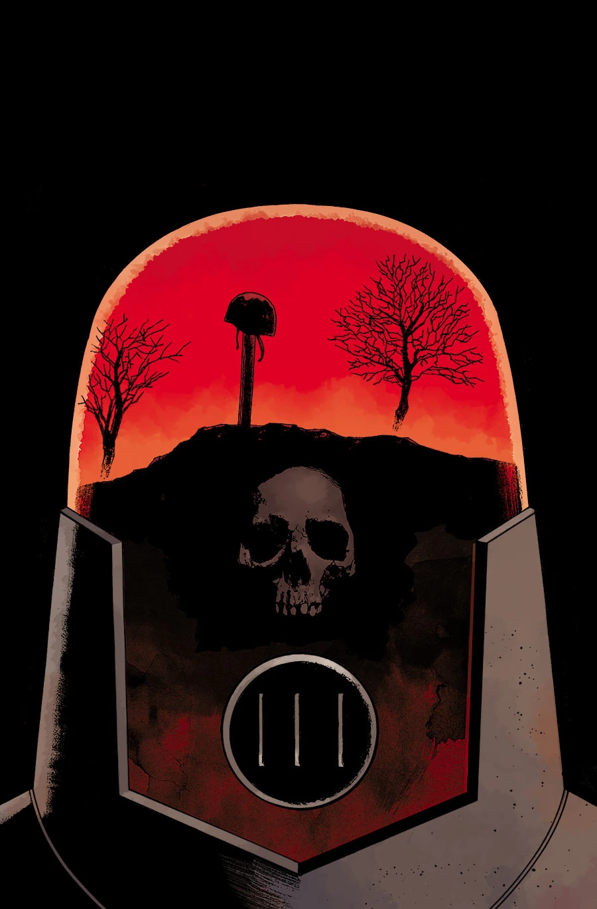

《**无所归宿，一无是处**》（*Nowhere, Nothing, Never*）是一个三期的故事弧，由 Peter Snejbjerg 作画。

## 公布

该故事弧作为 10 月份“13 Days of Hellboy”活动的一部分，在 [Comic Book Resources](http://www.comicbookresources.com/?page=article&id=56025) 上公布。除了标题和一段引自 [Scott Allie](/entry/Scott_Allie) 的话之外，关于这个项目当时几乎没有透露更多信息：

> Arcudi 对 Mignola 的世界最大的贡献，是让里面住满了活生生、会呼吸的人。不幸的是，他们并不总能一直活着、一直呼吸。他们不得不太过频繁地面对自己队友的死亡，而对他们中的大多数人来说，这件事并不会因此变得轻松。约翰与死亡之间那层模糊的关系之所以变得清晰，是因为接受身边人的死去对他而言已经太容易了……

## 剧情梗概

### 第一部分

一次可怕的任务之后，[约翰](/entry/Johann_Kraus)探员与其他 [B.P.R.D.](/entry/Bureau_for_Paranormal_Research_and_Defense)探员日渐疏远，这促使他采取了极端的手段。其他探员会把真相告诉[凯特](/entry/Kate_Corrigan)吗？这位幽灵探员又将何去何从？

### 第二部分

约翰失踪后，凯特向 BPRD 探员们当面质问，要弄清堪萨斯一座小镇汽车旅馆大屠杀的真相。

### 第三部分

约翰回到一位在他眼皮底下牺牲的探员的墓前，却发现那场死亡的真相比他所知的更加凄惨。

## 画廊

