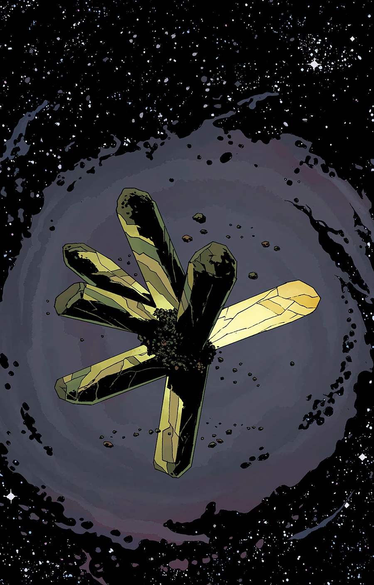
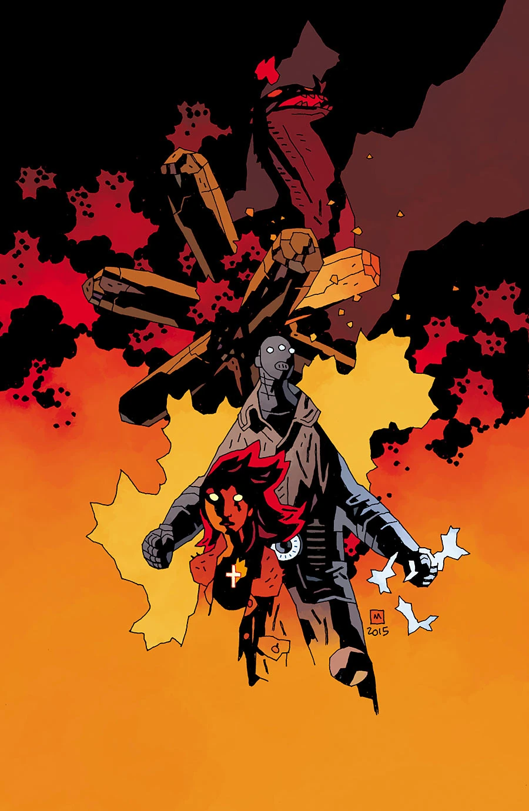
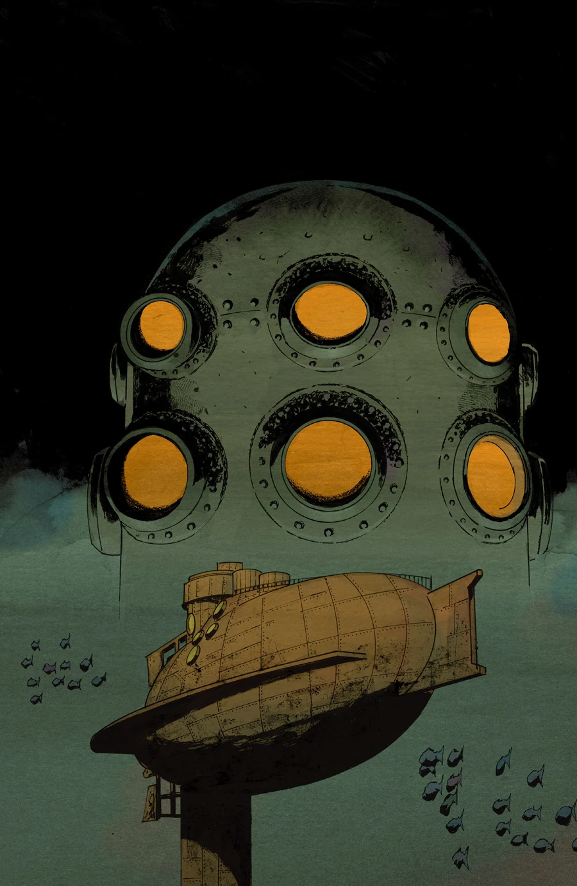
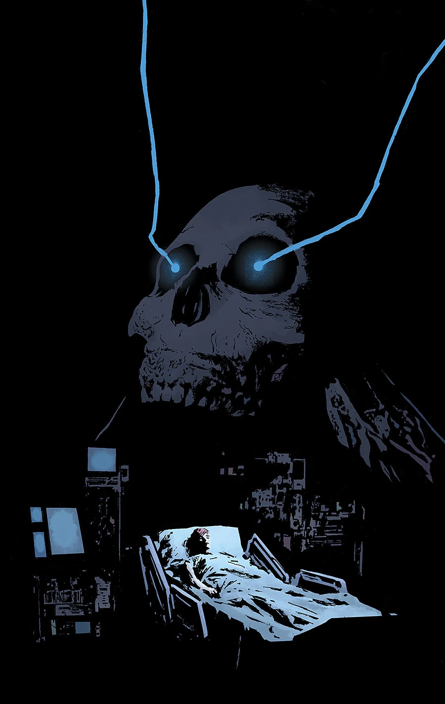
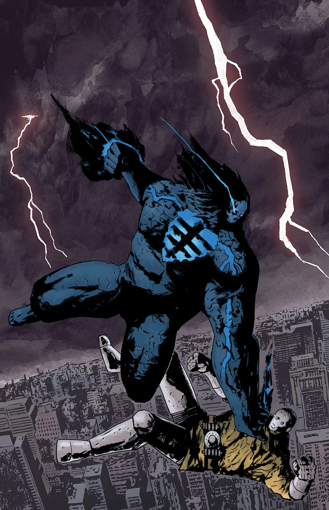
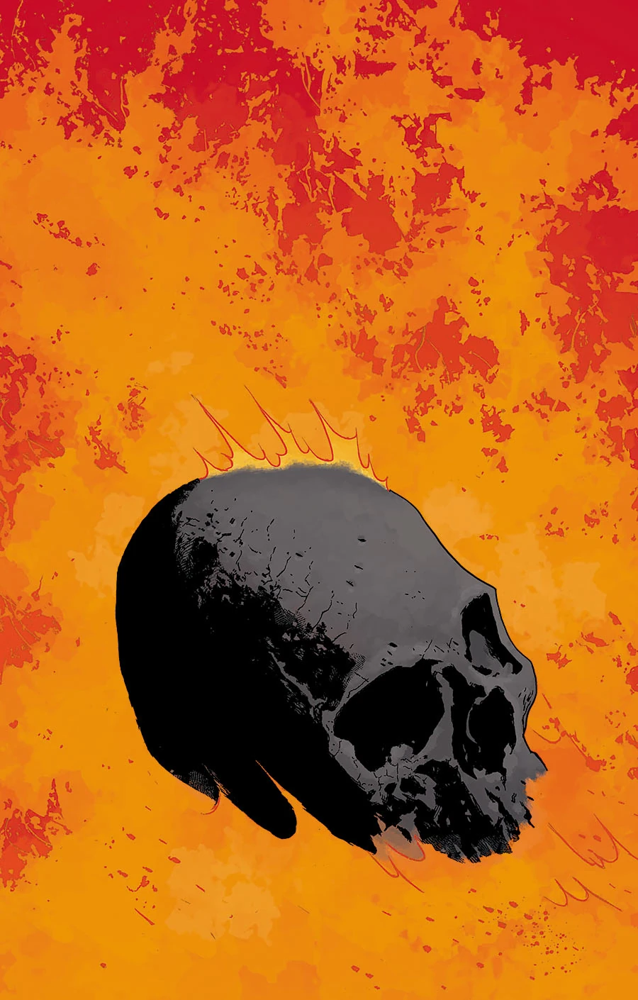

《**末日降临**》（End of Days）是一个五期故事线，也是《[B.P.R.D.: Hell on Earth](/entry/BPRD%3F%E4%BA%BA%E9%97%B4%E5%9C%B0%E7%8B%B1)》最终宏大故事的前半部分。

## 出版历史

该故事线的一张宣传图于 2015 年 5 月首先在 [Bleeding Cool](http://www.bleedingcool.com/2015/05/13/dark-horse-reveals-the-impossible-will-happen-for-the-mignolaverse-this-summer-plus-august-covers/) 上公开。

## 剧情梗概

### 第一部分

不可能之事即将发生！

在进入 Hell on Earth 最终宏大故事之际，赌注之高前所未有，黑焰正在试探自己力量的极限。

### 第二部分

中西部陷入危机！BPRD 最强大的敌人被释放到人间，他们竭力阻止浩劫蔓延，但即便他们最强力的武器也无济于事！

### 第三部分

BPRD 派出他们最强的两位战士协助消灭黑焰，在最新盟友那件不可思议的武器帮助下，局势终于出现转机。

### 第四部分

黑焰卷土重来，在哈得孙河上肆虐！潘雅和凯特试图在 BPRD 总部以灵能提供支援，丽兹和约翰则与黑焰交战，阻止他摧毁纽约市。

### 第五部分

BPRD 与黑焰之间的战斗愈演愈烈！丹佛的小队试图从远处击倒敌人，丽兹和约翰则要赶在黑焰摧毁纽约市之前结束这场战斗。

## *Kill the Black Flame*

这篇两页的后备特稿由 [Matt Strackbein](/entry/Matt_Strackbein) 自编自绘，刊登在 *B.P.R.D.: Hell on Earth—End of Days* \#1 中。内容回顾了[黑焰](/entry/The_Black_Flame_%28character%29)的历史。该特稿未被收录进任何合订本。

## 画廊

Mike Mignola 变体封面

NYCC 变体封面

