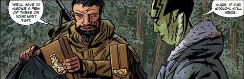
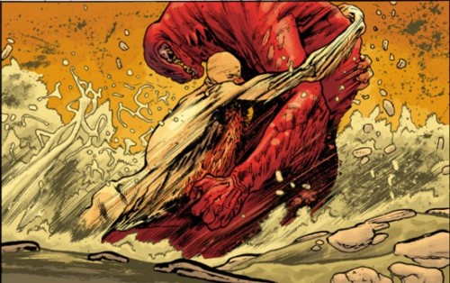
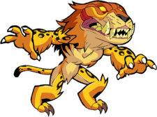

**本杰明·达米奥（Benjamin Daimio）**是 [B.P.R.D.](/entry/Bureau_for_Paranormal_Research_and_Defense)的一员。本曾是美国海军陆战队员，在神秘的情况下死而复生，2004年以小队指挥官身份加入该局。凭借多年军旅经验，本协助该局策划并推进它所面对的超自然威胁之战，同时还要应付自己的心魔以及围绕他重生发生的种种事件。

## 历史

### 早年与死亡

本·达米奥出生于军人家庭——他的父亲曾在越南执行过二十多次飞行任务——他在美国海军陆战队服役多年、表现优异，军衔升至上尉。

他第一次接触超自然事物，便带来了改变一生的后果。2001年6月10日，本·达米奥率领一支8人海军陆战队小队进入玻利维亚丛林，搜寻并营救一群据称被一个名为“真道”的政治组织扣押的修女。尽管他们心存怀疑——真道从未从事过任何形式的暴力活动——陆战队员们还是奉命进入丛林。他们很快发现了真正的元凶：一个崇拜当地美洲豹神的隐秘邪教，正是该邪教袭击并杀害了该地区爱好和平的部落。与邪教交火后，他的几名手下或死或重伤，本自己也受了伤，随后他与那头怪物正面相对——怪物在这名士兵心中诱发了恐怖的幻象，然后神秘地宣告：他的新生即将开始。

他被认定死亡、安排解剖，却在三天后、解剖开始之前醒来，划破尸袋钻了出来。尽管看上去仍带着伤势——包括左脸一道巨大的伤口——他却完全康复，被分配到五角大楼特别行动处，最终成为 [B.P.R.D.](/entry/B.P.R.D.)的非正式顾问。

### 加入该局

 本·达米奥在自己被招募一事上与[曼宁](/entry/Thomas_Manning)发生冲突。](Captainzombie.jpg "Liz Ben Daimio clashes with Manning over Daimio's recruitment.")于2004年离开五角大楼，以野外小队指挥官身份加入 B.P.R.D.。当时[亚伯·塞皮恩](/entry/Abe_Sapien)和[凯特·考瑞根](/entry/Kate_Corrigan)正在休假，以进一步调查亚伯近来关于自身过去的发现，局长[汤姆·曼宁](/entry/Tom_Manning)任命本负责筹备该局与蛙怪之间的公开战争。他牵头把该局从康涅狄格州费尔菲尔德搬迁到科罗拉多群山中被封存的国防研发中心——这是他在五角大楼任职期间得知的一处秘密设施。搬迁并非一帆风顺，达米奥生硬的态度、给人感觉的冷酷无情以及重武力轻外交的偏好，在团队内部——尤其与[丽兹·舍曼](/entry/Liz_Sherman)之间——造成了摩擦，却意外成了容易受人影响的[罗杰](/entry/Roger)心目中的榜样。

### [蛙族之战](/entry/War_on_Frogs)

随着 B.P.R.D. 与[蛙怪](/entry/Frog_monster)的战斗在美国各地持续激化，消沉的亚伯退出了外勤工作，达米奥上尉负责策划并指挥许多军事行动，以遏制蛙怪的蔓延。尽管本和丽兹仍频繁冲突，罗杰却越来越依恋本——他花更多时间出外勤、率领士兵冲锋陷阵，甚至染上了他的一些习惯，尤其是他的自负、鲁莽和对雪茄的嗜好，这令本颇为受用。

### *《黑焰》*与*《宇宙机器》*

该局有所不知，[津科公司](/entry/Zinco_Corporation)及其首席执行官[兰迪斯·波普](/entry/Landis_Pope)已打着黑焰的旗号与蛙怪结盟，毫不知情的罗杰被诱入陷阱杀害。尽管他们最终重整旗鼓、击败了怪物般的[卡塔-赫姆](/entry/Katha_Hem)，暂时遏止了蛙怪的阴谋，本却为罗杰之死深感自责；他担心，正是罗杰试图效仿自己，才最终把他引上了绝路。

在该局设法寻找让罗杰复活的途径时，本与同事们走得稍微近了些；尽管他的态度仍偶尔让他与大家——尤其是丽兹——产生分歧，他还是分享了自己过去的一些经历，包括他死亡与重生的故事。本和亚伯也结下了情谊，这份情谊源于对彼此能力与职业精神的相互欣赏。

### 奥安尼斯学社

亚伯前往印度尼西亚探寻自己前世的更多真相时，本陪同前往。亚伯向这位上尉吐露了自己前世的故事。当亚伯最终发现他从前的同袍仍然活着，并且密谋杀害数百万人时，本与当地当局、亚伯以及埃及木乃伊[潘雅](/entry/Panya_%28character%29)合作，终结了他们的阴谋。

### 内心的恶魔

然而在 B.P.R.D. 任职期间，本始终被过去的阴影、以及围绕他在玻利维亚之死和三天后复活的神秘事件所困扰。同事们不知道的是，常有一位被他简称为“那个中国人”的神秘法师秘密来访，对达米奥上尉施行秘传仪式，压制他感觉在自己体内酝酿的黑暗力量；这股力量正越来越难以应付。

[约翰·克劳斯](/entry/Johann_Kraus)发现本的祖母就是臭名昭著的日本战犯“绯红莲花”，并把发现告知该局、与本对质时，矛盾终于激化。本为自己的保密辩护，愤怒地宣称美国军队都没在意这件事，他们也不应该——他自己的履历，加上他父亲本人的军旅生涯，应足以消除一切怀疑。这又在本和其他人——尤其是约翰——之间钉下了一根楔子。

### *《杀戮地带》*

当[温迪戈达里尔](/entry/Daryl_Tynon)被转移到 B.P.R.D. 新总部时，本内心的动荡外溢，造成了致命后果。多年前袭击他和手下的那头美洲豹精灵已在本体内安了家，如今开始显现——它先杀死了一直试图帮助压制恶魔的中国法师，很快又开始杀害 B.P.R.D. 的工作人员。

尽管怀疑最初落在刚被释放的温迪戈头上，但一个神秘袭击者潜入基地、企图用炸弹杀死本——他清楚地知道本被某种可怕的东西附了身——怪物的清白就此洗清。那人是前海军陆战队员，也是那场多灾多难的玻利维亚任务的另一名幸存者，名叫[查维斯](/entry/Chaves)，他行刺失败，被亚伯开枪击毙。但从废墟中现身的，才是造成这些死亡的真凶：美洲豹精灵本人借本的身体化出了形体。怪物又杀死了几名工作人员，包括毁掉了约翰从奥安尼斯学社那里取得的新身体，随后逃入科罗拉多的荒野。

本的朋友亚伯率领探险队前往荒野设法找他，却一无所获，因为其他事务把 B.P.R.D. 抽走了。与此同时，怒不可遏的约翰发誓要为自己新肉身的毁灭向他复仇。

本和温迪戈都消失了。

### 与世隔绝

想到这么多无辜者死于自己之手，又深知自己无法控制附身的精灵，本在荒野中离群索居，最终辗转进入加拿大和不列颠哥伦比亚；温迪戈达里尔也到了那里，本觉得自己有必要待在他附近。

尽管隐居了数月，本仍继续尽力帮助有需要的人；在追踪不列颠哥伦比亚乡村城镇的离奇失踪案时，他发现自己再次与亚伯·塞皮恩联手——后者既在调查失踪案，也在调查有关达里尔的目击报告。两人并肩作战，终结了一头在加拿大造成多起死亡的奥古·赫姆所带来的威胁。心怀愧疚的本谢绝了亚伯请他重返该局的邀请，两人友好地分了手——几周后亚伯带回了更多给本的补给，包括雪茄，甚至还有一张达里尔家人的照片，让他转交给温迪戈。

 尽管亚伯为本的位置保密，复仇心切的约翰却在亚伯的笔记本电脑上装了窃听器，追踪他的调查，并在找到有关温迪戈可能目击地点的情报时证实了自己的猜测——他知道，无论温迪戈在哪里，本肯定就在附近。

### *《漫长的死亡》*

许多周后，亚伯中枪受伤无法行动，丽兹仍然失踪，新的报告显示离亚伯当初前往之处不远的不列颠哥伦比亚又发生了更多失踪案。约翰立刻抓住机会，率领一队人前往调查，他知道自己也许能找到达米奥。

形势很快明朗：美洲豹精灵如今比以往任何时候都更掌控局面，正是它造成了这些死亡——它袭击 B.P.R.D. 小队、杀死数名士兵，好不容易才被[卡拉·贾罗科](/entry/Carla_Giarocco)击退。约翰带着一把他在查维斯尸体上发现、对该局隐瞒的特殊刀刃——这武器能够摧毁美洲豹精灵，也能连同本一起毁掉——占据着一名死去公园护林员的尸体走进森林，最终与本对峙。尽管本试图弥补，为自己对他和其他人造成的伤害道歉，约翰却拒绝接受道歉；他宣称宽恕早已来不及，唯有本的死才能赎罪。两人搏斗，美洲豹恶魔最终胜出，约翰的灵魂退回他的收容服——那把刀也遗失了。

 日益绝望、被内疚折磨的达米奥知道自己已无法压制美洲豹精灵，可能还会有更多无辜者的鲜血沾在他手上。他无法自杀，便去找温迪戈达里尔——唯一能够与美洲豹精灵搏斗并杀死它的存在——并在自己化身为恶魔之际，迫使这平和的生物与自己殊死一战。两头怪物激战一整夜，最终温迪戈胜出，本的身体被毁灭。第二天约翰发现了本的遗骸，心满意足地离开。温迪戈的状况，以及本灵魂的下落，仍然成谜。

## 能力

作为前美国海军陆战队军官，本不但身体素质过硬，还拥有丰富的军旅经验。他也是一位经验丰富的神枪手，对种类繁多的武器都有丰富的知识。尽管经历过死亡与重生，本本身并没有超自然能力。

被美洲豹精灵控制时，情况则截然不同。它拥有非凡的力量、速度和耐久力。美洲豹精灵几乎对一切常规攻击手段免疫，包括子弹和物理打击。此外，它几乎能从任何伤势中迅速再生。只有火和爆炸物能暂时伤到精灵，尽管它仍会迅速愈合。但它并非不可摧毁——某些魔法武器可以伤到它，比如查维斯、后来的约翰所持的刀；另一个强大超自然生物之手也能伤到它，具体而言，就是温迪戈。

## 在其他媒体中

### 《地狱男爵》（2019）

本·达米奥在[2019年电影](/entry/Hellboy_(2019_film)))中登场，主要以人形出现。每当他在任务中受到任何重伤，他的美洲豹形态就开始浮现。他能用制服中的一剂镇静剂阻止自己变形。当面对一头进化后的[格鲁阿加赫](/entry/Gruagach)、被压在瓦砾之下时，他开始变形。他正要给自己注射镇静剂，却看到地狱男爵被格鲁阿加赫压制得越来越厉害，便扔掉镇静剂，任由自己完全变形。在美洲豹形态下，他与地狱男爵联手击败了格鲁阿加赫。

### *《Brawlhalla》*

 作为2019年电影的联动宣传，达米奥在 Blue Mammoth Games 的游戏《[Brawlhalla](/entry/Brawlhalla)》中登场，作为 Mordex 的联动皮肤。

## 注释

<references />
