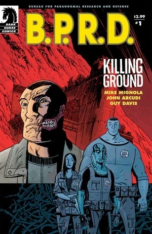
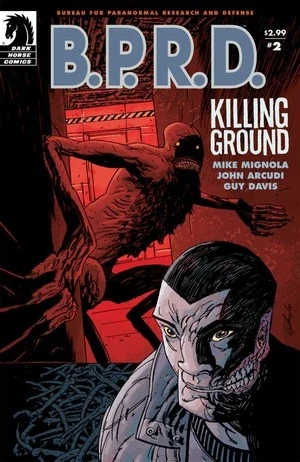
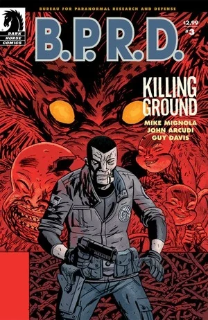
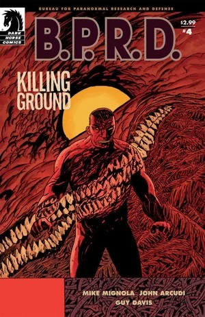
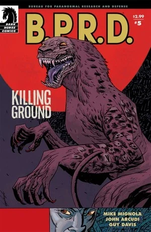

《**杀戮地带**》（Killing Ground）是一部五期限定迷你系列，于 2007 年下半年出版。

## 出版历史

这部五期迷你系列于 2007 年 8 月至 12 月出版。该故事于 2008 年 5 月收录进平装合订本《[B.P.R.D.: Killing Ground](/entry/Trade_Collections)》。

## 剧情梗概

### 第一部分

[超自然调查防御署](/entry/Bureau_for_Paranormal_Research_and_Defense)（B.P.R.D.）正在发生变化。[亚伯](/entry/Abraham_Sapien)在印度尼西亚的遭遇为调查局带来了一名新成员，而[约翰](/entry/Johann_Kraus)则发现自己掌握了一件极其珍贵的筹码。但并非所有变化都在向好的方向发展；邪恶势力已经悄然蛀入调查局总部的心脏，超自然的猎人与猎物之间的界限日益模糊，B.P.R.D. 需要动用所有新资源才能应对。

### 第二部分

某种邪恶之物降临 B.P.R.D.：[丽兹](/entry/Liz_Sherman)的末世幻象不断升级，[达米奥](/entry/Benjamin_Daimio)则持续疏远自己的队友。

### 第三部分

某种邪恶之物降临 B.P.R.D. 的新总部。随着一头[怪物](/entry/Daryl_Tynon)逃脱、一名神秘的武装入侵者潜入大楼，死亡人数不断攀升，B.P.R.D. 的探员们已经没有多少时间来弄清究竟谁能信任。

### 第四部分

一头神秘怪物在 B.P.R.D. 总部的心脏地带一路杀戮，探员们束手无策，而丽兹则进一步退入自己的幻象世界。

### 第五部分

在 B.P.R.D.: Killing Ground 的最终期里，怪物消失了，只留下成片的尸体和无解的疑问。[凯特](/entry/Kate_Corrigan)和约翰希望从掌握近期谋杀案答案的人——也就是受害者们——口中得到一些解答。

## 内容

### 角色

#### [超自然调查防御署](/entry/Bureau_for_Paranormal_Research_and_Defense)（B.P.R.D.）

- [本·达米奥](/entry/Benjamin_Daimio)（豹人/Werejaguar）
- [丽兹·舍曼](/entry/Elizabeth_Sherman)
- [凯特·考瑞根](/entry/%E5%87%AF%E7%89%B9%C2%B7%E8%80%83%E7%91%9E%E6%A0%B9))
- [约翰·克劳斯](/entry/Johann_Kraus)
- [亚伯·塞皮恩](/entry/Abraham_Sapien)
- [潘雅](/entry/Panya_%28character%29)
- [James Henry O’Donnell](/entry/J%C2%B7H%C2%B7%E5%A5%A5%E5%94%90%E7%BA%B3%E6%95%99%E6%8E%88))
- [安德鲁·德文](/entry/Andrew_Devon)
- [托马斯·曼宁](/entry/Thomas_Manning)（仅被提及）
- Mr. Dorne（多恩先生）
- 其他探员与工作人员

#### 其他

- Manuel Antonio Chaves
- [达里尔·泰南](/entry/Daryl_Tynon)（[温迪戈](/entry/Wendigo)）
- [奥格德鲁·赫姆](/entry/Ogdru_Hem)（梦境/幻象）
- [蛙怪](/entry/Frog_monster)（梦境/幻象）
- [姆姆南·萨](/entry/Memnan_Saa)
- "Chinaman"（中国佬）
- Olly（猫，奥利）
- [潘雅](/entry/Panya_%28character%29)的梦境
  - Olavisi（猫，奥拉维西）
  - 潘雅的父亲/阿肯那顿
- [约翰](/entry/Johann_Kraus)的「朋友们」（Pauline、Faye 等）
- [大螯虾](/entry/The_Lobster)
- Chaves 的故事（闪回）
  - Eric Polanco（豹人/Werejaguar）
  - 陆军上校
  - Huyana

### 地点

- 美国
  - [超自然调查防御署](/entry/Bureau_for_Paranormal_Research_and_Defense)（B.P.R.D.）总部（科罗拉多州）
  - [超自然调查防御署](/entry/Bureau_for_Paranormal_Research_and_Defense)（B.P.R.D.）旧总部（康涅狄格州费尔菲尔德）
  - Shaney's Boot Scootin' Roadhouse（科罗拉多州博尔德郊外）
- 埃及（梦境）
  - [潘雅](/entry/Panya_%28character%29)的家（梦境）
- 玻利维亚（闪回）

### 重要器物

- [奥安尼斯学会](/entry/Oannes_Society)的生物躯体
- 罐中能猴（[Noh Monkey](/entry/Noh_monkey)）
- [尖刺圆筒](/entry/Spiked_Cylinder)（[极北族人](/entry/Hyperboreans)的器物）（梦境）
- Huyana 的匕首

## 花絮

- 一格描绘[温迪戈达里尔](/entry/Daryl_Tynon)吃山羊的画面，是在致敬戈雅的画作《[农神吞噬其子](https://en.wikipedia.org/wiki/Saturn_Devouring_His_Son)》。同一幅画后来在 [The Long Death](/entry/The_Long_Death) 第 \#2 期的封面上再次被致敬。在地狱男爵故事《[In the Chapel of Moloch](/entry/In_the_Chapel_of_Moloch)》中，戈雅也被重点提及。
- "Shaney's Boot Scootin' Roadhouse" 里播放的歌曲是《[Achy Breaky Heart](https://en.wikipedia.org/wiki/Achy_Breaky_Heart)》，最初由 Don Von Tress 创作。这首歌最流行的版本（也很可能就是被致敬的版本）由 [Billy Ray Cyrus](https://en.wikipedia.org/wiki/Billy_Ray_Cyrus) 演唱录制。

## 画廊

封面作者 Guy Davis

 \#1

 \#2

 \#3

 \#4

 \#5
