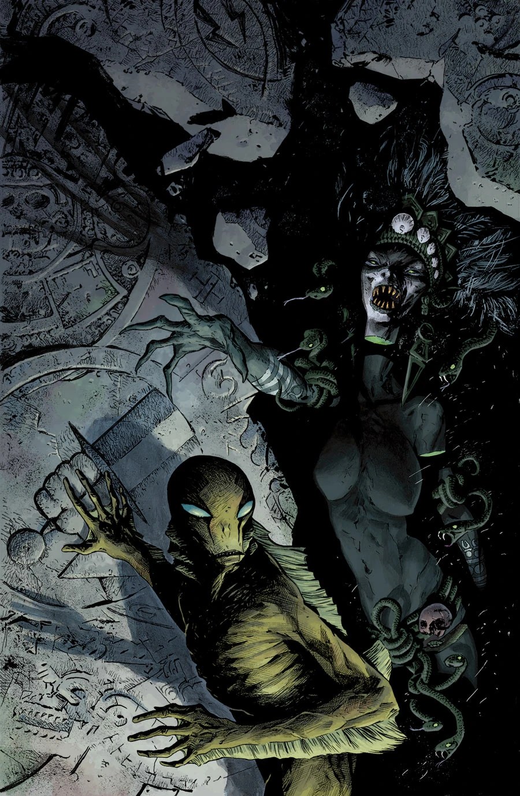
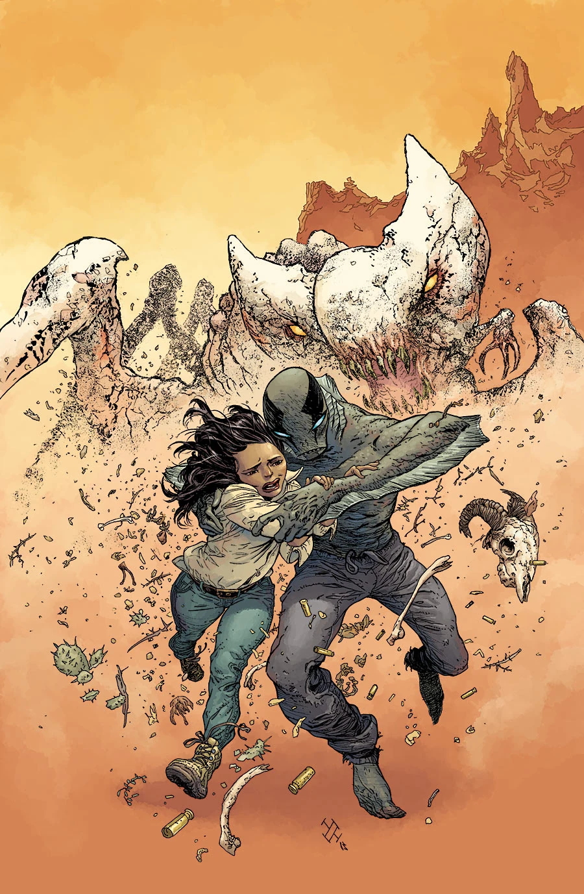

《**来者之形**》（The Shape of Things to Come）是一个两期故事弧，于 2013 年 10 月至 11 月出版，由 Sebastián Fiumara 作画。

## 剧情概要

### 第一部分

[亚伯](/entry/Abraham_Sapien)发现，他与[超自然调查防御署](/entry/Bureau_for_Paranormal_Research_and_Defense)（B.P.R.D.）正在经历的人间地狱，与那些浸透鲜血的玛雅传说——关于人类起源与世界末日的传说——之间存在着联系。

### 第二部分

亚伯一头扎进一场混战：一方是从沙漠沙地里爬出来的食肉怪物，另一方是将菲尼克斯与世界其余部分隔绝开来的壁垒民兵武装。

亚伯对决玛雅末日！

## 画廊

