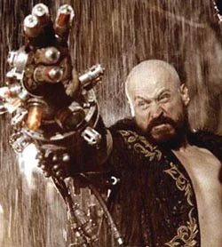

*每一次死去，我都跨过了生死的边界，而主人也随我多带回一分。*

*<small>——格里高利·叶菲莫维奇·拉斯普廷（谈他自己与巨兽 Behemoth）。</small>*

*相信我，我活得够久了，我知道……这个世界覆灭时，不会有一滴眼泪为它而落！*

<small>——格里高利·叶菲莫维奇·拉斯普廷</small>

*孩子，看看你做了什么。你杀死了我，一个无足轻重的人。但在我的位置上，将会崛起……一位神……*

——格里高利·拉斯普廷，在巨兽破体而出的最后时刻所说

**格里高利·拉斯普廷**（Grigori Rasputin，全名 **格里高利·叶菲莫维奇·拉斯普廷**）是[奥古·桀哈](/entry/Ogdru_Jahad)麾下一位重要的使者，也是[地狱男爵](/entry/Hellboy_%28character%29)的头号死敌，是《地狱男爵》漫画系列中的次要反派。这个角色以现实中与俄罗斯帝国末年罗曼诺夫家族关系密切的[俄罗斯神秘主义者](/entry/%3Awikipedia%3AGrigori_Rasputin)为原型。

## 历史

格里高利·拉斯普廷生于 1869 年 1 月 21 日。年轻时他频繁看到幻象，也察觉到自己体内蕴藏着巨大的力量——治愈病人和预见未来的能力。这些力量使他相信自己注定要成就伟业。他凭借自己的能力在沙皇尼古拉二世的宫廷中谋得一席之地，用力量治愈了阿列克谢皇子的血友病。

1902 年，他与 Zoya 有了一段私情；后来 Zoya 来找他，告诉他自己怀了他的孩子。拉斯普廷感知到 Zoya 腹中女孩有些异样，便把她打发走了。1913 年 1 月，Zoya 再次拜访拉斯普廷，同行的还有她的丈夫 Yuri 和女儿——为了恶心他，她故意给女儿也取名叫[瓦尔瓦拉](/entry/Varvara)，与他的婚生子女同名。他杀了 Yuri，把瓦尔瓦拉和病弱的 Zoya 丢在严寒之中。Zoya 在第二天日出前死去，瓦尔瓦拉不久后被恶魔[Yomyael](/entry/Yomyael)附身。[1]

### 龙之声

1916 年 12 月 16 日被 Felix Yusopov 亲王刺杀后，拉斯普廷被[奥古·桀哈](/entry/Ogdru_Jahad)复活并联络，受命充当它们在世间的凡世使者。随后他逃往意大利冥想，再次与"巨龙"沟通。1937 年 7 月，[海因里希·希姆莱](/entry/Heinrich_Himmler)找到了拉斯普廷，给他机会去研究一种结束第二次世界大战的秘术手段。拉斯普廷知道纳粹德国赢不了这场战争，但打算尽可能长久地利用其资源来实现自己的目标：触发天启，以此启动一个新的伊甸园。

[诸神黄昏计划](/entry/Project_Ragna_Rok)由此诞生，由拉斯普廷和他亲自挑选的一群纳粹科学家追随者主持：[伊尔莎·豪普斯坦](/entry/Ilsa_Haupstein)、[克焰人](/entry/Karl_Ruprect_Kroenen)和[利奥波德·克茨](/entry/Leopold_Kurtz)。1941 年，在"幽灵行动"的名义下，克焰人和克茨召唤出 Albert Mayhew 的灵魂，将其束缚在一名德国士兵的躯体里，好让拉斯普廷找到他，并借他进入 Eugene Remy 的陵墓。Mayhew 带他们找到了位于巴黎的陵墓并打开了它，却被 Remy 的灵魂杀死作为报应。[A·N·桑杜](/entry/A.N._Sandhu)试图出面阻止拉斯普廷时被他杀死，拉斯普廷由此取得了与 Remy 一同下葬的古老石碑。这块石碑将为他提供他所追寻的关于巨龙的新知识。[2]

### 毁灭之种

1944 年 12 月，拉斯普廷在苏格兰海岸外的一座小岛上举行仪式，企图为纳粹召唤天启之兽。他成功召唤了[那个生物](/entry/Hellboy_%28character%29)，但它却出现在另一个地点，落入了盟军之手。尽管对自己所启动的一切充满信心，拉斯普廷还是让追随者们进入休眠冷冻状态，自己则退到了北极圈。拉斯普廷本人进入冷冻状态时，他召唤出的那个生物将由[特雷佛·布鲁姆](/entry/Trevor_Bruttenholm)抚养长大，即地狱男爵。

1994 年，他带着奥古·桀哈的怪异子嗣[萨杜-赫姆](/entry/Sadu-Hem)重返人间。拉斯普廷的目标是用地狱男爵的石质右手把奥古·桀哈从水晶牢笼中解放出来，任它们将尘世夷为平地。然而，地狱男爵在[超自然调查防御署（B.P.R.D.）](/entry/Bureau_for_Paranormal_Research_and_Defense)的同伴[丽兹·舍曼](/entry/Liz_Sherman)和[亚伯·塞皮恩](/entry/Abe_Sapien)及时出手干预，挫败了拉斯普廷的计划。拉斯普廷被杀，萨杜-赫姆被烧死。

### 唤醒恶魔

当他的棋子们试图让[吸血鬼](/entry/vampire_%28creature%29)[弗拉基米尔·朱雷斯库](/entry/Vladimir_Giurescu)复活时，拉斯普廷以幽灵形态再次出现。拉斯普廷指示诸神黄昏计划的忠实成员[伊尔莎·豪普斯坦](/entry/Ilsa_Haupstein)放弃复活朱雷斯库的努力，改为躺进由[科库](/entry/Koku)献上的施咒铁处女中。豪普斯坦照做并死在其中，但她的血使女神[赫卡特](/entry/Hecate)得以将这具铁处女当作永久而不可摧毁的躯体——赫卡特的凡世躯体与拉斯普廷本人的一样，早已被摧毁。此后不久，拉斯普廷退入尤克特拉希尔的树根，在那里见到了[雅加婆婆](/entry/Baba_Yaga)，她告诉他，他不过是奥古·桀哈手中的一颗棋子。

### 征服者蠕虫

拉斯普廷最后一次以幽灵形态现身，充当[英格·冯·卡朗普特](/entry/Inger_von_Klempt)的谋士。他说服她，她将成为人类最终种族的第一人；但她最终被[大螯虾强生](/entry/Lobster_Johnson)处决，而随着[征服者蠕虫](/entry/Conqueror_Worm)被摧毁，世界末日得以避免。赫卡特嘲讽拉斯普廷重启新伊甸园的努力再度失败，拉斯普廷怒而对女神出手，结果被赫卡特重创。[雅加婆婆](/entry/Baba_Yaga_%28character%29)收走了他残存的灵魂，把它放进一颗橡果里。

### 遗产

#### 拉斯普廷的信徒

BPRD 调查重生的[萨杜-赫姆](/entry/Sadu-Hem)从新泽西一处调查防御署设施中失踪一案时，发现了一个由拉斯普廷的信徒领导的末日邪教。这名信徒在拉斯普廷被长矛刺死的同一天胸口出现了伤口，他应验了拉斯普廷关于杀死自己之人的预言。杀死拉斯普廷的探员[亚伯·塞皮恩](/entry/Abe_Sapien)本人被这名信徒用长矛刺死。然而塞皮恩很快复活，信徒和萨杜-赫姆都被杀死。

#### 黑暗召唤

在系列接近尾声时，地狱男爵正试图杀出[雅加婆婆](/entry/Baba_Yaga_%28character%29)的世界，女反派把尽可能多的力量灌注给她的奴隶——不死的[柯歇伊（人物）](/entry/Koshchei_%28character%29)，命他杀死地狱男爵。当她自身的力量耗尽时，她说自己还有最后一次机会，想用拉斯普廷的灵魂（仍在橡果中）为柯歇伊供能。但她的恶魔朋友[科库](/entry/Koku)把橡果扔进了世界之树的树根之间，说道："不能用他。"地狱男爵听到有人提起拉斯普廷的名字，只说了一句："别提那家伙，我一肚子火！"装着拉斯普廷灵魂的橡果随后落入地狱，最终坠入深渊。

### 归来

奥古·桀哈之一被召唤到尘世并被击败后，它的黑暗找到了拉斯普廷。他在地狱中与[爱德华·格雷](/entry/Edward_Grey)交锋；瓦尔瓦拉摆脱[Yomyael](/entry/Yomyael)的附身后，拉斯普廷经她之手重返尘世。拉斯普廷借巨龙之力，再次与地狱男爵对峙。然而，地狱男爵借助地狱之力占了上风，扭断了拉斯普廷的脖子，永远终结了他的威胁。

尽管如此，地狱男爵仍不得不召来丽兹·舍曼释放力量，摧毁残存的萨杜-赫姆；烈焰灼烧大地，在此过程中引发了诸神的黄昏。残存的奥古·桀哈虽被召唤到尘世却已死去，它们的力量被[奥西里斯俱乐部](/entry/Osiris_Club)吸收，而地狱男爵很快也击败了他们。残存的人类被迫转入地下，一个新的蛙人种族从亚伯·塞皮恩身上诞生。从某种意义上说，拉斯普廷所预见的未来就这样成了现实——只是其中再也没有他或巨龙的位置。

## 能力

早在被奥古·桀哈招募之前，格里高利·拉斯普廷就已具备某种程度的超自然能力，包括暂时治愈他人的力量。19 世纪末 20 世纪初与雅加婆婆接触后，他的力量才真正开始成熟，使拉斯普廷成为一名极为强大的巫师。通过把自己的一部分灵魂献给雅加婆婆，拉斯普廷还获得了永生，尽管并非不可战胜。

死前，拉斯普廷展现出种类繁多的超自然天赋。地狱男爵正是借他的魔法才被带到这个世界；纳粹的许多末日计划也是在他的指导下产生的。经过数十年冥想、与巨龙沟通后，拉斯普廷的力量增长到只需一触便能读人心思、还能从远处控制众多人类的心智。在萨杜-赫姆的协助下，拉斯普廷能把四名探险者变成[蛙人](/entry/Frog_monster)，远比后来萨杜-赫姆单独制造的大多数蛙人强大。地狱男爵在 Cavendish 庄园首次遭遇拉斯普廷时，这位巫师能在头部挨了一发大口径枪伤后幸存，还能仅凭低声呢喃就把地狱男爵震飞，并轻易压过地狱男爵随身携带的众多护身符咒。拉斯普廷还能以秘术手段控制丽兹·舍曼的心智，也曾在被长矛刺穿胸膛后活下来——尽管这伤让他元气大伤（可能是因为他此前已耗费大量力量去撬开奥古·桀哈的牢笼）。在被打回一具燃烧的骷髅后，他死前展示的最后一项能力是喷火；随后地狱男爵用石拳将他击碎，杀死了他。

死后，拉斯普廷变成了幽灵，但仍是一个拥有相当强大力量的幽灵。即使成了幽灵，他身上仍带着亚伯·塞皮恩造成的矛伤，这道伤口如今会冒出蓝色火焰。作为幽灵，拉斯普廷能瞬间移动、化为无形，还能使人失明。他还能穿行于不同维度，甚至一路前往世界之树附近拜访雅加婆婆。拉斯普廷还能在他认定重要的人身上"打上标记"，使一团蓝色火焰在他们头顶闪烁。这道标记对当事人究竟意味着什么（如果确有含义的话），尚不清楚。

## 电影版本

### [《Hellboy》（2004）](/entry/Hellboy_%282004_film%29)

 演员[Karel Roden](https://en.wikipedia.org/wiki/Karel_Roden)在[《Hellboy》](/entry/Hellboy_%28film%29)中饰演主要反派拉斯普廷。片中他与纳粹合作，展现出与冥界相关的强大秘术能力。拉斯普廷被描绘得近乎不死：每一次死去，他都会复活，体内也多承载一分他的神（这可能是在致敬《The Island》——其中一个奥格德鲁·赫姆寄居在一名崇拜者体内）。这种能力很可能受到现实中拉斯普廷难以被杀的传闻启发。

与漫画不同，电影里的拉斯普廷不是信仰疗法术士，而是罗曼诺夫家族的秘术顾问。他无所顾忌地钻研黑术、崇拜奥古·桀哈，招致 Felix 亲王及其同谋者对他实施刺杀。在一场为他设下的晚宴上，他被下毒、枪击、刀刺、棒打、阉割，最后被 Felix 及其同谋者溺死。他后来复活并隐匿起来。第二次世界大战爆发时，拉斯普廷加入图勒学会，被阿道夫·希特勒任命用秘术对抗盟军。然而纳粹并不知道，拉斯普廷是在利用他们实施自己释放奥古·桀哈的计划。

1944 年，拉斯普廷在一队纳粹分子协助下，试图用一台巨型装置释放[奥古·桀哈](/entry/Ogdru_Jahad)：当他呼唤创造奥古·桀哈的伟大之灵阿努姆之名、把魔法轰向装置时，装置便会打开一道通往奥古·桀哈牢笼的传送门。他相信奥古·桀哈会消灭它们的敌人，把世界重建成天堂。然而盟军袭击了举行仪式的教堂，[特雷佛·布鲁姆](/entry/Trevor_Bruttenholm)教授朝传送门扔出一枚手榴弹。手榴弹炸坏了生成传送门的装置，使它变得不稳定。传送门把拉斯普廷吸了过去；他试图逃脱时，失灵的设备将他电击致死。

六十年后，拉斯普廷的情人[伊尔莎·冯·豪普斯坦](/entry/Ilsa_von_Haupstein)和[克焰人](/entry/Karl_Ruprect_Kroenen)在摩尔达维亚的群山中将他复活。回到这个在他缺席期间已然改变的世界后，拉斯普廷召唤出地狱猎犬[萨麦尔](/entry/Sammael)。布鲁姆在影片大部分时间里都在追查拉斯普廷的下落，后者则在片中多次向地狱男爵显形。最终，他与杀死布鲁姆的克焰人一同进入调查防御署总部。在他的陵墓中，拉斯普廷吸走了丽兹的灵魂，告诉地狱男爵：只要他释放奥古·桀哈，丽兹的灵魂就会归还。[约翰·迈尔斯](/entry/John_Myers)说服地狱男爵住手；地狱男爵掰断重新长出的双角，用其中一只角刺中拉斯普廷。这一次，这位神秘主义者被彻底杀死。

### [《Hellboy II: The Golden Army》](/entry/Hellboy_II__The_Golden_Army)

《Hellboy II: The Golden Army》的三碟装 DVD 版中，收录了一部名为《Zinco Epilogue》的动态漫画，讲述一家名为[Zinco](/entry/Zinco_Corporation)的公司在第一部电影的陵墓残骸中开展研究。公司只找到克焰人的尸体，便把它带走研究。公司创始人 Zinco 先生带着克焰人被砍下的头颅前往阿蒙森冰川。Zinco 把克焰人的头放在一台他找到的机器上，头颅随即复活。克焰人开口道："如你所承诺的，我的主人。"Zinco 回答说自己不是他的主人——直到剧情揭示：拉斯普廷已经归来。由于拉斯普廷是在 Zinco 面前重新现身，目前尚不清楚他是从巨兽体内幸存了下来，还是一个幽灵。

### [《Hellboy》（2019）](/entry/Hellboy_(2019_film)))

Markos Rounthwaite 在一段闪回中饰演格里高利·拉斯普廷。

## 画廊

292583-74717-grigori-efimovich-ra_super.jpg

## 参考资料

[1] *[《B. P. R. D.: The Devil You Know》](/entry/The_Devil_You_Know_%28story_cycle%29) 第 11 期*

[2] *[《Rasputin: The Voice of the Dragon》](/entry/Rasputin__The_Voice_of_the_Dragon)*
