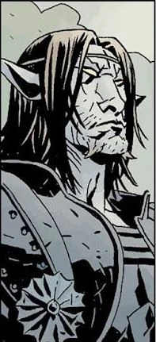

> "但如果*注定*要有一个结局，那就让它*轰轰烈烈*。让它*血流成河*。与其在黑暗中凋零，不如燃尽。不要默默地离去……不要无人知晓地离去……哦，你们这些战争之神啊……就让它*成为*战争吧。"

**利恩湖的棕精灵（Gruagach of Lough Leane）**是一种[仙子](/entry/Fairies)生物，隶属于 [Daoine Sidhe](/entry/Daoine_Sidhe)，也是[地狱男爵](/entry/Hellboy)不共戴天的仇敌。他目前被困在弗莫尔[巨人](/entry/giant)[Grom](/entry/Grom)不断退化的身体里，如今外形像一头发育畸形、突变的拟人化野猪。他把自己如今的处境归咎于地狱男爵，一心要为所受的屈辱复仇。他还渴望看到自己的族人重铸昔日荣光；在他看来，仙子一族宁可战死求生，也胜过在人类的阴影中默默消逝。

## 历史

### 地狱男爵出现之前

棕精灵曾是图哈德达南（Tuatha De Danann）的一位会变形的战士，图哈德达南后来成为 Daoine Sidhe，即爱尔兰的仙子一族。很久以前，他随至高王[达格达](/entry/Dagda)（Dagda）的儿子们一同出征，对抗巨人（据凯尔特神话所述，大概是图哈德达南的敌人弗莫尔人）。棕精灵能够变化成许多形态，战斗中他化身为一头庞大的怪物，亲手斩杀了二十名巨人。此后不久，棕精灵爱上了一个人类女孩。女孩想看看他与巨人作战时的模样，但仙子不愿答应，怕她会被自己吓到。当时有一条奇异的法则：倘若女孩见到他的怪物形态时失声尖叫，棕精灵就会被放逐到某片迷雾笼罩的炼狱之地，再也见不到她。尽管如此，女孩还是说服他现出怪物之形。正如他所担心的，看到自己的仙子爱人变成一头长着獠牙的巨型野兽，女孩吓得畏缩，但她强忍住了尖叫。为了安抚她明显的恐惧，棕精灵变成一只小鸣禽。然而一只猫突然出现，女孩尖叫着向他发出警告——伴随着这声尖叫，棕精灵永远迷失在了迷雾之中。[1]

棕精灵发现自己困在一片凄凉的迷雾维度，那里还游荡着其他迷失的、不幸的仙子灵魂。他在这片混沌之境漫无目的地徘徊了不知多久，慢慢退化成昔日自我的一具干枯躯壳。最终，他找到了返回人世的路，但几乎失去了全部力量。

### *[《尸体》](/entry/The_Corpse)*

1959 年，棕精灵（已退化成一个幼童般的换生灵）被派往爱尔兰，顶替被掳走的婴儿[爱丽丝·莫纳汉](/entry/Alice_Monaghan)。莫纳汉一家对这场掉包隐约起疑，设法找来地狱男爵调查这个古怪的孩子。地狱男爵用仙子自古的克星寒铁揭穿了换生灵。棕精灵被迫告诉地狱男爵如何从 Daoine Sidhe 手中救回孩子。雪上加霜的是，棕精灵被扔进了火炉，但他成功逃脱。受此羞辱，换生灵言不由衷地发誓，要为地狱男爵的"虐待"向他复仇。地狱男爵随后动身，准备按仙子一族的古老规则与他们周旋；棕精灵则潜入一条浑浊的河流，唤醒了民间传说中的河中妖婆绿齿珍妮（Jenny Greenteeth，剧情暗示棕精灵曾与她有过一段恋情）。他让珍妮放出被囚禁的战争怪物 Grom——弗莫尔巨人最后的幸存者，外形是一个巨大的野猪头人形生物。

与此同时，地狱男爵正拖着一个名叫 Tam O'Clannie 的绞死者的多话尸体四处奔波，要为他找一个基督徒的安葬之所，以平息仙子一族的怒气。当地狱男爵拖着尸体走过一座古老石桥时，Grom 被放出来袭击他。棕精灵在附近肆无忌惮地飘着，幸灾乐祸地痛骂地狱男爵，结果嘲弄到一半就被 Grom 从空中一把抓起，整个吞了下去。地狱男爵与 Grom 激战，借助一件圣物制服了巨人，圣物令 Grom 缩小逃走。地狱男爵成功从 Daoine Sidhe 手中救回婴儿爱丽丝，而棕精灵的灵魂却趁机压服了 Grom 的心智，篡夺了这具已经缩小的弗莫尔巨人身体的控制权。[2]

### Daoine Sidhe 议事会

在*[《第三个愿望》](/entry/The_Third_Wish)* 第 2 期中，已永久困在 Grom 猪形身体里的棕精灵，与达格达国王和[爱德华·格雷爵士](/entry/Sir_Edward_Grey)站在一起，同众多仙子生物一同临朝。棕精灵表示，他相信只要没有地狱男爵，仙子一族就能重新统治世界，而不必退守世界之下的黑暗中慢慢消逝——达格达已经听天由命地接受了后一种命运。格雷说棕精灵想要的不过是复仇。他并不否认，说地狱男爵曾用铁灼烧他，而他如今被困在 Grom 的"猪身子"里。棕精灵再次宣称他必报此仇。

在*[《岛屿》](/entry/The_Island)* 的尾声中，棕精灵与图哈德达南的前代仙女王[Mab](/entry/Mab)交谈。她告诉他地狱男爵还活着，正在返回英格兰。棕精灵仍想阻止地狱男爵，并问女巫们在做什么。Mab 回答说她们在等候女王[赫卡特](/entry/Hecate)的消息。她告诉他他打不过地狱男爵，但棕精灵拒不听劝。他傲然宣称，即便这会给他的族人带来终结，他也宁愿看着他们在战争的荣光中谢幕，而不是默默消逝。

### *[《黑暗召唤》](/entry/Darkness_Calls)*

棕精灵闯入英格兰女巫的一场集会，女巫们正在为（实际已被废掉的）赫卡特寻找替代者。他告诉她们必须立"她"为女王，他指的是一位[神秘的女恩人](/entry/Queen_of_Blood)。女巫们对他的提议深感戒惧，心中满是恐惧与旧日的耻辱，但她们意识到，他所说的那个人是她们求生的最后、也是最大的希望。[3]

棕精灵带着两个仙子喽啰，来到英格兰一座教堂下方的秘密洞窟。他唤醒洞窟的守护者，把一封不列颠女巫的信呈给这位巨人。巨人不情愿地照信中的要求行事，走进一处戒备森严的深坑，释放囚禁在那里的存在——即将成为新任女巫之王的人。[4]

棕精灵看着巨人带回一只木箱，箱中装着前代女巫之王被肢解的遗骸——她遭到了自己追随者的背叛。巨人返回自己的安息之地，不愿卷入即将发生的事端。棕精灵和同伴离开教堂时，看到一只毫不起眼的鸟。他对那只鸟说，它的女主人该选好自己站在哪一边了，因为新女王即将降临。仙子们拖走装着她们新女主人的箱子。与此同时，达格达在远处注视着他们，预见到他们的行为将为自己的族人招来毁灭。[5]

棕精灵和同伴带着箱子回到 Daoine Sidhe 的集会。达格达国王恳求他们三思。棕精灵的一个同伴被当下的狂热冲昏头脑，从背后刺死了这位仙子君王。那仙子起初满不在乎，但看到刀上染着金色的血时，才意识到自己弑君的分量。凶手凄声哀嚎着国王的名字，自尽后蒸发消散。棕精灵措手不及，似乎对这意外的转折深感不安，但他还是趁机利用了眼前的局面。他为失去国王而哀恸，随后号召仙子一族聚集到自己和他的[血皇后](/entry/Queen_of_Blood)麾下。[6]

### *[《狂猎》](/entry/The_Wild_Hunt)*

棕精灵站在山顶，身边是集结中的仙子大军。一个刺猬仙子似乎代表集结的大军发言，他失望地表示，仙子一族的其他部族仍无消息传来，包括苏格兰的西利宫廷（Seelie Court）、威尔士的 Ellyllon 宫廷、北欧的巨魔和日耳曼的 Feens。棕精灵透露巨人再次四处出没，而血皇后很久以前就曾承诺把他们的部分领土归还，但计划还没来得及实施她就遭到了背叛。刺猬仙子追问这位女王何时归来，棕精灵只能回答说她准备好时自会降临，并将率领一支大军前来参战。[7]

后来，恶魔[阿斯塔罗斯](/entry/Astaroth)（Astaroth）乔装来到山顶，求见利恩湖的棕精灵。阿斯塔罗斯对（或佯装对）眼前这个矮小猪人就是他要找的人感到惊讶，棕精灵则悲伤地讲述了过往的悲剧经历，正是这些把他逼到如今这步田地。他希望血皇后能让他重获昔日荣光，阿斯塔罗斯给他一只镶满宝石的金色圣餐杯，杯中盛满附近村庄里取来的人血。棕精灵把血倒入箱中，血皇后就此复活，口中念出一段不祥的诅咒。[8]

赋予她生命之后，棕精灵随侍在血皇后身边，看着她重建权势。他把头枕在她膝上，她爱抚着他，承诺时机成熟时会恢复他的力量，好让他好好替她除掉地狱男爵。昏昏欲睡的棕精灵见证了日德兰仙子国王那矮子般的使者前来，使者把自己国王的军队许诺给血皇后，并向她献上一顶金冠。果如传闻所言，她命令惊恐的使者把金冠重铸成一把刀，用它去刺杀自己的国王。她不要王冠，而要一顶铁盔，塑成三只渡鸦的形状，刻上 Badbdb、Macha 和 Mor-Rioghain（凯尔特战争三女神）的名字。[9]

随后，地狱男爵取得了[圣剑 Excalibur](/entry/Excalibur)，以及他意料之外的身份——不列颠正统国王。棕精灵的女王也被揭示为 Nimue，即前代湖中仙女，她崇拜奥古·桀哈。急不可耐的棕精灵恳求女主人立刻赐他力量，但血皇后拒绝了。仙子犯下了质疑她力量的致命错误，他随即哀求原谅，却无济于事。皇后痛斥他，声称"哪怕一只刺猬伺候我都比你强！强上一百倍，你这背信弃义的猪！"并把他逐出门下。他可怜兮兮地哭嚎着逃走了。[10]

### *[《风暴》](/entry/The_Storm)* 与 *[《狂怒》](/entry/The_Fury)*

地狱男爵带着长大成人的[爱丽丝·莫纳汉](/entry/Alice_Monaghan)重新踏上冒险，而心碎的棕精灵在树林中漫无目的地游荡，想躲避越聚越猛的风暴。他被一块石碑绊倒，遇到一个身穿长袍、幽灵般的大胡子男人，那人说棕精灵此刻正站在他的坟墓上。棕精灵在男人面前畏缩求饶，称他为主人。男人冷笑一声，告诉他："对你没有怜悯，猪猡。"[11]

男人显露出传奇人物[梅林](/entry/Merlin)的真身，讲述了他与 Nimue 的过往：她引诱他交出全部秘密，又设计把他骗入永世封埋的长眠。失去他的指引后，湖中仙女被[巨龙](/entry/Ogdru_Jahad)的呼唤逼疯，成为血皇后。梅林接着向棕精灵揭示，皇后的大军已经开始响应她的召唤，并谴责仙子当初只为对地狱男爵的一点怨怼就放出了她，从而亲手推动了本族的毁灭。棕精灵反驳这一说法，但梅林让他看到血皇后已经谋杀了 Mab 女王——图哈德达南最后纯净之血被洒出，被她用来标记自己的新斗士——棕精灵的希望彻底粉碎。巫师斥责棕精灵的天真与盲目的愤怒，预言 Nimue 的战争过后，只会留下血流成河、白骨遍野。最后，梅林诅咒棕精灵：他要活着受折磨，亲眼见证自己一手造成的一切，"直到世界停止转动"。[12]

地狱男爵前往皇后的高塔与她对峙时，偶遇棕精灵——他脖子套着绞索吊在树上，却求死不能。他凄然泪下，承认自己想向地狱男爵复仇，但从没想过放出血皇后会给世界、给自己的族人带来这样的毁灭。他恳求一死，地狱男爵想成全他，把一把自动手枪的子弹全打进他胸口。梅林的诅咒生效，棕精灵死不了。后来爱丽丝·莫纳汉赶去协助地狱男爵的路上，也经过了棕精灵身边。

血皇后被击败后，[摩根勒菲](/entry/Morgan_Le_Fey)（Morgan Le Fey）找到仍吊在森林里的棕精灵，对他说在这场游戏的所有棋子中，他一直是她最中意的一个。棕精灵哀求说他不想看到即将到来的世界，她说她也不想。她用法力把他从梅林的诅咒中解放出来，握住他的手说，他们现在必须离开这个世界，去往他们这类人该去的地方。[13]

## 其他媒体

### *[地狱男爵](/entry/Hellboy_(2019_film))*（2019）

棕精灵在 2019 年重启版《地狱男爵》中作为第二反派登场。与漫画不同，电影里的他言辞更加凶悍、满口脏话，说话带着浓重的利物浦口音。

他第一次与地狱男爵交手是在 1992 年，当时他被仙子留下，伪装成襁褓中的爱丽丝·莫纳汉。地狱男爵到来后，用一块铁制的马蹄铁——一种能伤害换生灵的物质——逼他现形。在莫纳汉家宅里短暂追逐后，地狱男爵用一把铁钳灼伤了暴露原形的棕精灵，他被迫承诺仙子会送回真正的爱丽丝。地狱男爵却不肯相信。最终棕精灵逃走了。他逃跑时，地狱男爵对着他逃走的烟囱大吼，勒令他把爱丽丝送回她家人身边，否则就亲自来抓人，言下之意是棕精灵和他的"仙子朋友们"都会没好果子吃。当天夜里，爱丽丝被送回父母身边，地狱男爵还威胁说要是"她尿布脏了"就去找他们算账。

接下来的 27 年里，棕精灵屈辱地流浪，沦为一个"憔悴、游荡的东西"。但他发誓要为铁伤之仇向地狱男爵报复。女巫[雅加婆婆](/entry/Baba_Yaga)感知到他的痛苦，召唤了棕精灵，指使他去收集装着血女巫[Vivienne Nimue](/entry/Nimue)被斩下却依然"活着"的肢体的棺椁。他在圣塞巴斯蒂安修道院找到了她的头颅，在那里屠杀了许多沉默的修士，只留下一个，逼他带自己去取棺椁。他强迫修士用声音打开棺椁，修士拒绝。棕精灵忍无可忍，强行扯下修士的舌头塞进自己嘴里，这样他就能亲自使用修士的声音。随后他收集了其余的棺椁，只差装着 Nimue 一只手的那一口。他把肢体带到一栋老宅，杀了宅中居民，并和她讨论她眼下的处境。她与他做了一笔交易：如果他让她复原，她就让他复原。

当天夜里，棕精灵闯入[奥西里斯俱乐部](/entry/Osiris_Club)（Osiris Club）总部，杀光在场所有人，找到了最后一口棺椁。地狱男爵在一次任务中发现了棕精灵，试图制服他。棕精灵觉得自己还没准备好与地狱男爵正面对抗，便呼唤 Nimue 相助，她以分散地狱男爵注意力的方式施以援手（即撩拨他的挫败感）。趁他分心，棕精灵带着血女巫的手逃走。后来棕精灵看着三个老丑婆把 Nimue 的身体重新缝合起来。被问及为何对地狱男爵如此执着时，他说明了缘由；Nimue 由此意识到他们共同的复仇欲望已被怒火蒙蔽，接着却话锋暗示她对地狱男爵另有打算，令棕精灵大惑不解。她随后派他协助自己把血收回体内。在彭德尔山，Nimue 把血液吸回苍白身体时，棕精灵就在场。当地狱男爵用[他的左轮手枪](/entry/Hellboy%27s_revolver_%282019_film%29)开枪打了她一个措手不及、轰掉她大半张脸时，棕精灵斥责地狱男爵碍事；当她制服地狱男爵时，棕精灵还嘲笑他不懂得"何时该等待"。

棕精灵急于复原并除掉地狱男爵，却被 Nimue 一口回绝；他赶紧提醒她曾许下承诺，她却扇了他一耳光，警告他说话小心。随后她命令他走进她新造出的传送门。之后他与 Nimue 一起在伦敦街头肆虐，前往圣保罗大教堂。途中他们突袭了 M-11 的秘密办公室——藏在一家炸鱼薯条店底下——杀光在场所有人，绑架了布鲁姆教授，随后动身前往圣保罗大教堂。地狱男爵得知出事，与长大的爱丽丝·莫纳汉及 M-11 指挥官本·达米奥少校一起火速赶往大教堂，却立刻撞上棕精灵——Nimue 赐予了他力量，他明显变得更壮硕、更巨大。他对先前伤过他的铁也刀枪不入了。

地狱男爵与棕精灵交战，最终不敌，幸得化身为豹人的达米奥相救。二人合力，一度在获得力量的棕精灵面前占了上风。不幸的是，怪物把达米奥砸到墙上、令他失去行动能力，随后再次准备结果地狱男爵；这时 Nimue 把他叫住。棕精灵不愿复仇落空，向 Nimue 透露：她能醒来全是因为他，是他推动了她的整个阴谋。闻听此言，Nimue 宣称自己就是"终结"，意味着她的野心已超出了他的复仇欲望。她背叛了棕精灵，坦言她只需要一个人把地狱男爵逼到极限；她用法术让他不断缩小。棕精灵自知必死，临死前表达了对血皇后背叛的难以置信，用最后时刻痛骂地狱男爵，随后爆成一摊血水。地狱男爵见状，疲惫地回骂了一句。

### *[Brawlhalla](/entry/Brawlhalla)*

棕精灵在 Blue Mammoth Games 的游戏《Brawlhalla》（2014）中作为 Teros 的联动皮肤登场。

## 注释

*Gruagach*（读作 *gru*-ah-gak，苏格兰盖尔语意为"多毛者"）是主要出现在苏格兰和爱尔兰凯尔特民间传说中的仙子生物。即便在原始传说中，也无法确定 Gruagach 究竟只有独一位还是有许多个（大多数仙子种类都是如此）。[阿斯塔罗斯](/entry/Astaroth)称他为利恩湖的*那位*棕精灵（the Gruagach of Lough Leane），这暗示或许还有其他同类。

民间传说里的棕精灵通常对人类友善，据说还会保护牲畜，但和大多数仙灵一样性情难测。一个常见的传统是为他们摆上一碟牛奶，以免他们偷走农庄里所有的奶。他们是 *Pooka*（一种黄眼睛、会变形的淘气小妖，以惊吓或捉弄路人为乐）的地方变体，也与 *Brownie*（一种帮忙做家务的小型居家小妖）有相似之处。

利恩湖（Lough Leane，爱尔兰语 Loch Léin，意为"学问之湖"）是基拉尼三湖中最大的一座，是爱尔兰凯里郡基拉尼附近著名的风景名胜。劳恩河从利恩湖向北流经基洛格林，注入丁格尔湾。另外两湖名为上湖与中湖，坐落在群山环抱的山谷中。

值得注意的是，利恩湖是爱尔兰南部凯里郡的湖泊，而棕精灵效忠于爱尔兰的图哈德达南和 Daoine Sidhe；然而棕精灵本身却是苏格兰民间传说特有的，与苏格兰的西利仙子宫廷有关（*[《狂猎》](/entry/The_Wild_Hunt)* 第 1 期有所提及）。一种可能的解释是：历史上苏格兰人及其盖尔文化起源于爱尔兰，棕精灵可能最初也来自爱尔兰。不过爱尔兰民间传说中同样出现了 gruagach，这一疑问也就迎刃而解了。

## 参考资料

[1]

[2] *[《狂猎》](/entry/The_Wild_Hunt)* 第 2 期

[3] *[《黑暗召唤》](/entry/Darkness_Calls)* 第 3 期

[4] *[《黑暗召唤》](/entry/Darkness_Calls)* 第 4 期

[5] *[《黑暗召唤》](/entry/Darkness_Calls)* 第 5 期

[6] *[《黑暗召唤》](/entry/Darkness_Calls)* 第 6 期

[7] *[《狂猎》](/entry/The_Wild_Hunt)* 第 1 期

[8] *[《狂猎》](/entry/The_Wild_Hunt)* 第 2 期

[9] *[《狂猎》](/entry/The_Wild_Hunt)* 第 5 期

[10] *[《狂猎》](/entry/The_Wild_Hunt)* 第 8 期

[11] *[《风暴》](/entry/The_Storm)* 第 1 期

[12] *[《风暴》](/entry/The_Storm)* 第 2 期

[13] *[《狂怒》](/entry/The_Fury)* 第 2 期
