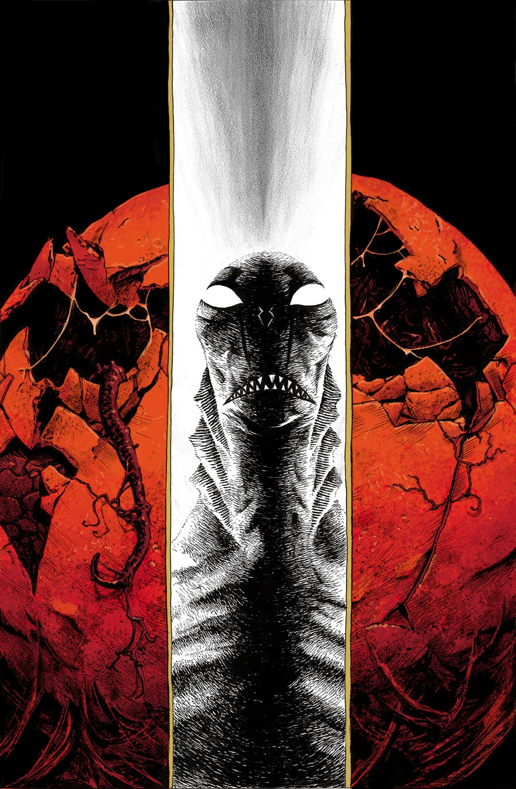
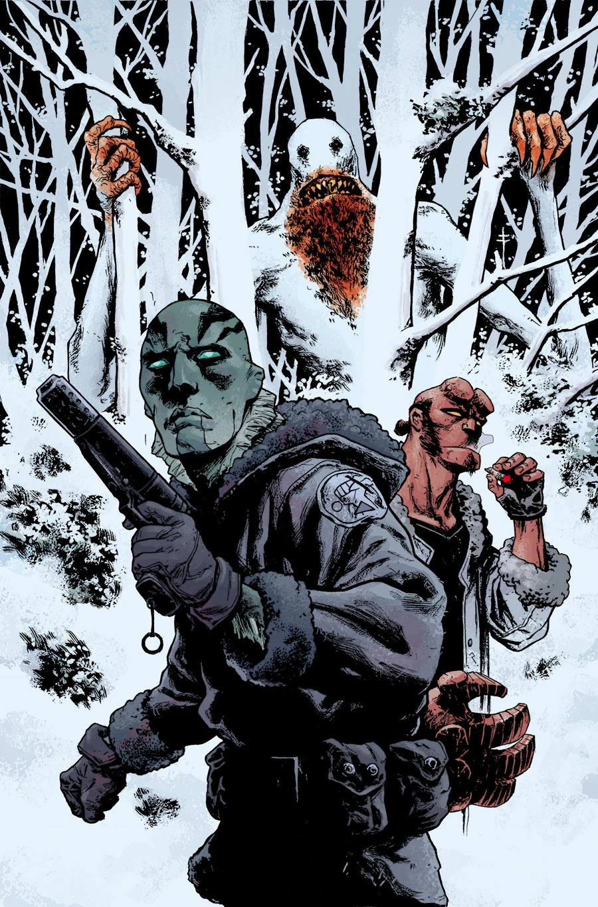
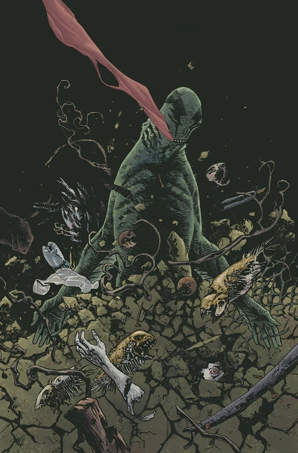

***《次世代新人类》（The New Race of Man）**是一部迷你系列，讲述亚伯调查索尔顿湖的卵的故事。

## 出版历史

《次世代新人类》是一个两期故事弧，于 2013 年 7 月出版，作画由 Max Fiumara 担任。

《次世代新人类》是 John Arcudi 长久以来一直想讲的故事，但他觉得自己无法在[《B.P.R.D.》](/entry/B.P.R.D._%28series%29)正刊中把它讲好。

## 剧情梗概

### 第一部分

逃离调查局追捕期间，亚伯前往索尔顿湖，在那里遇到一个崇拜怪卵的离奇教团。

### 第二部分

一具被啃食过半的尸体冲上岸后，一个小教团怀疑饥饿的凶手可能是亚伯；亚伯逃向索尔顿湖，却迎面遭遇一只危险的奥格德鲁·赫姆（Ogdru Hem）幼体。

## 画廊

