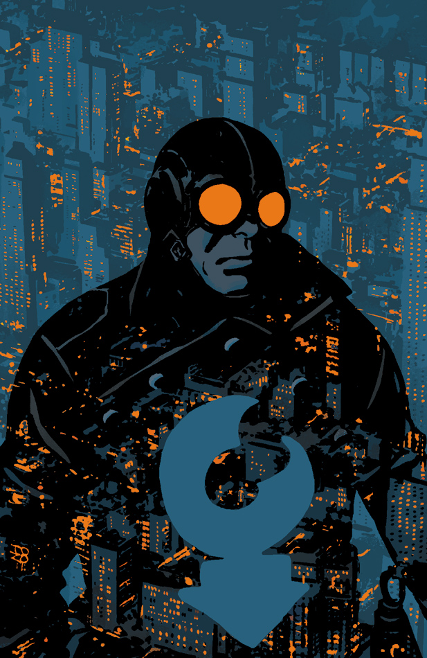
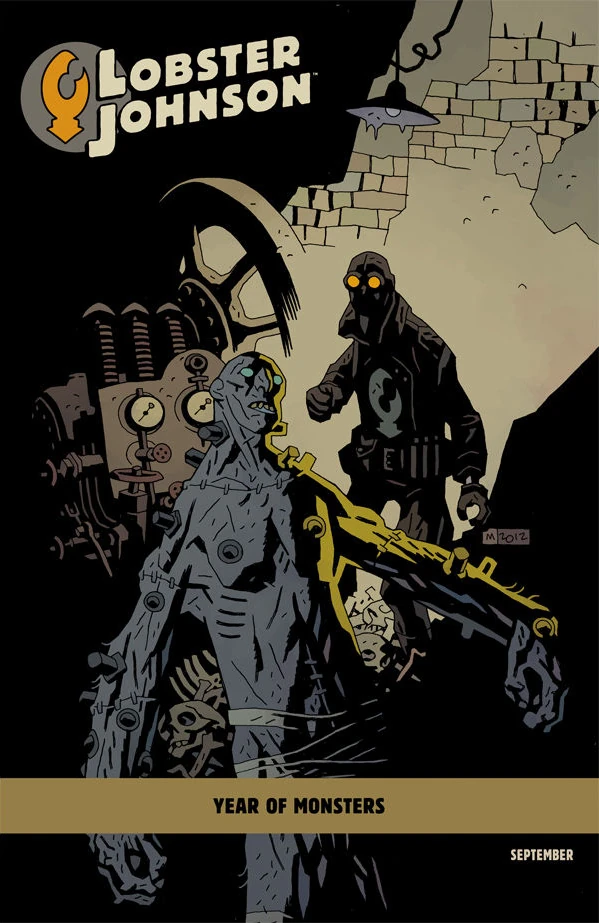

《**死无全尸**》（Caput Mortuum）的故事发生在 1930 年代[龙虾人](/entry/The_Lobster)作为犯罪斗士生涯的早期。

## 出版历史

这部单刊于 2012 年 9 月出版，封面由 Tonči Zonjić 绘制，另有 Mike Mignola 绘制的变体封面，属于 *[怪物之年](/entry/Year_of_Monsters)* 封面系列的一部分。

## 剧情简介

这一次，地狱男爵最爱的枪火义警把正义带上天空——他被卷入一场飞艇上的近身激战！

## 画廊

[Tonci Zonjic](/entry/Tonci_Zonjic)

[怪物之年](/entry/Year_of_Monsters)变体封面
作者 [Mike Mignola](/entry/Mike_Mignola)
