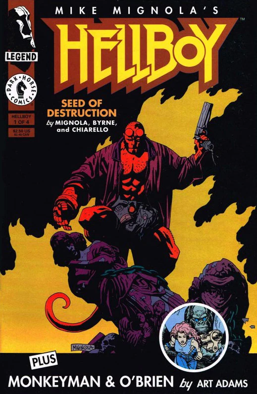

《**毁灭之芽**》（Hellboy: Seed of Destruction）是第一部 *[地狱男爵](/entry/Hellboy_%28series%29)* 漫画迷你系列，由 Dark Horse Comics 出版。它由 [Mike Mignola](/entry/Mike_Mignola) 构思并绘制，[John Byrne](/entry/John_Byrne) 撰写剧本。

这在一定程度上是第一部[地狱男爵电影](/entry/Hellboy_%28film%29)的基础。

## 出版历史

《毁灭之芽》最初以四期限定的迷你系列形式于 1994 年 3 月至 6 月间每月出版。这四期中还附有由 Arthur Adams 编剧并绘制的四回备份故事 *Who are Monkeyman and O'Brien?*。

该故事被重印于平装合订本[1] *[地狱男爵：毁灭之芽](/entry/TPB)* 第一版。此后该平装合订本又出了三个版本，每个版本都有独特的封面。第二版于 1997 年 6 月发行。随后又推出了第二版的第二次印刷，同样带有独特封面。第三版于 2003 年 11 月出版。定制版于 2006 年 12 月出版。定制版是该书较小的口袋本尺寸版本，通过部分零售商购买时与 *[地狱男爵动画版：风暴之剑](/entry/Hellboy_Animated%3A_Sword_of_Storms)* DVD 捆绑销售。

除了以平装形式出版外，《毁灭之芽》还于 1995 年出版了精装版。精装版手工编号，限量 1000 册，装在配套的书套中。第二个精装版本（这次是口袋本尺寸）于 2008 年 6 月 24 日发行，与一个 PVC 地狱男爵手办捆绑销售。

作为 Dark Horse 的"1 美元 1 本"促销活动（重印多部热门刊物的第一期）的一部分，《毁灭之芽》第一期于 2010 年 8 月以修改后的封面重印，售价一美元。[2]

为庆祝《毁灭之芽》第 1 期发行 25th 周年，该期再次重印，由 Mignola 和 [Dave Stewart](/entry/Dave_Stewart) 提供新封面。这次重印于 2019 年 3 月免费发放。多家零售商和漫展为此次庆祝活动制作了变体封面。

## 剧情简介

### 第一部

漫画开篇于 1944 年，一名叫 [George Whitman](/entry/George_Whitman) 的美国陆军军官接到报告，他受命率领一支突击队前往英国中部地区（虚构的）东布罗姆维奇村。这支陆军小队（由一位与纳粹作战的超级英雄[自由火炬](/entry/The_Torch_of_Liberty)陪同）接受三名超自然事务官员的指导，其中一人是年轻的 [Trevor Bruttenholm](/entry/Trevor_Bruttenholm)。据团队的灵媒 [Cynthia Eden-Jones 女士](/entry/Lady_Cynthia_Eden-Jones)所言，当地一座废弃教堂中将发生一件可怕的事件：那是由纳粹策划的一个末日计划，可能预示着世界的终结。

然而，真正的仪式正在苏格兰海岸外的小岛塔马甘特岛上进行。纳粹在一个石阵周围架设了一排奇异的机器，石阵中央站着传说中的俄国灵媒 [Grigori Rasputin](/entry/Grigori_Rasputin)。这位巫师戴着一副威力强大的护手，试图将 [Ogdru Jahad](/entry/Ogdru_Jahad) 从它们的监狱召唤到人间；这些怪兽虽未现身，却被描述为"不知怜悯"和"瘟疫的先驱"，表明它们是不辨善恶的危险存在。

 虽然 Ogdru Jahad 没有被召唤出来，但一个红皮肤、形似孩童的恶魔在东布罗姆维奇教堂的一团烈焰中出现，并很快被 Bruttenholm 教授称为"[地狱男爵](/entry/Hellboy_%28character%29)"。纳粹行动的负责人 Klaus Werner von Krupt 对 Rasputin 表面上的失败感到沮丧，但这个疯僧另有看法，并宣称他已经启动了世界的终结。

场景随后转到 1994 年，年迈许多的 Bruttenholm 在纽约的私人住所中讲述地狱男爵诞生的事件，这时恶魔本人走进了办公室。据透露，Bruttenholm 已经失踪一年多，他是在一次极地考察后失踪的。他向地狱男爵讲述了自己最近失踪的经过，告诉他自己与卡文迪什家的三个儿子以及一位名叫 Sven Olafssen 的著名北极探险家一同前往北极圈。四人进入了世界之巅的一个洞穴，洞中矗立着一尊奇异的洛夫克拉夫特式触手生物雕像，一个人在它脚下冥想。当 Bruttenholm 触碰那件圣物时，它似乎活了过来，而他几乎记不得之后发生的事。他还没来得及继续说下去，就被一群青蛙打断，他跑出办公室，对养子留下最后一句话："快逃！"。

地狱男爵还来不及反应，Bruttenholm 就被一只巨大的[青蛙怪物](/entry/Frog_monster)杀死，他干枯的尸体周围留下了孔洞状的痕迹。那怪物试图杀死地狱男爵，但他对青蛙怪来说太过强大，并在它试图逃跑时开枪击中了它。杀死怪物后，地狱男爵打电话给 B.P.R.D. 局长 [Tom Manning](/entry/Tom_Manning)，告知他 Bruttenholm 的死讯。就在 Manning 和其他官员安排事务时，场景转到一栋维多利亚式老宅的内部，一个阴暗的身影正与一位仪态庄重的老妇人谈论 Bruttenholm 的死。漫画结尾处，她的茶杯里出现了一只青蛙……

### 第二部

在发现了一些与教授之死有关的线索后，地狱男爵前往一座名为[卡文迪什庄园](/entry/Cavendish_Hall)的老宅，同行的有同事 [Liz Sherman](/entry/Liz_Sherman) 和 [Abe Sapien](/entry/Abe_Sapien)。宅子的主人 Emma Cavendish 女士正是上一章结尾出现的那个女人。她解释说自己是卡文迪什庄园最后的继承人，她的儿子们显然已在与 Bruttenholm 的考察中丧生。她还提到，她的儿子们并不是卡文迪什家族中第一批试图寻找那个洞穴的男性——家族中世世代代的每个男性都在寻找洞穴的途中死去。这种做法始于一位名叫 Elihu Cavendish 的水手，他是一位绅士兼捕鲸人，周游世界，在无数港口听过奇闻异事。他把找到北极的神殿作为毕生目标；他失败后，后代的每个男性都试图完成他的壮举。Cavendish 女士向三人倾诉自己作为家族最后一名在世成员的悲伤，并希望自己死后卡文迪什庄园能沉入下方的湖中。

随后管家护送三人前往各自的房间。Cavendish 女士独自一人时，那个阴暗的身影再次出现，告诉她他将让她与儿子们团聚，并对他们说："孩子们，来和你们的母亲吻别道晚安吧……"

三人决定开始调查，Abe 脱下装束从窗户跳入水中，希望能在宅子下方的水底找到些什么。地狱男爵随后通过内线电话联系 Liz，他们讨论起管家的长相如何与 [Sven Olafson](/entry/Sven_Olafson) 一模一样——那位北极探险家据说已在与 Bruttenholm 和卡文迪什兄弟的考察中丧生。一群青蛙突然出现在 Liz 的房间里，当她把这事告诉地狱男爵时，他大喊让她立刻离开房间，自己也朝她的房间跑去。

地狱男爵赶到房间时发现 Liz 不见了；而 Olafssen 在大厅里，假装不知道她去了哪里。当地狱男爵威胁探险家开口时，他变成了一只青蛙怪物，两人在宅中打斗。在看似杀死了第二只怪物后，地狱男爵回到客厅，发现 Cavendish 女士已经死去，身上布满与 Bruttenholm 尸体上相似的痕迹。他后悔没有做些什么来保护她，但之前出现的那个黑衣人现身，自曝身份是 Rasputin。Rasputin 声称是他把地狱男爵从虚空中召唤出来的，并称地狱男爵的命运就是帮助他毁灭世界。地狱男爵还来不及撤退，一组巨大的触手就砸穿地板，把他拖入宅子下方洞穴般的深处。

### 第三部

在[卡文迪什庄园](/entry/Cavendish_Hall)下方的黑暗中——那里被揭示为一座阿兹特克神殿——Rasputin 开始向地狱男爵讲述 [Ogdru Jahad](/entry/Ogdru_Jahad) 的本质，以及它们渴望摆脱囚禁的欲望。地狱男爵很快不耐烦，朝 Rasputin 的头部开枪；但这个僧人迅速愈合，并念出一道咒语，将地狱男爵掀飞出去。这让恶魔感到担忧，因为这意味着他随身的符咒、护身符、圣物等在 Rasputin 的力量面前毫无用处。巫师警告地狱男爵，既然是他把他带到这个世界上的，他也能轻易把他从世界上抹去。Olafssen 青蛙怪随后返回，与地狱男爵重新展开战斗。

与此同时，Abe 穿过连接卡文迪什庄园地窖、洞穴与湖泊的水道。在地下洞穴中，他遇到了卡文迪什两兄弟，他们自己也变成了青蛙怪；不过他们不像 Olafssen 那样凶暴，而是被看到正拥抱着被他们奉 Rasputin 之命杀死的母亲的尸体。再往里走，Abe 发现了 Elihu Cavendish 的遗体，被安置在一张王座般的椅子上，手里握着一把鱼叉。

回到神殿，Rasputin 揭示了他与 Ogdru Jahad 的联系。1916 年被一群贵族杀死、尸体被扔进涅瓦河后，Rasputin 被 Ogdru Jahad 复活，他离开俄国，在一个意大利村庄中寻求庇护，逐渐获得末日先知的名声。不久 [Heinrich Himmler](/entry/Heinrich_Himmler) 来访，把他带到德国，主持 [Adolf Hitler](/entry/Adolf_Hitler) 众多孤注一掷的末日计划之一。虽然 Rasputin 知道希特勒注定失败，但他也知道自己可以利用第三帝国的资金、科学头脑和技术资源来扩展自己的野心。他与 [Karl Ruprect Kroenen](/entry/Karl_Ruprect_Kroenen)、[Ilsa Haupstein](/entry/Ilsa_Haupstein)、[Leopold Kurtz](/entry/Leopold_Kurtz) 等人结盟，设计了一台机器，要将 Ogdru Jahad 带到人间并将其烧成灰烬。

计划失败、团队解散后，Rasputin 向北进发，收到了 [Sadu-Hem](/entry/Sadu-Hem) 的幻象——就是 Bruttenholm 发现的那尊雕像生物，它现在就在卡文迪什庄园下方的神殿中。僧人进入深度冥想，在深渊中看到了 Ogdru Jahad。被 Bruttenholm 的触碰重新唤醒后，他读取了教授的记忆，得知了地狱男爵的存在。他利用恢复的力量精神控制考察队将 Sadu Hem 装上一艘船运往美国，那生物一路上吞噬了船上所有的人。他还任由发疯的 Bruttenholm 返回纽约，因为他知道这将是引诱地狱男爵落入陷阱的绝佳诱饵。

Rasputin 随后透露，他让 Olafssen 抓走了 Liz，现在计划将她的力量通过自己导入 Sadu Hem，后者将利用这股能量解开 Ogdru Jahad 的水晶茧。他现在不再需要地狱男爵，并宣称人间地狱即将来临。

### 第四部

当 Liz 的力量流入 Sadu Hem 时，Ogdru Jahad 在它们的监狱中隆隆震动。一个未知的[外星](/entry/The_Visitor_%28character%29)种族被看到正在观察事态，担心"那七位"一旦把地球变黑，就会吞噬整个宇宙。地狱男爵继续与 Olafssen 战斗，最后他找到一枚震荡手雷并将它塞进怪物的喉咙，随后向怪物体内残存的那点人类意识道歉。

Rasputin 为胜利在望而欢欣，吟诵着五十年前他试图召唤那生物时用过的同一道咒语。然而，还没等他完成咒语，他就被 Abe 用鱼叉刺穿了胸膛——Abe 正被复仇心切的 Elihu Cavendish 附身。僧人的注意力被打断，Liz 的火焰力量变得无法控制，烧焦了 Sadu Hem 并导致洞穴坍塌。Abe 从 Cavendish 的控制中醒来，纵身跃出去救 Liz，然后向地狱男爵打招呼，抱着 Liz 从附近的楼梯离开。

暴怒的 Rasputin 随后试图杀死地狱男爵，但他的大部分力量已经耗尽，无法得手。他试图要挟恶魔，声称如果自己被杀，地狱男爵将永远无法知道自己的真正使命。地狱男爵用巨大的右手砸碎了 Rasputin 的头骨，自己跑上楼梯，离开庄园并看着它沉入湖中。Abe 和 Liz 试图追问他洞穴里发生了什么，以及那个巫师的身份，但地狱男爵不愿告诉他们。

当地狱男爵回想僧人的最后话语时，场景转到挪威一座废弃的城堡，里面有一间古老神秘的纳粹实验室的废墟。[Kroenen](/entry/Karl_Ruprecht_Kroenen)、[Ilsa](/entry/Ilsa_Haupstein) 和 [Kurtz](/entry/Leopold_Kurtz)——Rasputin 旧日的门徒——的身影被看到冻在墙上厚厚的冰层中。然而，附近一个装置闪烁着启动，冰层开始碎裂……

## 故事年表

在地狱男爵的世界中，《毁灭之芽》发生在 1994 年初。[3] 故事的主要情节以[卡文迪什庄园](/entry/Cavendish_Hall)的毁灭告终，发生在 5 月 11 日。这个日期在《[蛙族瘟疫](/entry/Plague_of_Frogs_%28story%29)》第 4 期中有明确说明。

按时间顺序，本故事之前是 *[Makoma](/entry/Makoma_%28story%29)*（1993 年 8 月 16 日），之后是 *[The Chained Coffin](/entry/The_Chained_Coffin)*（1994 年 5 月 14 日）。

## 内容

### 角色

#### 地狱男爵事件

- [自由火炬](/entry/The_Torch_of_Liberty)（闪回）
- [英国超自然学会](/entry/The_British_Paranormal_Society_%28organization%29)
  - [Trevor Bruttenholm](/entry/Trevor_Bruttenholm)
  - [Malcolm Frost](/entry/Malcolm_Frost)（闪回）
  - [Cynthia Eden-Jones](/entry/Cynthia_Eden-Jones)（闪回）
- [George Whitman](/entry/George_Whitman)（闪回）
- [Sarah Hughes](/entry/Sarah_Hughes) 的孩子们（鬼魂）（闪回）

#### [纳粹](/entry/%3ACategory%3ANazi)

- [Ragna Rok 计划](/entry/Project_Ragna_Rok)
  - [Grigori Rasputin](/entry/Grigori_Rasputin)
  - [Karl Ruprect Kroenen](/entry/Karl_Ruprect_Kroenen)
  - [Klaus Werner von Krupt](/entry/Klaus_Werner_von_Krupt)（闪回）
  - [Ilsa Haupstein](/entry/Ilsa_Haupstein)
  - [Leopold Kurtz](/entry/Leopold_Kurtz)
- [Heinrich Himmler](/entry/Heinrich_Himmler)（闪回）
- [Adolf Hitler](/entry/Adolf_Hitler)（闪回）
- [Herman von Klempt](/entry/Herman_von_Klempt)（闪回）
- [Kriegaffe](/entry/Kriegaffe)（闪回）

#### [B.P.R.D.](/entry/Bureau_for_Paranormal_Research_and_Defense)

- [地狱男爵](/entry/Hellboy_%28character%29)
- [Thomas Manning](/entry/Thomas_Manning)
- [Elizabeth Sherman](/entry/Elizabeth_Sherman)
- [Abraham Sapien](/entry/Abraham_Sapien)

#### 其他

- [Sven Olafson](/entry/Sven_Olafson)（变成了[青蛙怪物](/entry/Frog_monster)）
- 卡文迪什家族
  - Emma Cavendish
  - [Elihu Cavendish](/entry/Elihu_Cavendish)
  - 三兄弟（变成了[青蛙怪物](/entry/Frog_monster)）
- [Ogdru Jahad](/entry/Ogdru_Jahad)（幻象）
- [Ogdru Hem](/entry/Ogdru_Hem)
  - [Sadu-Hem](/entry/Sadu-Hem)
- [Ereshigal](/entry/Ereshigal)（被提及）
- [外星人](/entry/Aliens)

### 地点

- 英格兰
  - 东布罗姆维奇教堂废墟（闪回）
- 苏格兰（闪回）
  - 塔马甘特岛（闪回）
- 美国
  - [Trevor Bruttenholm](/entry/Trevor_Bruttenholm) 的私人住所（纽约市）
  - [B.P.R.D.](/entry/Bureau_for_Paranormal_Research_and_Defense) 总部（康涅狄格州费尔菲尔德）
  - [卡文迪什庄园](/entry/Cavendish_Hall)（纽约州北部）
  - 圣特里尼安医院（华盛顿特区）（闪回）
- 挪威
  - [Ogdru Hem](/entry/Ogdru_Hem) 神殿（闪回）
  - [Ragna Rok 计划](/entry/Project_Ragna_Rok)的城堡
- 外星飞船（外太空）

## 花絮

第一次印刷，带有 <em>Monkeyman &amp; O'Brien</em> 宣传内容。

- 《毁灭之芽》的原版封面都带有"特别附赠：Art Adams 创作的 *Monkeyman & O'Brien*"横幅，以及由 Adams 绘制的这两个角色的配套圆形镂空插图，用以宣传作为备份故事刊载的内容（见右图）。由于《毁灭之芽》的重印本和合订本不包含这些故事，各期封面通常会经过轻微编辑以移除该文字，并用通用的 B.P.R.D. 标志盖住 Monkeyman & O'Brien 的插图。
  - Mignola 和 Adams 都是 Dark Horse Comics 短暂存在的 [Legend](/entry/Dark_Horse_Comics) 出版品牌的成员。
  - [30 周年纪念《毁灭之芽》第 1 期丝网印刷品](https://www.darkhorsedirect.com/products/hellboy-30th-anniversary-seed-of-destruction-1-screenprint)是包含 *Monkeyman & O'Brien* 交叉宣传的现代出版物的罕见例子。
- 被 Rasputin 提及的 [Ereshigal](/entry/Ereshigal) 是统治亡者之地的美索不达米亚女神。
- 在 Trevor 家中的众多器物中，可以看到一块描绘[新亚述带翼精灵](https://www.meisterdrucke.ie/fine-art-prints/Assyrian/190143/Relief-depicting-a-Winged-Genie,-from-the-Palace-of-Sargon-II-at-Khorsabad,-Iraq-.html)的浮雕。
- 卡文迪什庄园中的一些画作基于现实世界的艺术品：
  - 一幅看起来像是英国海军军官 James Fitzjames 的照片
  - 另一幅似乎部分基于 Rockwell Kent 为 1982 年版《白鲸记》创作的一幅[插图](https://commons.wikimedia.org/wiki/File:Moby_Dick_p510_illustration.jpg)。

## 封面画廊

全部封面由 [Mike Mignola](/entry/Mike_Mignola) 绘制。

### 各期

25 周年纪念版
E
25 周年纪念版
ComicsPro 限定版

### 平装合订本

与 *[地狱男爵动画版：风暴之剑](/entry/Hellboy_Animated%3A_Sword_of_Storms)* DVD 捆绑销售

### 精装本

与 PVC 地狱男爵手办捆绑销售

## 奖项

- 1995 年
  - 荣获[艾斯纳奖](https://www.comic-con.org/awards/eisner-awards-current-info)最佳重版画集奖
  - Mike Mignola 荣获艾斯纳奖最佳编剧/画师奖

## 参考资料

## 链接

- [Dark Horse 第 1 期简介](http://www.darkhorse.com/profile/profile.php?sku=93-336)
- [合订本评论](http://www.comicsbulletin.com/reviews/107395241575582.htm)，[Comics Bulletin](/entry/Comics_Bulletin)

[1] (1994, [Dark Horse Comics](/entry/Dark_Horse_Comics)，平装，128 页，1994，[ISBN 978-1-56971-316-7](/entry/Special%3ABookSources/978-1-56971-316-7)，2004，[ISBN 978-1-59307-094-6](/entry/Special%3ABookSources/978-1-59307-094-6)，精装，1995，[ISBN 978-1-56971-051-7](/entry/Special%3ABookSources/978-1-56971-051-7))

[2] [简介](http://www.darkhorse.com/Comics/17-639/1-for-1-Hellboy-Seed-of-Destruction)

[3] 年份在《Darkness Calls》第 1 期中有明确说明，该期一个脚注中称 Bruttenholm 于 1994 年去世。
