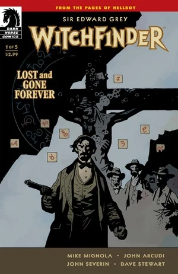
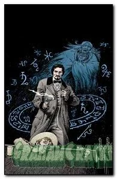
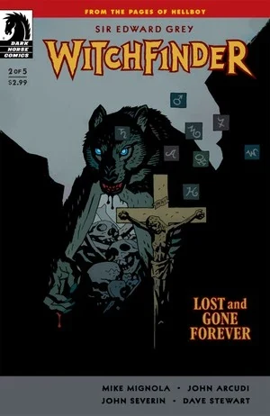
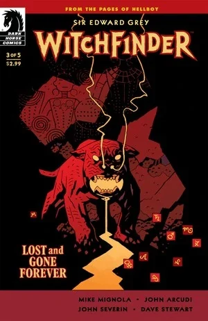
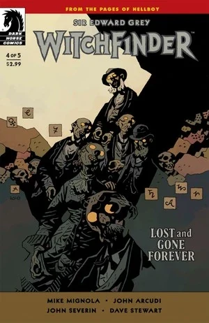
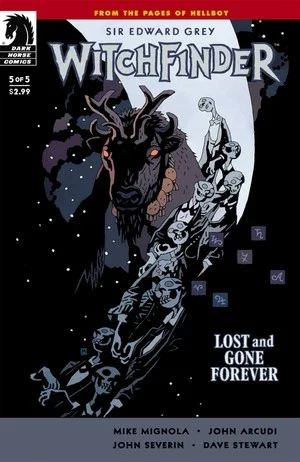

《**永远消逝**》（Lost and Gone Forever）是一部于 2011 年 2 月至 6 月间出版的五期限定连载。它是[《猎巫人》](/entry/Sir_Edward_Grey%3A_Witchfinder)的第二部限定连载，上一部为《[天使之令](/entry/In_the_Service_of_Angels)》。第一期出版时有两个封面版本，一个由 [Mike Mignola](/entry/Mike_Mignola) 绘制，另一个变体封面由 [John Severin](/entry/John_Severin) 绘制。

## 角色

- [爱德华·格雷爵士](/entry/Sir_Edward_Grey)
- [摩根·凯勒](/entry/Morgan_Kaler)
- 艾萨克
- [亚当·格拉伦勋爵](/entry/Lord_Glaren)
- [厄里斯](/entry/Eris)
- 萨满凯帕
- 瓦维亚

## 剧情简介

### 第一部

1880 年，[爱德华·格雷爵士](/entry/Sir_Edward_Grey)抵达犹他州的里德林。他走进当地一家酒吧，要求与警长谈话。格雷卷入一场打斗，最终被赶出了镇子。他与愿意帮助他的当地人摩根·凯勒一同骑马离去。凯勒向格雷讲述这座镇子以及当地教堂的情况。据说那座教堂已被魔鬼占据，镇民们便把它付之一炬、烧成平地。格雷告诉凯勒，他在寻找一个名叫格拉伦勋爵的男人，此人曾在这一带活动。他们继续骑行时，一个长着水牛头的男人朝格雷扑了过来。

### 第二部

爱德华·格雷被狼人咬伤、弃于死地，仅凭上帝的恩典才活了下来。但在西部荒野致命的平原上，当格雷讲述自己直面神秘学生物的骇人历险时，上帝却无处可寻。

### 第三部

在一场与僵尸的枪战之后，格雷遭遇了一只致命的石犬，它是邪恶女巫厄里斯众多凶残爪牙之一。

### 第四部

格雷从一头怪物般的石犬的颚下逃脱，前往一座废弃的煤矿，矿中挤满了一大群僵尸。

### 第五部

一场猛烈的风暴肆虐大地，爱德华·格雷迎战女巫厄里斯和她的牛仔僵尸团伙。

## 画廊

第 1 期

第 1 期变体封面，作者 John Severin

第 2 期

第 3 期

第 4 期

第 5 期
