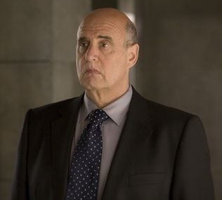

**汤姆·曼宁（Thomas Manning）**是[超自然调查防御署（B.P.R.D.）](/entry/Bureau_for_Paranormal_Research_and_Defense)的主管。

## 历史

曼宁 1946 年 1 月 16 日出生于马萨诸塞州萨默维尔。他是一名政府雇员的儿子，在三个孩子中排行第二，学业出色，就读于华盛顿特区的美利坚大学，取得国际研究学士学位。

### B.P.R.D. 生涯

尽管家人和朋友都以为他会进入外交部门，曼宁却申请了[超自然调查防御署（B.P.R.D.）](/entry/Bureau_for_Paranormal_Research_and_Defense)的外勤职位。他于 1976 年加入 B.P.R.D.。

1980 年，在做了四年外勤探员后，曼宁晋升为野外行动主管。1982 年，[特雷佛·布鲁姆](/entry/Trevor_Bruttenholm)辞去调查署主管职务；曼宁被提拔为野外行动主管，并协助临时主管完成交接。

1997 年，曼宁策划了[搜寻朱雷斯库城堡](/entry/Wake_the_Devil)的行动。然而这次任务导致 [巴德·沃勒](/entry/Bud_Waller) 阵亡，[丽兹·舍曼](/entry/Liz_Sherman)被一个[人造人](/entry/Roger)吸走了生命。在罗马尼亚的 Wauer 研究所，曼宁与[亚伯·塞皮恩](/entry/Abe_Sapien)和 [西德尼·利奇](/entry/Sidney_Leach) 陪同正在接受 Olasz 医生治疗的舍曼。不幸的是，丽兹离开了人世。但她死去仅仅片刻之后，[地狱男爵](/entry/Hellboy_%28character%29)、[凯特·考瑞根](/entry/Kate_Corrigan)和那个人造人（地狱男爵给他取名[罗杰](/entry/Roger)，让利奇大惑不解）走进医院。罗杰随即将丽兹的念焰能量导回她体内，让她起死回生，代价却是自己的生命。

曼宁把罗杰带回美国，B.P.R.D. 的科学家在罗杰胸口植入一台发电机维持他的生命。作为预防措施，曼宁让人在发电机内装了一枚小型炸弹，一旦罗杰产生敌意就炸死他。尽管这枚炸弹从未派上用场，这种不信任却激怒了地狱男爵；2001 年[洪特城堡事件](/entry/Conqueror_Worm_%28story%29)之后，地狱男爵从 B.P.R.D. 辞职。

#### 主管任期

托马斯·曼宁于 2002 年成为 B.P.R.D. 主管。

在[蛙怪](/entry/Frog_monster)瘟疫和[黑焰](/entry/Landis_Pope)崛起期间，曼宁督导清剿蛙怪的野外任务，并负责招募[本·达米奥](/entry/Ben_Daimio)加入调查署。此外，他还主持了 2004 年 B.P.R.D. 总部迁往科罗拉多的工作。

到 2017 年地狱男爵回到 B.P.R.D. 时，曼宁正罹患一种未公开的疾病，卧床不起。尽管如此，他仍在华盛顿特区一处戒备森严的设施中继续主持调查署。

## 性格

曼宁是一个非常严肃、直来直去的人，却深受下属尊敬与信任。他与大多数下属关系融洽，是一位称职、可靠的领导者。遗憾的是，曼宁常常在下属的需求与上级的命令之间左右为难，早年间通常会遵从后者。在罗杰体内安装炸弹的命令并非出自他本人，而是出自他的上级；当地狱男爵把他痛斥一顿后，他坦承自己和地狱男爵一样不喜欢这道命令。

近年来，曼宁提拔罗杰带领自己的小队，很可能是为了弥补炸弹事件的过失。或许是受地狱男爵辞职的触动，在一场夺去罗杰及其小队的灾难之后，曼宁最近拒绝接受本·达米奥上尉的辞呈。就这样，曼宁开始与受自己照管的人建立更深的信任关系，对上级那些越发可疑的命令也越来越多地阳奉阴违。

## 其他媒体

### 2004–2008 年电影系列

Jeffrey Tambor 饰演曼宁

#### *[《地狱男爵》](/entry/Hellboy_%28film%29)*

在电影系列中，汤姆·曼宁（由 [Jeffrey Tambor](/entry/Jeffrey_Tambor) 饰演）与其说是超自然调查员，不如说更像一个官僚和政客。除了担任 B.P.R.D. 主管，他还是联邦调查局特别行动处主任。他还积极向公众否认[地狱男爵](/entry/Hellboy_%282004%E2%80%932008_film_character%29)和 B.P.R.D. 的存在，把一切照片或目击者报告斥为蓄意伪造。曼宁与地狱男爵的工作关系一度十分紧张（他甚至骂地狱男爵是怪物，结果被扔出窗外），直到地狱男爵救了曼宁一命（曼宁也反过来救了地狱男爵）；之后两人有了一段交心时刻，曼宁教地狱男爵怎样才是正确点雪茄的方式。片尾彩蛋里，他仍待在自己救下地狱男爵的那个房间里，满心恐惧，拼命呼喊地狱男爵和其他人来帮忙。

#### *[《地狱男爵 2：黄金军团》](/entry/Hellboy_II%3A_The_Golden_Army)*

然而在《地狱男爵 2：黄金军团》中，曼宁与地狱男爵的紧张关系再度升级：地狱男爵的行动导致 B.P.R.D. 的存在曝光，曼宁的位置被[约翰·克劳斯](/entry/Johann_Kraus)取代，成了地狱男爵的上司。影片开头，曼宁显得心烦意乱、压力重重——为了让地狱男爵不暴露，他做了大量工作（地狱男爵对保密并不太上心，经常留下大量照片或视频，曼宁不得不追查收缴）。由于地狱男爵曝光，[约翰·克劳斯](/entry/Johann_Kraus)被派来领导小队，曼宁立刻对这位灵体探员产生了好感。地狱男爵和其他 B.P.R.D. 探员（包括克劳斯）未经曼宁同意便擅自行动、阻止了[弩阿达王子](/entry/Prince_Nuada)之后，曼宁训斥了他们，却被他们当场宣布辞职惊得目瞪口呆。

### 地狱男爵：动画版

曼宁在*[《地狱男爵：铁血惊魂》](/entry/Hellboy%3A_Blood_and_Iron)*中客串登场，由 Jim Cummings 配音。他的性格与漫画原作非常接近，不过显得稍微不那么严肃和强势：他甚至试着分配任务小队，可队员们一开始各持己见，他就放弃了，任由他们想组什么队就组什么队。
