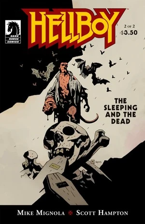

在《**沉睡的死灵**》（The Sleeping and the Dead）中，[地狱男爵](/entry/Hellboy_%28character%29)与一个[吸血鬼](/entry/Vampire_%28creature%29)搏斗，却发现了一个早已被毁的家庭。

## 出版历史

《沉睡的死灵》以两期限定迷你系列的形式出版，时间为 2010 年 12 月和 2011 年 2 月。第 1 期发行时有两个封面，一个由 [Mike Mignola](/entry/Mike_Mignola) 绘制，另一个由 Scott Hampton 绘制的变体封面。该故事被收入《[地狱男爵——第 11 卷：地狱新娘及其他故事](/entry/Trade_Collections)》，于 2011 年 10 月首次出版。

## 剧情简介

### 第一部

1966 年，[地狱男爵](/entry/Hellboy_%28character%29)在一家英国客栈里追踪一名女吸血鬼。他开枪射中吸血鬼，并一路尾随以确保它会死。当他找到吸血鬼的尸体时，一个老年男人正站在尸体旁。那男人开枪打中地狱男爵。地狱男爵醒来后追踪那男人回到他家，却发现那女人已经死了。男人解释说那女人是他的妹妹，一个更老的吸血鬼奴役了他，把他的妹妹变成了吸血鬼，还折磨了他的另一个妹妹。男人认为那个老吸血鬼会因这女人的死而暴怒。地狱男爵中计，被迫与另一个妹妹对峙——她还不完全是吸血鬼，但也不再是人类。

### 第二部

[地狱男爵](/entry/Hellboy_%28character%29)在房子下方的一处空间里与那个妹妹搏斗。与此同时，两名 [B.P.R.D.](/entry/Bureau_for_Paranormal_Research_and_Defense) 特工与故事早些时候帮助过地狱男爵的一个男人会合。

吸血鬼在夜间醒来，得知他的爱人已死。他唤醒了许多沉睡的吸血鬼——整整一代人的时间里他一直在悄悄制造他们。特工们突然发现吸血鬼从他们周围的地下不断冒出，只得拼命搏斗求生。

地狱男爵一拳把那生物——曾经是个小女孩——打穿了一堵墙。墙壁的碎裂反而解放了那生物，它攻击了曾经折磨她的人——那个吸血鬼——把他杀死。随着主人死去，正在攻击特工们的吸血鬼们纷纷瘫倒，了无生气。

女孩的灵魂释放了她所承载的一切邪恶，她的尸体碎落到地上，终于获得了安宁。地狱男爵踉跄着走出房子，找到了特工们。

## 画廊

封面由 [Mike Mignola](/entry/Mike_Mignola) 绘制。

