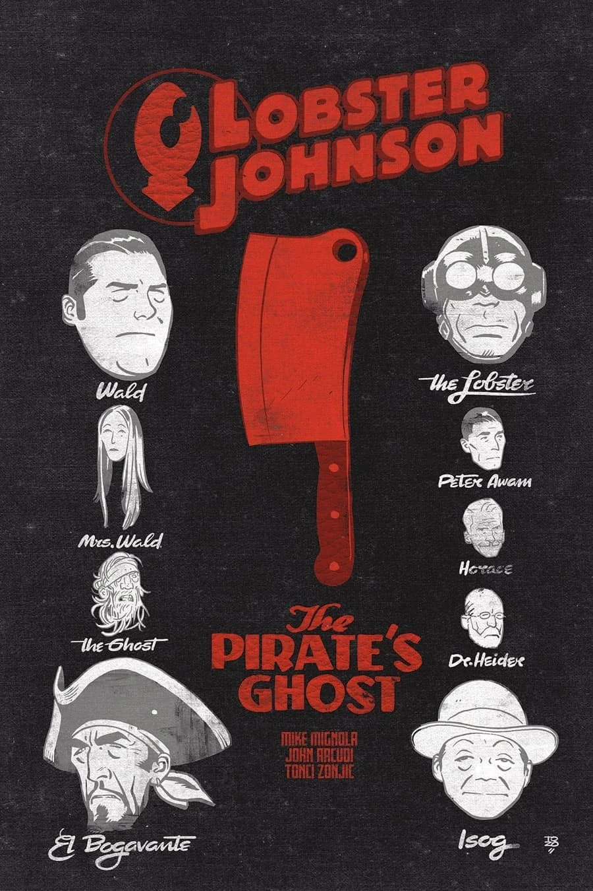
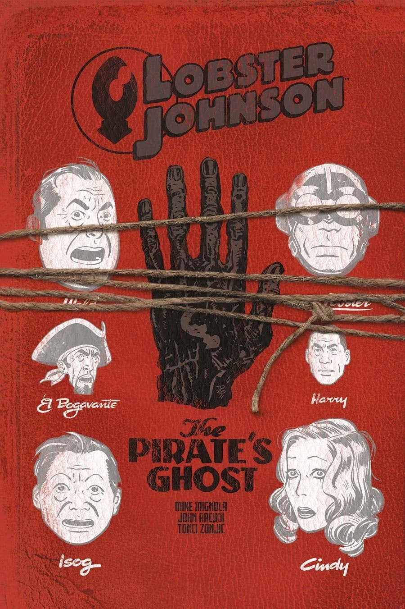

《**海盗魂**》（The Pirate's Ghost）是一个故事，发生在 1930 年代[龙虾人](/entry/The_Lobster)作为犯罪斗士生涯的中期。

## 出版历史

这部三期限定短篇连载于 2017 年 3 月至 5 月出版。Tonci Zonjic 亲自为该系列上色。

## 剧情简介

### 第一部

一艘幽灵海盗船出现在哈德逊河上，纽约港巡逻队对此力不从心，而龙虾人对一位黑帮大头目的追捕可能与此事有所关联。

### 第二部

龙虾人搜寻一名失踪记者与一艘幽灵海盗船出现之间的联系。

### 第三部

龙虾人对失踪记者的搜寻在一艘海盗船上迎来爆炸性的结局。

## 画廊

|第 #2 期

|第 #3 期
