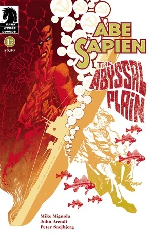
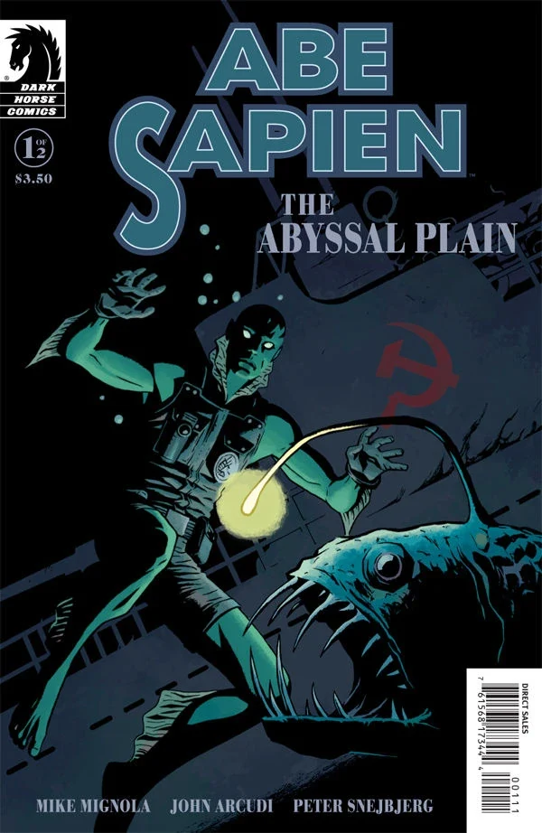
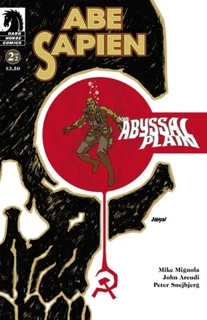

《**深海平原**》（The Abyssal Plain）是一部两期的《[亚伯·塞皮恩](/entry/Abe_Sapien_%28series%29)》限定迷你系列，由 [Mike Mignola](/entry/Mike_Mignola) 与 [John Arcudi](/entry/John_Arcudi) 编剧，[Peter Snejbjerg](/entry/Peter_Snejbjerg) 作画。

## 出版历史

《亚伯·塞皮恩：深海平原》（Abe Sapien: The Abyssal Plain）于 2010 年 6 月和 7 月作为两期限定迷你系列出版。第一期配有两款封面：一款由 [Dave Johnson](/entry/Dave_Johnson) 绘制，另一款由 [Peter Snejbjerg](/entry/Peter_Snejbjerg) 与 [Dave Stewart](/entry/Dave_Stewart) 合作的变体封面。本故事与《[闹鬼男孩](/entry/The_Haunted_Boy)》以及《[恶魔不说笑](/entry/The_Devil_Does_Not_Jest)》一同收入合订本《[亚伯·塞皮恩——第 2 卷：恶魔不说笑及其他故事](/entry/Trade_Collections)》。

## 剧情简介

### 第一部分

1948 年，一名叫[约瑟夫](/entry/Iosif_Nichayko)的苏联士兵坐在挪威海底一艘沉没的潜艇中，慢慢等待死亡的降临。他靠在一个标着"梅尔基奥雷的勃艮第盔"（Melchiorre's Burgonet）字样的箱子上，给深爱的女人写信。

多年后的 1984 年 8 月，[亚伯·塞皮恩](/entry/Abe_Sapien)和探员[萨尔·塔索](/entry/Salvatore_Tasso)乘船来到挪威海，打捞"梅尔基奥雷的勃艮第盔"。亚伯讲述了这件器物的来历：

教皇克莱门特七世在位期间，乌戈·梅尔基奥雷（Ugo Melchiorre）以上尉之职为他效力。在摩德纳战役中，梅尔基奥雷设法把必败之战扭转为胜利。尽管他身受重伤，却不需要人搀扶就自行走下了战场。然而人们刚摘下他的头盔，他便咽了气。

第二次世界大战期间，这顶勃艮第盔落在纳粹手中。战后的 1946 年，苏联特殊科学局拿走了这件圣物。1948 年，勃艮第盔被装上一艘潜艇，准备送往一位俄国神秘学者处接受研究，但潜艇始终没有抵达。

亚伯潜到沉船处，带着勃艮第盔返回。探查沉船时，惊扰亡者让亚伯心中五味杂陈。回到船上后，亚伯说他打算把头盔交给[奥唐奈教授](/entry/Professor_James_Henry_O%27Donnell)进行分析。

船长和亚伯就是否打捞沉船发生争执。亚伯希望让潜艇安息，以纪念死者；船长则需要钱，想看看船上是否还留有值钱的东西。争执还没有结果，一具被水泡胀的僵尸就爬上了甲板。

### 第二部分

这一期在苏联士兵约瑟夫的闪回场景与船上的亚伯·塞皮恩之间交替展开。

在当下，一艘苏联巡洋舰正驶往潜艇沉没地点。一名叫瓦西里（Vasily）的苏联特殊科学局探员正与上级讨论他们的任务。瓦西里告诉他，自己之所以志愿加入特殊科学局，是想重新体验那种恐惧——小时候他见过一个鬼魂，他想获得直面这种恐惧的经历。

与此同时，塔索探员向僵尸开枪，但它毫不在意，继续走着，也没有伤害他们。亚伯意识到这具僵尸正是守在勃艮第盔旁的那个男人，于是决定观察它。

僵尸站在如今存放勃艮第盔的保险箱前，仍然没有对他们采取任何行动。亚伯仍想继续等待观察，船长却想毁掉它。突然，他们接到消息：一艘苏联巡洋舰正在逼近。

一段闪回中，我们得知约瑟夫曾在特殊科学局工作，而且尽管他深爱着妻子，对待职责却极为认真。他被带去与[瓦尔瓦拉](/entry/Varvara)谈话。瓦尔瓦拉告诉他，接下来五周他要护送一个板条箱。他抗议说这样会错过妻子的生日，但她坚持要他去。

回到当下，苏联巡洋舰逼近的消息结束了亚伯与船长的争执。船长准备启航。仍在观察僵尸的亚伯意识到，它一复活便恢复了守卫勃艮第盔的职责。他走上前，替它打开了保险箱。

另一段闪回中，约瑟夫告诉妻子他必须去履行职责，但发誓一定会回到波琳娜（Polina）身边，再也不离开。

随着俄国人逼近沉船，亚伯和塔索驾船离去。塔索说，勃艮第盔要落到他们手里真是可惜。亚伯回答说，他已经用无线电联系了梵蒂冈，他们会向克里姆林宫施压，迫使其交出勃艮第盔。就在他们说话时，我们看到瓦西里兴高采烈地朝沉船潜去——逼近的是僵尸约瑟夫，他蜷缩在勃艮第盔周围，摆出保护的姿态守卫着它。

## 故事时间线

潜艇于 1948 年春沉没。主线故事发生在 1984 年 8 月。

## 画廊

除特别注明外，封面均由 [Dave Johnson](/entry/Dave_Johnson) 绘制。

 \#1

 \#1 变体封面
作者 [Peter Snejbjerg](/entry/Peter_Snejbjerg)

 \#2
