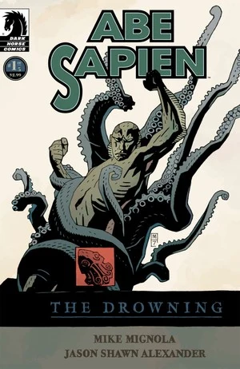
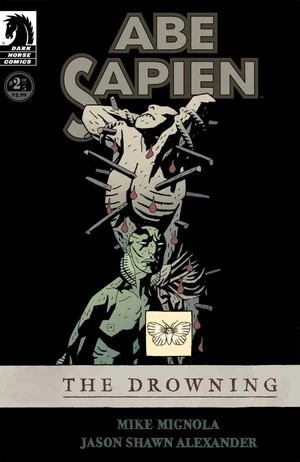
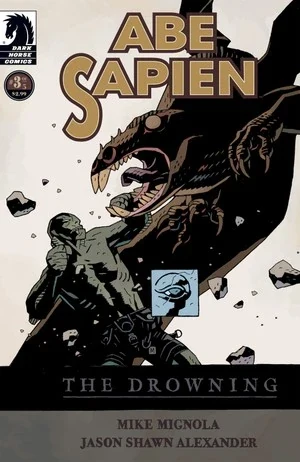
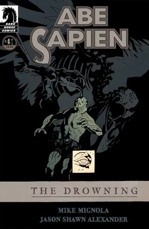
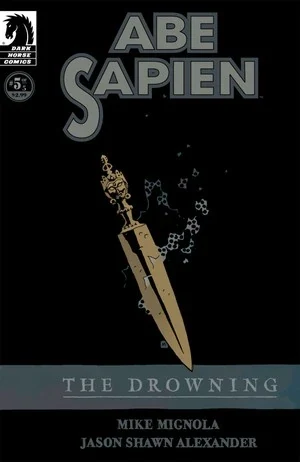

《**溺亡**》（The Drowning）是[亚伯·塞皮恩](/entry/Abe_Sapien_%28series%29)的第一部独立迷你系列，故事背景设定在 20 世纪 80 年代初。

## 出版历史

《Abe Sapien: The Drowning》于 2008 年 2 月至 6 月作为五期迷你系列出版。故事收录于 2008 年 9 月出版的合订本[《*Abe Sapien – Volume 1: The Drowning*》](/entry/Trade_Collections)中。

## 剧情简介

### 第一部分

一个世纪前，超自然调查者[爱德华·格雷](/entry/Edward_Grey)在[圣塞巴斯蒂安岛](/entry/Saint-S%C4%93bastien)附近海域与一个强大的术士交战，并将其消灭。20 世纪 80 年代初，[B.P.R.D.](/entry/Bureau_for_Paranormal_Research_and_Defense)最新入队的探员奉命取回术士的遗骸。然而，面对挡在面前的超自然力量，亚伯·塞皮恩准备得远远不够。

### 第二部分

超自然力量向[圣塞巴斯蒂安岛](/entry/Saint-S%C4%93bastien)汇聚，[亚伯](/entry/Abraham_Sapien)发现自己孤身一人，对抗着一个沉睡百年的邪恶存在。

### 第三部分

同伴全部罹难，圣塞巴斯蒂安岛被梦魇般的事物吞没，亚伯一边拼尽全力求生，一边奋力杀向风暴之眼——以及藏身其中的怪物。

### 第四部分

随着亚伯愈发深入这座岛屿的谜团、深入那段与人类文明史同样漫长的邪恶遗产，圣塞巴斯蒂安岛可怕的秘密终于浮出水面。

### 第五部分

在他第一部独立迷你系列这一惊心动魄的终章中，亚伯与数个世纪以来一直庇护着圣塞巴斯蒂安岛的那股力量正面相对。

## 画廊

 \#1

 \#2

 \#3

 \#4

 \#5
