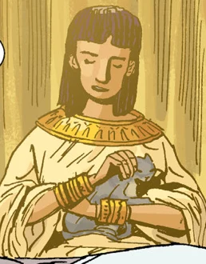
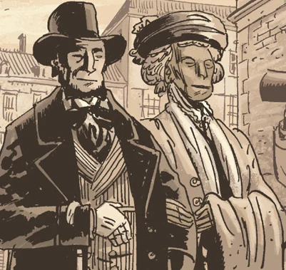
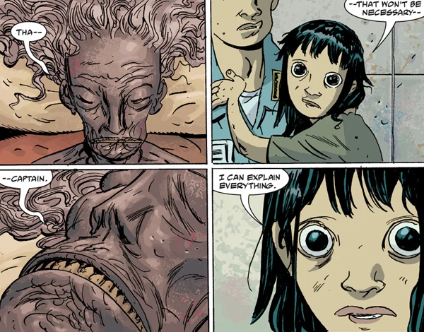
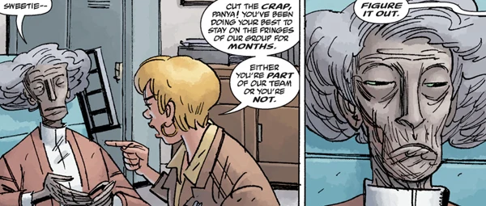

**潘雅（Panya）**是一位古埃及人。1859 年 11 月，她被制成木乃伊的身体被拆开缠裹布时，人们发现她仍然活着。她成为维多利亚社会的名人，之后遭到绑架，被[奥安尼斯学会](/entry/Oannes_Society)囚禁，直到 2006 年 8 月被[超自然调查防御署（B.P.R.D.）](/entry/B.P.R.D.)救出。她的动机往往令人捉摸不透。

## 传记

### 早年生活

 潘雅去世并被制成木乃伊之前的生活，人们知之甚少。在与[丽兹·舍曼](/entry/Liz_Sherman)的一次交谈中，她提到自己的第一只宠物——一只名叫 Olabisi 的猫，还有她的父亲 Meryra——他近来在梦中以阿肯那顿的形象出现；但她没有再谈及其他家人或去世前的生活。

### 苏醒

维多利亚时代的英格兰，埃及热正盛，流行着诸如"木乃伊拆布派对"之类的活动。潘雅就是这样一场派对的主角：拆布拆到一半时，她猛然睁开双眼，被发现仍然活着。降生到一个全新的世界，她孤立无援。[赫利奥波斯拉神兄弟会](/entry/Heliopic_Brotherhood_of_Ra)的 Glaren 勋爵将她收留，教她读书写字，教她英国社会的规矩。她成了小有名气的人物，活跃在社交聚光灯下，朋友中不乏许多重要人物。

这些人物中有一位 [Martin Gilfryd](/entry/Memnan_Saa)，一个专攻埃及学的古怪神秘学家。Gilfryd 认为潘雅掌握着某种她不肯透露的复活秘密，便开始不断骚扰她。这使兄弟会对她的社交往来更加警惕。Glaren 勋爵声称想庇护她，邀请她住进修会的庄园。

在那里，潘雅可以自由探索智识，参与了他们许多科学与超自然两方面的实验，也从不缺少陪伴。但她渐渐厌倦了被关在室内，决定出去待一段时间。Glaren 勋爵却不许她离开。

 就在那时，潘雅开始更顽强地磨练自己的灵能，直到能让庄园里所有人失去意识，趁机逃走。她通过一名信使，得以与敌对教派[奥安尼斯学会](/entry/Oannes_Society)的成员会面，对方答应帮她逃往美洲。潘雅几乎不担心要重新开始生活——她自由了。但这是学会设下的骗局。她没有被带往美洲，而是被带到印度尼西亚海岸外一座隐秘小岛。这座岛长期以来是该教派的秘密行动基地，岛上有一座巨大的庄园，还有许多杂交动物与她作伴。但真相无法回避——潘雅逃出一只笼子，却落进了另一只笼子。

然而，随着岁月流逝，潘雅的怨怼渐渐消退，他们的研究也成了不错的消遣。她慢慢衰老，身体因疏于照料而日渐衰弱，先是离不开轮椅，继而卧床不起。学会当初费尽心机得到她，并相信她是一位名叫 Naunet 的水之女神的转世，但他们并不完全信任她；他们经常在她床边焚烧鸦片制剂，以防她动用灵能作怪。她最终适应了药物的影响，却发现学会成员的意志太强，最多只能让他们剧烈头痛，无法进一步操纵他们。尽管如此，潘雅从不错过任何能给他们添堵的机会，同时一直留意寻找逃出去的路。

### 逃亡

潘雅的机会终于在 2006 年到来。她附身在一个年轻的印度尼西亚女孩身上，把奥安尼斯学会的前成员[亚伯·塞皮恩](/entry/Abe_Sapien)引到岛上的藏身处。亚伯被学会扣押期间，她通过那个女孩联系[本·达米奥](/entry/Ben_Daimio)，警告他学会的终极计划：摧毁印度尼西亚的大部分地区，把死者的灵魂捕获进由学会成员操控的巨型躯体中，每一个都将"自成一国"。

 在本和亚伯的帮助下，她成功终止了所有炸弹，并逃出了小岛。潘雅——连同岛上许多人造杂交动物——被带往 B.P.R.D. 总部接受康复安置。她被隔离起来，主要是为了她自身的安全：她已经与世界隔绝了几十年，对现代病毒和细菌毫无抵抗力。

### 在调查署的生活

她很快与[丽兹·舍曼](/entry/Liz_Sherman)亲近起来；丽兹在她卧床时给她带来水果冰沙。潘雅似乎对丽兹眼下的噩梦困扰有着不同寻常的洞察力，还请丽兹帮她弄一只小猫。

潘雅后来帮丽兹找到了 [姆姆南·萨](/entry/Memnan_Saa)：丽兹、[凯特·考瑞根](/entry/Kate_Corrigan)与约翰举行降神会，召唤[大螯虾强生](/entry/Lobster_Johnson)的幽灵。一阵卡片纷纷贴上墙壁，拼出"MARTIN GILFRYD"这个名字。正是潘雅意识到，她过去认识的那个人，就是如今折磨丽兹的同一个人。随后她顺着丽兹心智中的联结回溯到 Gilfryd 的心智，想找出姆姆南·萨的藏身处。在被他亲手驱逐之前，她成功锁定了他的位置。

[约翰·克劳斯](/entry/Johann_Kraus)也看中了她的能力，问她是不是能找到任何人。潘雅准确地猜到，他是想让她帮忙追踪本·达米奥——本此前曾陷入一场杀戮狂潮，约翰的第二具身体（从奥安尼斯学会收回的那具）就是受害者之一。片刻后约翰怒气冲冲地拂袖而去，说明潘雅拒绝了帮忙。

丽兹被 Gilfryd 绑架后，B.P.R.D. 出动营救，潘雅留在后方。此时她已经能下床并使用轮椅。除了她的猫，她还得到一只岛上的鸟猴杂交生物。潘雅声称它一定是自己逃出来的，但剧情暗示是潘雅想办法亲手放了它。无论如何，这只杂交动物几乎成了她形影不离的伙伴。

这时，潘雅反复断言丽兹不会回到调查署，即便在丽兹获救之后也是如此。最终事实证明潘雅是对的——丽兹被救了出来，但此后不久便失踪，从未真正回到总部。

### *《BPRD：人间地狱》*

潘雅在调查署继续发挥作用，体力也逐渐恢复；她的状态还不足以担任外勤探员，但可以承担监控值班，留意新的事态。

 这段时间，没有丽兹做伴，她换了新的消遣方式：捉弄约翰·克劳斯。两人关系时好时坏，有时甚至是公开的敌对，需要凯特出面调解。约翰执迷于让从奥安尼斯学会收回的那具闲置身体重新活动，当他以为身体自己动了一下时，这一希望更是被煽得火热。实际上，那是潘雅在操纵那团尚未发育完全的血肉。她还嘲笑说，他所谓的做梦不过是一时走神罢了。

[菲尼克斯·埃斯佩霍](/entry/Fenix)加入调查署后，潘雅受命监督她的训练。但第一堂课上，菲尼克斯看到一个可能未来的恐怖幻象后陷入恐慌，指责潘雅想操纵她，随后逃走。

### 当前状态

潘雅仍在 B.P.R.D.，预计还会待上一段时间。她将对菲尼克斯的训练施加直接影响。在丽兹的一个幻象中，一张照片里的她穿着套装、行动自如，可能暗示未来她的身体机能会进一步恢复，并成为一名外勤探员。

## 能力

不知是天生还是后天习得，但无论如何，潘雅拥有强大的灵能。她能从数十英里外控制一个女孩的心智、借她之口说话，也能进入姆姆南·萨的心智，锁定他的藏身处。

她还准确地判断出，丽兹从姆姆南·萨手中获救后不会回到调查署总部；她是否拥有预言未来的能力，这一点尚未被充分展开。

她的能力极限究竟在哪里、能如何运用，目前仍无定论。

## 关系

### 盟友

- [丽兹·舍曼：](/entry/Liz_Sherman)一名念焰者，这位阴郁寡言的女人拥有创造和操控火焰的灵能。丽兹与潘雅关系亲密，曾向潘雅坦白自己从姆姆南·萨那里看到的幻象。
- [亚伯·塞皮恩](/entry/Abe_Sapien)：一个对自己的过去毫无记忆的两栖人。亚伯是救出潘雅的人，但除此之外两人再无交集；这究竟是因为亚伯公务繁忙，还是因为他想把自己作为 Langdon Caul 的过去抛在身后，尚无定论。
- [凯特·考瑞根](/entry/Kate_Corrigan)：特殊人才小队的外勤主管。凯特与潘雅相处融洽，不过事实证明凯特不会受潘雅操纵，这令潘雅颇为失望。
- [约翰·克劳斯](/entry/Johann_Kraus)：克劳斯是一位德国灵媒，身体被毁，但灵体外质形态留存下来。虽然没有公开敌对，但潘雅毫不掩饰自己认为约翰是个蠢货，而且似乎以捉弄他为乐。
- [安德鲁·德文](/entry/Andrew_Devon)：新近加入调查署的成员，曾是学者。与潘雅关系似乎不错，但对她有些紧张。
- [菲尼克斯·埃斯佩霍](/entry/Fenix)：拥有预言能力的少女。潘雅被指派给菲尼克斯，试图训练她驾驭自己的力量。

### 敌人

- [奥安尼斯学会](/entry/Oannes_Society)：一个信奉海洋之力的维多利亚时代教派。潘雅被他们囚禁了一百多年，他们难辞其咎。
- [姆姆南·萨](/entry/Memnan_Saa)：前身是 Martin Gilfryd，维多利亚时代的神秘学家，在他成为姆姆南·萨之前潘雅就知道他。
