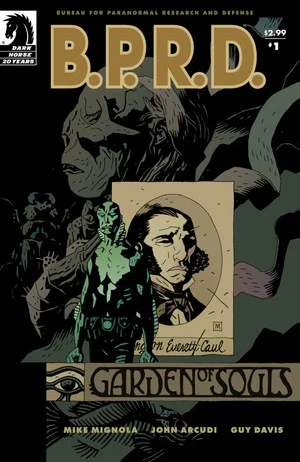
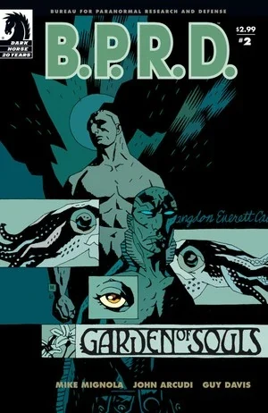
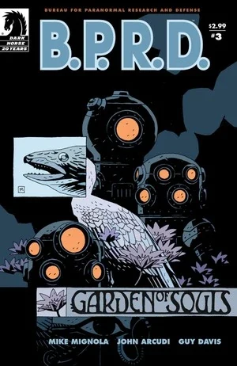
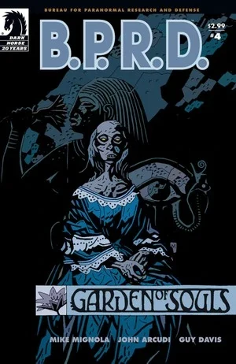

在《**灵魂花园**》（Garden of Souls）中，[亚伯·塞皮恩](/entry/Abraham_Sapien)循着一条离奇线索深入印度尼西亚丛林，找到一个与他美国内战时期前生有所牵连的秘密社团。与此同时，[丽兹](/entry/Liz_Sherman)的末日幻象开始不断升级，[约翰](/entry/Johann_Kraus)则对[调查防御署](/entry/Bureau_for_Paranormal_Research_and_Defense)的一名成员有了惊人的发现。

## 出版历史

这部五期迷你系列于 2007 年 3 月至 7 月出版。故事于 2008 年 1 月收录进平装合订本《[B.P.R.D.: Garden of Souls](/entry/Trade_Collections)》。

## 剧情梗概

### 第一部分

亚伯·塞皮恩的过去找上了门，把 B.P.R.D. 带到南中国海，并深入印度尼西亚的丛林。

### 第二部分

亚伯·塞皮恩的调查让他逐渐接近丛林中的一处营地，那里住着一群与他自身过去有着离奇关联的半机械人。与此同时，在新 B.P.R.D. 总部的地下室里，约翰对团队中的一名成员有了惊人发现，而丽兹看到了世界末日的幻象。

### 第三部分

[达米奥](/entry/Ben_Daimio)拼命搜寻亚伯期间，发现了一个可能撼动大地根基的阴谋。另一边，亚伯与来自过去的故人重逢，气氛却急转直下——他坦言自己几乎不记得身为兰登·考尔（Langdon Caul）的前生。回到 B.P.R.D. 总部，约翰、[凯特](/entry/Kate_Corrigan)和丽兹讨论达米奥那段隐秘过往所意味着什么。

### 第四部分

亚伯了解到另一位维多利亚时代离奇幸存者的来历，并揭开昔日同袍毁天灭地的阴谋；与此同时，达米奥和一个小女孩争分夺秒，试图阻止地球上所有生命的终结。

### 第五部分

印度尼西亚的事态走向高潮，亚伯和达米奥争分夺秒，要阻止亚伯过去那些离奇人物的末日计划。

## 内容

### 角色

#### [B.P.R.D.](/entry/Bureau_for_Paranormal_Research_and_Defense)

- [亚伯拉罕·塞皮恩 / 兰登·考尔](/entry/Abraham_Sapien)
- [伊丽莎白·舍曼](/entry/Elizabeth_Sherman)
- [本雅明·达米奥](/entry/Benjamin_Daimio)
- [约翰·克劳斯](/entry/Johann_Kraus)
- [凯瑟琳·考瑞根](/entry/%E5%87%AF%E7%89%B9%C2%B7%E8%80%83%E7%91%9E%E6%A0%B9))
- [汤姆·曼宁](/entry/Thomas_Manning)（照片）
- 其他探员与工作人员

#### 其他

- [姆姆南·萨 / Martin Gilfryd](/entry/Memnan_Saa)
- [潘雅](/entry/Panya_%28character%29)
- [拉神赫利奥皮斯兄弟会](/entry/Heliopic_Brotherhood_of_Ra)
  - [亚当·格拉伦](/entry/Adam_Glaren)（闪回）
- [奥安尼斯学会](/entry/Oannes_Society)
  - Edward Musgrove Sundborne
  - McWhirter
  - Philip Ensner
  - Dameron
  - 变异动物
- Daniel Puan
- [雄钦](/entry/Shonchin)（闪回）
- 「Chinaman」
- [能剧猴](/entry/Noh_monkey)
- 达米奥的玻利维亚任务士兵们（梦境）
- [京特·艾斯](/entry/Gunter_Eiss)（仅被提及）
- Edith Howard（照片）
- Lastri
- B.P.R.D. 档案
  - [基里亚科斯·加拉加斯](/entry/Kyriakos_Gallaragas)（照片）
  - [拉伊蒙德·迪斯特尔](/entry/Raimund_Diestel)（[黑焰](/entry/The_Black_Flame_%28character%29)）（照片）
  - [由美子·达米奥（绯红莲花）](/entry/Yumiko_Daimio)（照片）
  - [鲁道夫·卑尔根（钢鹰）](/entry/Rudolf_Bergen)（照片）
  - Rickard Mott（Geist）（照片）[1]
- [奥格德鲁·赫姆](/entry/Ogdru_Hem)（幻象）
- [蛙怪](/entry/Frog_monster)（幻象）
- 巴厘巴板（Balikpapan）警方
- [水灵](/entry/Water_Spirit)（闪回）

### 地点

- 英格兰
  - Minbrough 勋爵的 Baywater 宅邸（伦敦）（闪回）
- 美国
  - [B.P.R.D.](/entry/Bureau_for_Paranormal_Research_and_Defense) 总部（科罗拉多州）
  - St. Trinian 医院（华盛顿特区）（闪回）
    - [奥安尼斯学会](/entry/Oannes_Society)集会地（闪回）
- 印度尼西亚
  - 巴厘巴板（Balikpapan）
  - [奥安尼斯学会](/entry/Oannes_Society)的岛屿 / 宅邸

### 重要器物

- [罗杰](/entry/Roger)之墓（以「Archie Stanton」之名安葬）
- [重锤装甲](/entry/Vril_Energy_Suit)头盔（普罗米修斯型号）（照片）
- [大螯虾](/entry/The_Lobster)的名片
- [奥安尼斯学会](/entry/Oannes_Society)
  - 机械躯体
  - 生物躯体
  - 炸弹
  - 潜水服
  - 潜艇

## 花絮

- 第 2 章中，约翰办公桌后的画作是艺术家 Pierre Puvis de Chavannes 的 *[The Dream: "In his sleep he Saw Love, Glory and Wealth Appear to Him"](https://www.wikiart.org/en/pierre-puvis-de-chavannes/the-dream-in-his-sleep-he-saw-love-glory-and-wealth-appear-to-him-1883)*。
- 第 3 章中，Dameron 唱的歌是 Charles K. Harris 的 [After the Ball](https://www.youtube.com/watch?v=zIXGlQdTDKY)。
- [奥安尼斯学会](/entry/Oannes_Society)成员称潘雅为 [Naunet](https://en.wikipedia.org/wiki/Nu_(mythology))，即代表海洋的埃及原初女神。

## 画廊

 \#1

 \#2

 \#3

 \#4

 \#5

## 注释

<references/>

[1] 根据速写本
