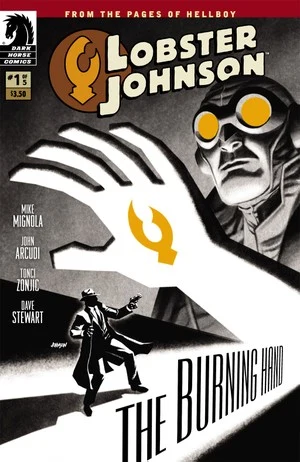
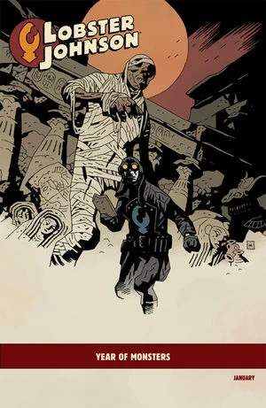
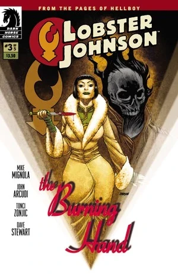
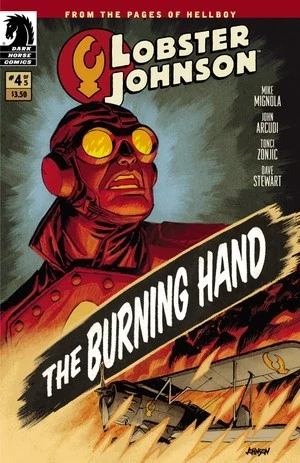
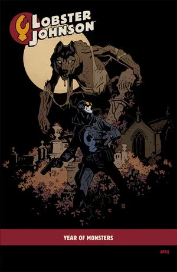
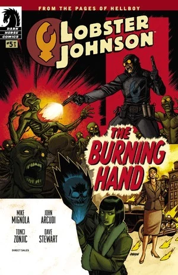

《**炽热虾螯**》（The Burning Hand）是一部五期限定短篇连载，故事发生在 1932 年[龙虾人](/entry/The_Lobster)生涯的早期。

## 出版历史

该限定连载于 2012 年 1 月至 5 月出版。该系列封面由 Dave Johnson 绘制，#1 期和 #4 期另有"[怪物之年](/entry/Year_of_Monsters)"变体封面，由 [Mike Mignola](/entry/Mike_Mignola) 绘制。

## 剧情简介

### 第一部

当一个幽灵印第安部落开始割取警察的头皮时，地狱男爵的打击犯罪英雄龙虾·约翰逊（Lobster Johnson）与他的盟友们登场，迎战这些敌人及其黑帮同伙！

### 第二部

随着城市里充斥着额头被烙上螯爪印记的黑帮分子尸体，黑帮头目[阿尼·瓦尔德](/entry/Arnie_Wald)求助于一名致命的神秘主义者和她古怪的搭档，以除掉这位被称为[龙虾·约翰逊](/entry/Lobster_Johnson)的义警。

### 第三部

一股烈焰威胁正将城市化为一片炼狱，唯有龙虾·约翰逊和他的犯罪斗士联盟能够终结这些超自然恐怖。

### 第四部

当死去的黑帮分子血染他秘密藏身处的地板时，犯罪斗士龙虾·约翰逊与一个强大的德国不死生物——[黑焰](/entry/the_Black_Flame_%28character%29)——正面对决。

### 第五部

为了逼近贪婪的黑帮头目[阿尼·瓦尔德](/entry/Arnie_Wald)，龙虾·约翰逊一路轰杀穿过一支疯狂的下水道食人族大军。

## 画廊

除另有说明外，封面均由 [Dave Johnson](/entry/Dave_Johnson) 绘制。

 #1

 #1 "[怪物之年](/entry/Year_of_Monsters)"变体封面
作者 [Mike Mignola](/entry/Mike_Mignola)

 #2

 #3

 #4

 #4 "[怪物之年](/entry/Year_of_Monsters)"变体封面
作者 [Mike Mignola](/entry/Mike_Mignola)

 #5
