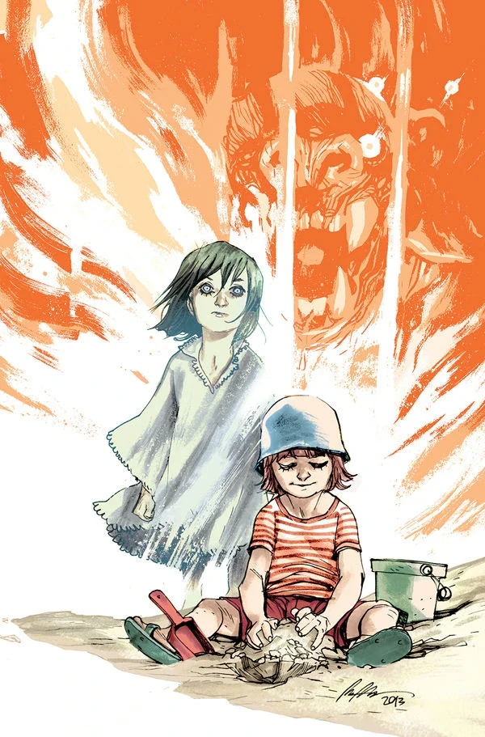
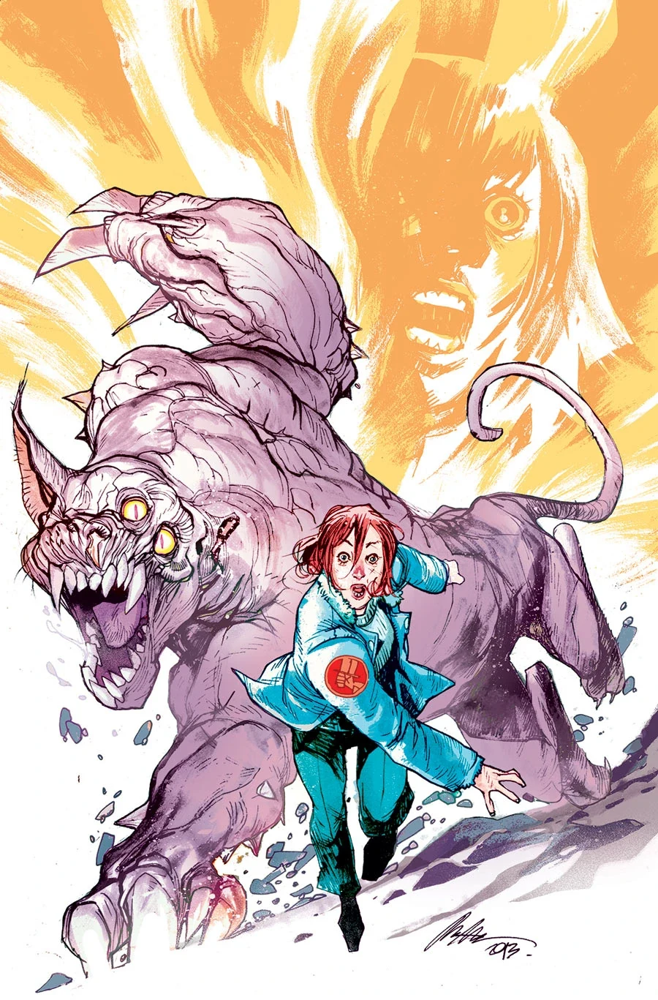
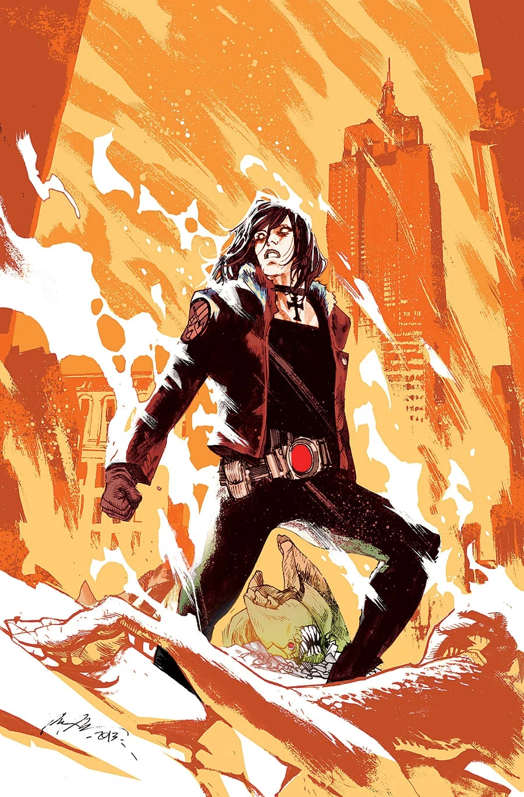
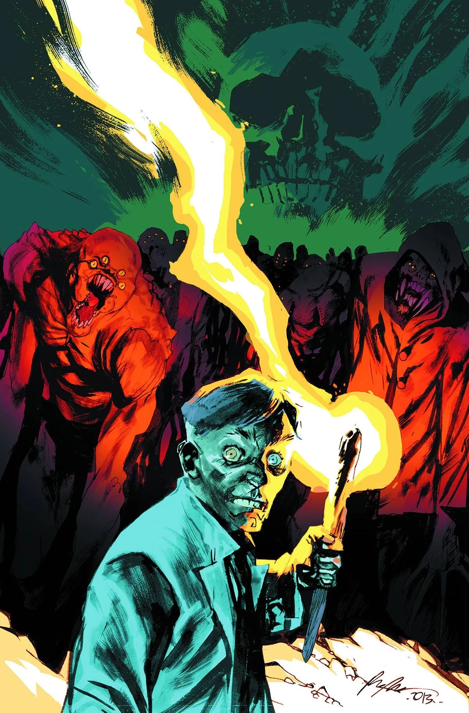

***《烈焰之湖》（Lake of Fire）**是一部五期迷你系列，自 2013 年 8 月起出版，封面由 [Rafael Albuquerque](/entry/Rafael_Albuquerque) 绘制。

## 剧情梗概

### 第一部分

丽兹·舍曼在犹他州一家医院里为求生而奋战，B.P.R.D. 则派出一支侦察小队进入曾是纽约市的无人区；年轻灵媒菲尼克斯在索尔顿湖遭遇了一个崇拜怪物的教团。

### 第二部分

年轻灵媒菲尼克斯偶然撞见一个怪物崇拜版的火人节（Burning Man），而丽兹·舍曼发现自己困在一座被毁的医院中，不得不面对一个疯狂医生及其怪物般大小的变异巨猫！

### 第三部分

丽兹逃出怪物充斥的医院之际，良知涌了上来——她想起了所有被她抛下、任疯医生宰割的人。她必须回去救他们，可在失去力量的情况下她又能做什么？她还能重新找回火焰吗？

### 第四部分

丽兹与一支警察小队伏击疯医生和他那些莫罗博士（Moreau）式的实验品，菲尼克斯则迎战一群邪教徒，并杀死了他们的神！

### 第五部分

丽兹·舍曼向疯医生的医院及其变异怪物大军发动烈火攻势，与此同时，B.P.R.D. 计划对已落入黑焰控制的曼哈顿发动偷袭。

## 画廊

