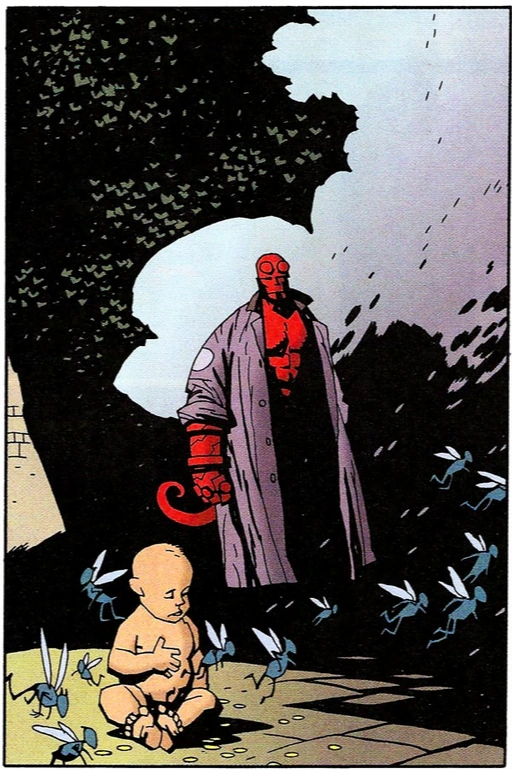
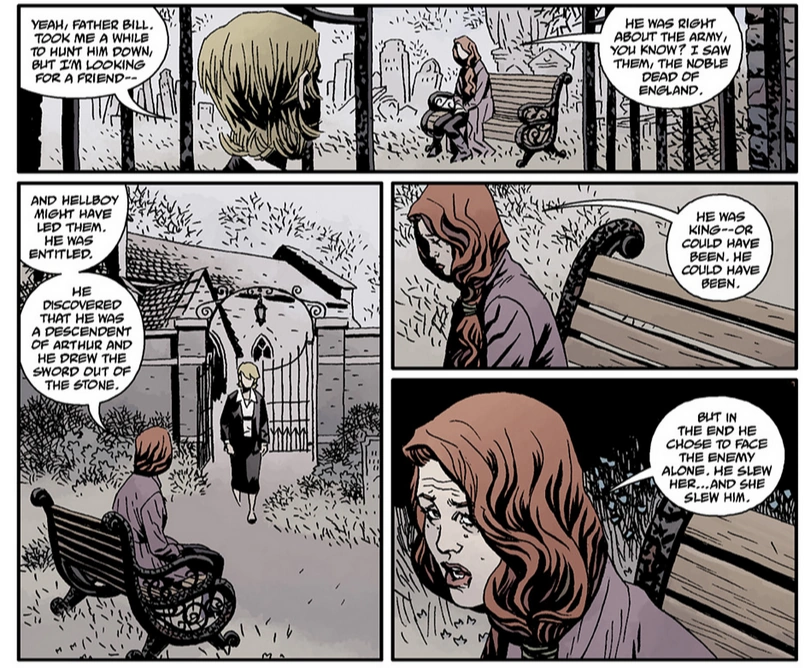
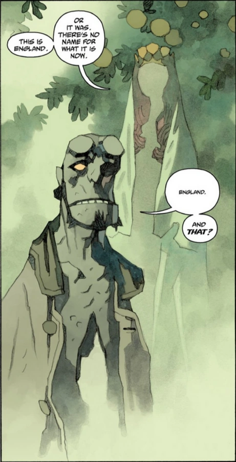
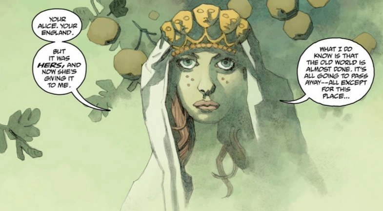
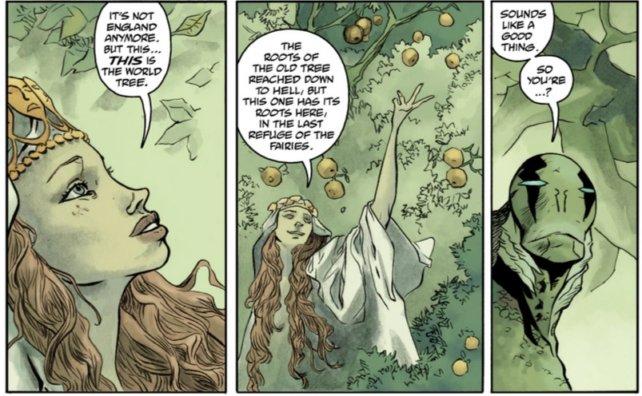
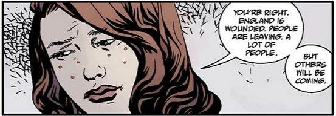
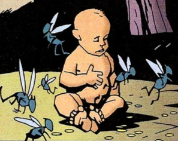

**爱丽丝·莫纳汉（Alice Monaghan）**是一位爱尔兰血统的女子，地狱男爵在她还是婴儿时将她救出。

## 历史

 爱丽丝还是婴儿时，仙子用一个换生灵把她掉包，把她当作自己的孩子养大，因为他们已经无法生育。[1] 为了救她，[地狱男爵](/entry/Hellboy)必须把一具尸体运到合适的墓地安葬，并除掉最后一个弗莫尔人。然而即便被送回之后，她仍能看见仙子；她说，仙子们再也没有像从前那样试图把她带走。她母亲发现这一点后，出于对她安全的担忧，把她送去上学。父母双双过世后，她终于回到家中居住，基本不再受到打扰。尽管已五十出头，爱丽丝看起来却异常年轻——她把这一点归因于与仙子相处了太长时间。[2]

被地狱男爵救出多年之后，他回到英格兰，两人重逢，她也被卷入他与 Nimue 的争斗。[3] 历经数次冒险与波折，爱丽丝协助地狱男爵击败了 Nimue，并在他离世时陪在他身边。[4] [Mab 女王](/entry/Queen_Mab)被[Nimue](/entry/Nimue)杀害后，这位老仙女王的灵魂把王冠传给了爱丽丝——这位生于仙灵与人类之间的人类。 [凯特](/entry/%E5%87%AF%E7%89%B9%C2%B7%E8%80%83%E7%91%9E%E6%A0%B9)在追查[比尔神父](/entry/Father_Bill)的下落、并在当地查到一些关于地狱男爵的线索时，于英格兰见到了爱丽丝。她们聊了一阵，爱丽丝一边向凯特讲述地狱男爵的遭遇、他的血如何为英格兰施洗，一边给她看两人交谈时在面前生长出的百合。满心困惑、为朋友哀伤的凯特突然接到[布鲁诺·卡尔胡](/entry/Bruno_Karhu)的电话，但她回头时，爱丽丝已经消失，她们所在的墓园开满了爱丽丝刚才给她看的百合。[5]

爱丽丝在英格兰一处美丽的仙境中出现在[亚伯·塞皮恩](/entry/Abraham_Sapien)面前，解释说她已接过守护者的职责，照料逃离世界末日的最后一批仙子难民，好让旧世界的一部分延续下去。亚伯想留下来逃避自己的宿命与痛苦，但爱丽丝告诉他不能留下，鼓励他不要再逃避，说他必须在即将到来的新世界中完成自己的宿命。[6]

在[《冥府猎犬》（The Hounds of Pluto）](/entry/The_Hounds_of_Pluto)中，她还在地狱男爵的梦境里与他短暂交谈，那是一组水彩画页，背景正是同样的英格兰仙境。两人的对话短暂而惆怅：爱丽丝知道地狱男爵想与她一起留在这个美丽的梦里，她也希望他能留下，但她知道他不能。

爱丽丝与最后的 [Daoine Sidhe](/entry/Daoine_Sidhe) 一同注视着外面的世界，以及为人类灵魂而展开的最后一战的到来。经历这一切，她仍期盼着地狱男爵和朋友们归来，可悲的是一切都太迟了，正如一个仙子所说："我想他们不会回来了。"[7] 一段时间之后，地狱男爵已经离世，地球被[奥格德鲁·赫姆](/entry/Ogdru_Hem)肆虐，[爱德华·格雷爵士](/entry/Edward_Grey)在地狱完成了所有必须完成的工作，并请[科舍伊](/entry/Koshchei_%28character%29)（Koschei）照看被地狱男爵重塑的新地狱；他本准备以阿刻戎河（[Acheron](/entry/Acheron_%28river%29)）的身份与地狱诸河一同离去，却被一条会说话的蛇给予再回英格兰一次的机会——蛇把他带到英格兰，迎接他的是爱丽丝。她请格雷担任英格兰的守护者，让他在被需要之前先安心休息，同时让他与自己[失去的爱人](/entry/Mary_Wolf)重聚。[8]

## 其他媒体登场

### [*《地狱男爵》*（2019 年电影）](/entry/Hellboy_(2019_film))

在 2019 年重启版中，爱丽丝由演员 Sasha Lane 饰演。

## 画廊

 

 

## 参考资料

[1] [The Corpse](/entry/The_Corpse)

[2] [The Wild Hunt](/entry/The_Wild_Hunt)

[3]

[4] [The Fury](/entry/The_Fury)

[5] [An Unmarked Grave](/entry/An_Unmarked_Grave)

[6] [The Garden (III)](/entry/The_Garden_%28III%29)

[7] [Ragna Rok](/entry/Ragna_Rok_%28story_arc%29)

[8] [Koshchei in Hell](/entry/Koshchei_in_Hell)
