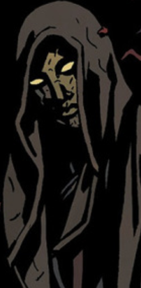

**爱德华·格雷（Edward Grey）**是 19 世纪的一名超自然调查员。在被拖入地狱并被赐予永生的诅咒之后，他一直活到现代，不仅获得了秘术力量，还洞悉了围绕[地狱男爵](/entry/Hellboy)命运的种种事件。人们常看到他与[达格达](/entry/Dagda)为伴，偶尔则与[雅加婆婆](/entry/Baba_Yaga_%28character%29)或[莫赫洛米](/entry/Mohlomi)同行。他已多次表现出对地狱男爵的信任，以及对其拒斥所谓"命运"之举的信心。

## 历史

### 早年

爱德华·格雷于 1856 年 9 月 16 日出生在英格兰西萨塞克斯。他的童年在罗伯特·黑斯廷斯勋爵的庄园度过，父亲在那里担任猎场看守。1869 年春天，格雷年满十二岁时，黑斯廷斯牛群中的若干头母牛被发现残杀在树林里。不久又有三个孩子失踪，当地男人纷纷组成搜寻队。格雷怀疑凶手并非寻常野兽，一路追踪那头掠食者，找到了它在黑斯廷斯家族墓穴中的巢穴。那怪物竟是黑斯廷斯的一个儿子——他显然是在巴黎上学时染上了狼人诅咒。此前他一直在秘密吞食家族墓穴中的尸体，直到无法控制的冲动驱使他开始猎杀牛群和孩童。格雷与狼人搏斗，用一颗经当地牧师祝圣的子弹杀死了它。

黑斯廷斯勋爵从未试图掩盖儿子的所作所为，并在当地牧师的监督下把儿子的尸体烧成灰烬。为报答格雷，黑斯廷斯慷慨地为他延医治疗，还让当地牧师确认这孩子没有遗传到狼人诅咒。格雷与黑斯廷斯之间结下了深厚的情谊，黑斯廷斯的仁慈与高尚令格雷深深敬佩。格雷很快成了西萨塞克斯小有名气的人物，据说他有过多次遭遇超自然现象的经历。

### 猎巫人

1876 年，黑斯廷斯推荐格雷去调查伦敦塔闹鬼的传闻。格雷前往伦敦，与一头被认为是杰弗里斯勋爵鬼魂的熊状怪物对峙。格雷对付那怪物的具体细节已不得而知，但此后那里再没有出现过任何骚乱。格雷很快声名鹊起，赢得了公众——也不可避免地赢得了王室——的瞩目。维多利亚女王本人希望格雷留任，做王室处理秘术事务的特别探员。格雷接受了女王的委任。

1879 年 2 月，格雷挫败了一个女巫团谋杀女王的阴谋。他及时阻止了她们，次月便因"在保护王权与国家方面的特殊贡献"被封为爵士。同年晚些时候，他调查了桑德斯探险队成员接连离奇死亡的事件——他们死于一种诡异[生物](/entry/Servants_of_the_Left_Hand)之手。调查期间，他找到了盟友：一个自称"[船长](/entry/Captain)"的男人，以及灵媒[玛丽·沃尔夫](/entry/Mary_Wolf)。玛丽尤其给爱德华爵士留下了难以磨灭的印象，她警告他：有一股与[阿刻戎](/entry/Acheron)河相连的命运正笼罩着他。这次调查也标志着他第一次与[拉神日轮兄弟会](/entry/Heliopic_Brotherhood_of_Ra)交手——后者同样对探险队的发现很感兴趣。兄弟会杀害了船长和玛丽，爱德华爵士为此与他们结下了终生不解的仇怨。[1]

1880 年，爱德华爵士远赴犹他州，追踪兄弟会前成员[亚当·格拉伦勋爵](/entry/Adam_Glaren)。在犹他州，他与当地牛仔[摩根·凯勒](/entry/Morgan_Kaler)及其朋友艾萨克结为好友。爱德华爵士和凯勒联手阻止了[厄里斯](/entry/Eris)——一个已在当地建立邪教的女巫。[2] 1882 年 8 月，爱德华爵士揭穿了来访的贵族吸血鬼[弗拉基米尔·朱雷斯库](/entry/Vladimir_Giurescu)企图在英格兰建立"秘密帝国"的阴谋。爱德华爵士打伤了朱雷斯库，迫使他逃回罗马尼亚。正是在这段时间，他第一次与[莫赫洛米](/entry/Mohlomi)接触——后者专程赶到英格兰，警告他提防朱雷斯库。[3]

1884 年，爱德华爵士调查了一系列与古代科技有关的失窃案，案犯是[奥尔德斯·米登加德·辛克莱](/entry/Aldous_Middengard_Sinclair)。调查中，维多利亚女王把格雷引荐给[铸造厂](/entry/Foundry_%28organization%29)，他也结识了[英国超自然学会](/entry/The_British_Paranormal_Society_%28organization%29)的成员——他们对这个案子也自有兴趣。辛克莱与兄弟会的关联还让爱德华爵士接触到了[潘雅](/entry/Panya_%28character%29)，她当时正寄住在[迈克尔·格拉伦](/entry/Michael_Glaren)勋爵府上。就在辛克莱即将在格林威治上空打开一道通往异世界的传送门时，爱德华爵士成功阻止了他，杀死了辛克莱，也毁掉了他的机器。[4] 同年晚些时候，爱德华爵士发现了荷兰术士[埃普克·弗罗曼](/entry/Epke_Vrooman)并展开追捕，最终在法国的圣塞巴斯蒂安岛附近将他杀死。[5]

1884 年至 1889 年间，爱德华·格雷爵士把注意力集中在拉神日轮兄弟会及其特许分支——银星骑士团和阿比多斯骑士团——日益诡异的活动上。1888 年，爱德华爵士协助调查了开膛手杰克连环杀人案，但他在该案中的确切角色至今仍是个谜。几个月后，由于维多利亚女王决定掩盖开膛手杰克的真实身份，爱德华爵士辞去了政府职务。他在白教堂区开设了一家独立的"秘术侦探"事务所。1889 年 2 月至 1908 年 7 月，他一直在伦敦以秘术侦探为业。1892 年，爱德华爵士把臭名昭著的女巫阿比盖尔·沃德豪斯扭送苏格兰场。1893 年 9 月普世神殿关闭之前，他一直密切监视拉神日轮兄弟会；在他们转为地下社团之后，他仍持续追踪其活动。

进入 20 世纪，爱德华爵士调查了关于兄弟会在欧洲活动的诡异传闻。1906 年 6 月 30 日通古斯大爆炸发生后，他认定这是兄弟会的一场仪式所致，随即关闭伦敦事务所，离开英格兰前往欧洲大陆。1914 年 4 月 13 日，爱德华爵士在纽约市重新露面，在那里开办了私人秘术侦探事务所。1916 年 2 月下旬，爱德华爵士听说兄弟会的分支银星骑士团正在芝加哥举行集会，便离开纽约前往芝加哥，从此杳无音信。

后来真相揭开：兄弟会当时正忙于召唤[地狱](/entry/Hell)公爵[安杜西亚斯](/entry/Amdusias)。他们已经把他部分召唤出来，这时爱德华爵士现身，将他们悉数处决。爱德华爵士成功阻止了安杜西亚斯的召唤，却被那恶魔拖回了地狱。安杜西亚斯赐下永生的诅咒，把他的身体撕成碎片，然后扔进了阿刻戎河。

爱德华爵士被一群地狱本土的无名生物发现。尽管他的外表依旧枯槁如尸，那些生物还是把他重新缝合成完整的人形。后来他偶然发现了[安格斯·威尔](/entry/Angus_Weir)的房子，便在其中住了下来，不过后来他也获得了逃离地狱的能力。栖居在屋中的威尔之灵向格雷传授魔法技艺，使他自己也成了一名出色的术士。[6]

### 现代

在他失踪近一个世纪之后，爱德华·格雷爵士以一种幽灵般的形态重现：他戴着一张毫无表情的面具，全身裹在斗篷之中，与精灵王[达格达](/entry/Dagda)和女巫[雅加婆婆](/entry/Baba_Yaga_%28character%29)为伍。

朱雷斯库事件期间，爱德华爵士、达格达和雅加婆婆旁观了地狱男爵的行动：他似乎被[赫卡特](/entry/Hecate)及其"儿子"弗拉基米尔·朱雷斯库杀死，又一度被抛出寻常世界、投入[奥古·桀哈](/entry/Ogdru_Jahad)的领域，而他们竟仍能看到这一切。在三位旁观者中，对地狱男爵拒绝担当诸神黄昏的带来者、亲手折断双角的决定，爱德华爵士似乎最不意外，也最为欣慰。爱德华爵士宣称地狱男爵的举动是"一个奇迹"，说他借此"诞下了他自己"。

后来在一次精灵聚会上，爱德华爵士再次与达格达一同出现。达格达和爱德华爵士借助一尊安放在浅水潭中的地狱男爵雕像观察着他。聚会上的几名成员——尤其是早已对地狱男爵怀恨在心的[棕精灵](/entry/Gruagach)——对地狱男爵能否违抗命运表示怀疑。爱德华爵士则一如既往往乐观处想；对于"地狱男爵的命运早已写就"的说法，他回答说，地狱男爵"正在改写它"。爱德华爵士又与众人一同看着地狱男爵从博格鲁什的魔爪中逃脱。此后不久，[乌尔戈-赫姆](/entry/Urgo-Hem)险些要了地狱男爵的命，莫赫洛米刚出手救下他，爱德华爵士便与他会面。两人讨论了此事的影响之后，莫赫洛米告诉爱德华爵士，他已准备好随他而去。

后来，爱德华爵士前去拜访失去力量、身陷囚笼的赫卡特，询问她的来历，赫卡特坦然相告。谈话中赫卡特自称是爱德华爵士的"女王"，被他断然否认。赫卡特还声称，在即将到来的魔法战争中，地狱男爵将在战斗中倒下，而爱德华爵士的命运便是去寻回他。赫卡特告诉他，地狱男爵同时会是他的拯救者与毁灭者；她还揭示，他将承受世间无人受过的痛苦，并且需要"行恶以成善"。她说这并非她给他的诅咒，而是注定要发生之事。随后她向他道别，希望他不要因将来的一切过于苛责自己；爱德华爵士一言不发地离开了她的圣所。

地狱男爵在对抗[血皇后](/entry/Queen_of_Blood)的战争末期战死后，爱德华爵士试图让雅加婆婆带他去见地狱男爵。雅加婆婆劝他任由地狱男爵接受自己的命运，但最终还是松了口，把爱德华爵士送入深渊。在那里，爱德华爵士从大群深渊生物和[厄里倪厄斯](/entry/Erinyes)手中护住地狱男爵；随后两人遭到一心复仇的[埃利戈斯](/entry/Eligos)攻击，他便带着地狱男爵瞬移离去。他布下一个法术陷阱，希望能困住并消灭很快便追上身来的埃利戈斯。爱德华把地狱男爵送走，独自与恶魔交战。

地狱男爵在深渊中迷失之后，爱德华凭魔法把他寻回。他告诉地狱男爵，他们所在的房子本属于一个背叛了主人的术士，主人们便把他的整栋宅邸拖入了地狱。那术士设下防护结界，不许任何地狱生物进入此屋；地狱男爵不禁问，那这房子又把他算作什么，爱德华回答说，他"从来不是一个简单的地狱生物"。随后爱德华向地狱男爵讲述了自己的经历，以及他如何变成如今这副模样。爱德华又告诉地狱男爵，尽管毁灭之右手仍长在他身上，他会发现世上已再没有活着的人想要这只手；他或许失去了旧日的生命，却第一次获得了真正的自由。

之后，爱德华与威尔的灵魂交谈。威尔说他对地狱男爵撒了谎，爱德华矢口否认，称"已经没有人还怀有那种利用它的野心了"。术士斥责他任由地狱男爵相信自己是自由的，而他注定还要做出更可怕的事；爱德华说，第一件可怕的事，在他把地狱男爵从深渊中拉出来时，他就已同意代他承担——地狱男爵至少该短暂地品尝一下自由的滋味。

一段时间之后，爱德华爵士前去寻找[格里高利·拉斯普廷](/entry/Grigori_Rasputin)的灵魂——他感觉到此人将成为奥古·桀哈黑暗力量的容器。他过于专注搜寻，直到为时已晚才察觉自己也正被猎杀：他在地狱深处被一头巨兽吞入腹中。在兽腹中，他遇到了许多同样试图寻找拉斯普廷的人，其中包括莫赫洛米。为了逃脱，他们同意让爱德华爵士吸收他们的力量——这也意味着要了他们的命。脱困之后，拉斯普廷出现在他面前，要求他效忠。爱德华爵士向拉斯普廷发起攻击，却被对方的力量压倒。[7]

后来他现身于地狱男爵面前，讲述了两人分别后发生的种种，并解释说与拉斯普廷对决本就是他命中注定之事。爱德华爵士还说明，人类必须转入地下才能活下去，并给出了一系列可供他们下行的坐标。

地狱男爵杀死拉斯普廷之后，爱德华爵士出现在他的鬼魂面前。当地狱男爵问这是否就是结局时，他向他展示了未来将要发生的事：奥古·桀姆终将取胜、它们短暂的统治走向终结，以及奥古·桀哈死去的尸身。爱德华爵士陪地狱男爵的鬼魂前往[奥西里斯俱乐部](/entry/Osiris_Club)所在地，解释说俱乐部成员已利用毁灭之右手吸收了巨龙的力量，如今企图把自己变成新世界的神祇。地狱男爵不许这一切成真，召唤毁灭之右手回到自己身边。随之而来的混乱中，他的灵魂与右手重聚，一举摧毁了奥西里斯俱乐部及其堡垒。[8]

### 阿刻戎

爱德华爵士在爆炸中幸存，返回地狱，前去看望仍被他的魔法囚禁的埃利戈斯。他把拉斯普廷落败的消息告诉埃利戈斯，对方却回敬说[普鲁托](/entry/Pluto)很快便会崛起——格雷的咒语在守望者赐予普鲁托的力量展示下被一一破除。尽管格雷恳求说侍奉普鲁托对他并无益处，两人还是大打出手，最后格雷以力量将两人转移到阿刻戎河畔。在那里，埃利戈斯收了手，要求格雷在杀他之前讲完自己余下的故事。格雷从命，讲述了自己种种抉择的经过，坚称绝不会允许普鲁托抹杀"地狱男爵改变地狱"这一奇迹。此时的格雷已得到阿刻戎河的力量，他压倒了埃利戈斯，并终于接受了自己不再是人类、而是地狱生物的事实。

很快，四位化身地狱诸河的存在前来迎接他：[佛勒革同](/entry/Phlegethon)（火河）、[科库托斯](/entry/Cocytus)（悲河）、[斯堤克斯](/entry/Styx)（恨河）与[勒忒](/entry/Lethe)（忘川）。他们把他称作兄弟阿刻戎，并提出要洗去他残余的人性，请他加入他们，一同前往地狱因地狱男爵而改变后所诞生的"未知之境"。格雷起初犹豫，安格斯·威尔的灵魂却力劝他接受邀请，而不要成为地狱最后一个恶魔。爱德华爵士同意接受邀请，但在那之前还有最后一件事要办。[9]

这最后一桩任务，是设法说服[柯歇伊](/entry/Koshchei_%28character%29)走出独居生活，守护地狱、抵御[普鲁托](/entry/Pluto)。随后他返回地狱诸河，却被一条巨蛇说动，前往英格兰——尽管地球其余部分已然毁灭，英格兰仍存在于另一个现实层面上。抵达之后，[爱丽丝](/entry/Alice_Monaghan)迎接了他，给他提供了安息的机会，同时请他在将来祸事再起时担任英格兰的守护者。格雷接受了两项提议，并与[玛丽·沃尔夫](/entry/Mary_Wolf)重聚。[10]

## 能力与天赋

爱德华·格雷爵士已多次展现出他与世上许多魔法生物和灵界居民都能说得上话，这表明他本人即便没有获得更多，也已具备了若干魔法属性。这一点在《地狱男爵在地狱》中得到证实：他凭一句咒语就挡开了失去力量的埃利戈斯。他显然是一名极为高明的魔法使用者；他的能力包括瞬间移动、悬浮、念动力、召唤火焰以及束缚恶魔。他似乎还能通过镜子把他人从遥远的地方拉过来。

爱德华爵士活跃于 19 世纪，却一直活到新千年之后很久，他似乎拥有远超常人寿数的非凡寿命。这是恶魔公爵安杜西亚斯的诅咒所致。

作为一位声名卓著的超自然调查员——至少是一位声名卓著的前超自然调查员——有理由相信，爱德华爵士掌握着大量关于超自然事物本质的知识。

## 趣闻

- 爱德华·格雷爵士与他的创造者[迈克·米格诺拉](/entry/Mike_Mignola)同一天生日。

## 参考资料

<references/>

[1] *[侍奉天使](/entry/In_the_Service_of_Angels)*

[2] *[永逝不返](/entry/Lost_and_Gone_Forever)*

[3] *[死者之城](/entry/City_of_the_Dead)*

[4] *[天堂之门](/entry/The_Gates_of_Heaven)*

[5] *[溺水](/entry/The_Drowning)*

[6] *[阿刻戎](/entry/Acheron_%28story%29)*

[7]

[8] *[你所知的恶魔](/entry/The_Devil_You_Know_%28story_cycle%29)*

[9] *[阿刻戎](/entry/Acheron_%28story%29)*

[10] [柯歇伊在地狱](/entry/Koshchei_in_Hell)
