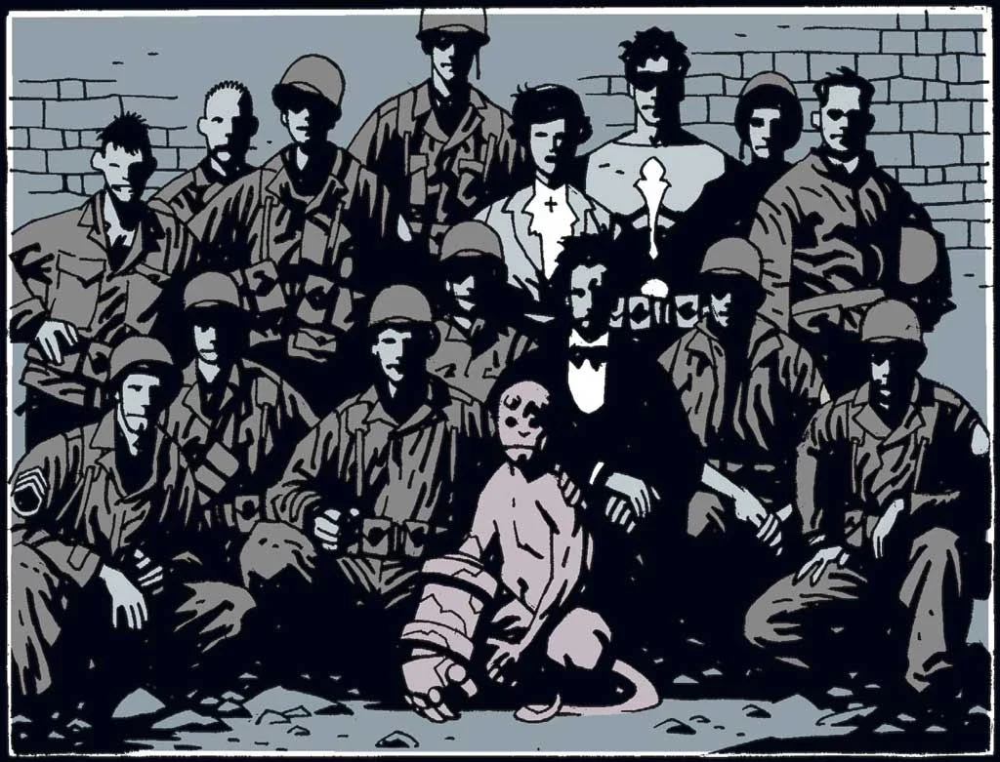
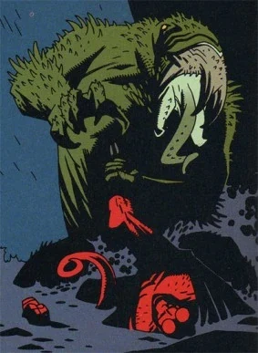
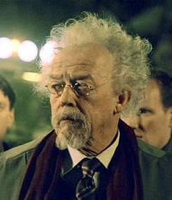
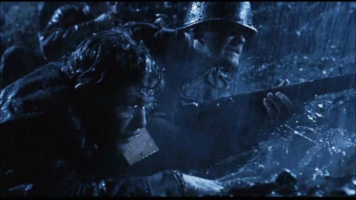

**特雷佛·布鲁姆（Trevor Bruttenholm）**教授（读作 /ˈbruːm/，发音同 **"Broom"**，日常也常被这样称呼）是一位神秘学专家，也是[超自然调查防御署（B.P.R.D.）](/entry/Bureau_for_Paranormal_Research_and_Defense)的首任主管。

1944 年 12 月 23 日的"地狱男爵事件"中他在场，第一次见到[地狱男爵](/entry/Hellboy_%28character%29)时无意中为他取了名字。此后多年，他一直担任地狱男爵的监护人。

## 历史

特雷佛·布鲁姆 1918 年 3 月 5 日出生于英格兰埃塞克斯。[1] 他年轻时就读于伊顿公学，加入了学校的幽灵俱乐部，并与 [Harry Middleton](/entry/Harry_Middleton) 结为好友。[2] 在超自然领域颇有造诣后，布鲁姆于 1938 年 7 月加入[英国超自然学会](/entry/The_British_Paranormal_Society_%28organization%29)。[3] 他于 1943 年从牛津大学毕业。

### 战时服役

当盟军意识到纳粹领袖阿道夫·希特勒正急于利用神秘学扭转第二次世界大战的战局时，布鲁姆成为美国总统富兰克林·D·罗斯福的顾问。战争期间他担任秘密的英国情报分析师，监听并归档德国的通讯，从中寻找他们行动的潜在线索。在追查一起看似平常的鬼魂目击事件时，布鲁姆和好友 [Harry Middleton](/entry/Harry_Middleton) 在一家酒馆遭到一具僵尸袭击。布鲁姆的舅舅 Simon 召集朋友，与僵尸的灵魂举行了一场降神会，不料发现它讲德语，并提到了 Simon 朋友们的一个同伙——Albert Mayhew。Mayhew 的灵魂被挖出，被赋予那具德国士兵的身体，纳粹要用他当向导，去寻找 Eugene Remy 的陵墓——Remy 是 Mayhew 所属教团[赫利奥波斯拉神兄弟会](/entry/Heliopic_Brotherhood_of_Ra)的杰出创始人。随后布鲁姆被空投到敌后的巴黎，由 A.N. Sandhu 引导前往巴黎地下墓穴中的 Remy 陵墓。在那里他和 Sandhu 撞上纳粹正在举行 Mayhew 复活 Remy 的仪式。Sandhu 被杀，他们最终未能阻止纳粹拿到 Remy 的秘密石板。

### "地狱男爵事件"

 1944 年，[辛西雅·伊登-琼斯夫人](/entry/Lady_Cynthia_Eden-Jones)从她的灵魂向导那里得知，东布罗姆威奇一座教堂废墟即将发生一场大灾变，她把此事通报给布鲁姆。布鲁姆随即通知了战争部，最终一支由中士[乔治·惠特曼](/entry/George_Whitman)率领的美军巡逻队，与辛西雅夫人、布鲁姆以及著名神秘学学者 [Malcolm Frost](/entry/Malcolm_Frost) 在东布罗姆威奇会合。一行人于 1944 年 12 月 21 日抵达废墟，比辛西雅夫人的向导预言事件发生的日期早两天。与此同时，俄罗斯神秘学家[格里高利·拉斯普廷](/entry/Grigori_Rasputin)和纳粹秘术部门的一个分支正准备启动[诸神黄昏计划](/entry/Project_Ragna_Rok)。12 月 23 日，就在拉斯普廷呼唤[奥古·桀哈](/entry/Ogdru_Jahad)的同一刻，一个恶魔般的小生物在耀眼的火球中出现在布鲁姆一行人面前。伊登-琼斯说这生物看起来"像个小男孩"，Broom 脱口而出"地狱男爵（Hellboy）"——无意中给他取了名字。[4]

### 超自然调查防御署（B.P.R.D.）

美国收押地狱男爵之后，布鲁姆与一群美国神秘学家在美国政府支持下创立了[超自然调查防御署（B.P.R.D.）](/entry/Bureau_for_Paranormal_Research_and_Defense)，并担任调查署首任主管。与此同时，布鲁姆继续与地狱男爵密切相处。他没有把地狱男爵当作怪物或危险的实验品，而是开始像对待人类小孩一样对待他，并于 1946 年 3 月正式收养了地狱男爵。[5]

1946 至 1952 年间，布鲁姆把时间分配在两方面：领导野外行动（包括发现并清除纳粹末日计划[Vampir Sturm](/entry/Project_Vampir_Sturm)的遗骸，以及与恶魔[瓦尔瓦拉](/entry/Varvara)的遭遇），以及照料渐渐长大的地狱男爵。他频繁前往华盛顿特区，为 B.P.R.D. 游说经费与政府支持。部分得益于布鲁姆的努力，联合国于 1952 年 8 月 6 日授予地狱男爵荣誉人类身份。一周后，布鲁姆提拔地狱男爵为 B.P.R.D. 外勤探员。

![34 岁的 Broom（右），1953 年。[6]](Hellboy1953.jpg "34 岁的 Broom（右），1953 年。") 布鲁姆担任主管期间足智多谋，任内 B.P.R.D. 不断壮大，其工作也获得联合国正式承认。1958 年 9 月，布鲁姆辞去主管职务，留在 B.P.R.D. 担任顾问和偶尔出动的外勤探员，这也让他有机会与地狱男爵共度更多时光。

随着年事渐高，布鲁姆越来越多地投入到与古利莫里亚语有关的私人研究中。

早在 1982 年，布鲁姆就对新近入队的探员[亚伯·塞皮恩](/entry/Abe_Sapien)进行了一系列私人催眠，试图揭开他的身世之谜。他成功唤醒了亚伯前世 Langdon Everett Caul 的人格，经过多次催眠疗程，了解到 Caul 曾是[奥安尼斯学会](/entry/Oannes_Society)成员的过往，以及导致他变形的来龙去脉。他甚至能在鱼人体内显化出第三个灵魂，大概就是造成他异变的那个存在。正是通过这些疗程，布鲁姆得知了卡文迪许一家的事。

#### 卡文迪许探险队

1992 年 11 月，布鲁姆与地狱男爵道别，随卡文迪许三兄弟前往北极圈，寻找极北文明的遗迹，希望找到更多有关亚伯身世的线索。探险队于 1993 年 1 月失踪，到 7 月已被认定遇难。[8]

12 月 23 日，[9] 布鲁姆和探险队在戈里尼姆发现了极北神庙的遗迹，[格里高利·拉斯普廷](/entry/Grigori_Rasputin)正静止在那里，旁边是一动不动的生物 [Sadu-Hem](/entry/Sadu-Hem)。布鲁姆触碰了拉斯普廷，这一接触不仅唤醒了拉斯普廷和 Sadu-Hem，还让拉斯普廷得以透过布鲁姆的心智观察，了解了地狱男爵的生平与来历。拉斯普廷断定，地狱男爵是把[奥古·桀哈](/entry/Ogdru_Jahad)从牢笼中解放出来的关键。Sadu-Hem 把卡文迪许三兄弟变成了[蛙怪](/entry/frog_monster)，[10] 这是调查署日后要面对的成千上万此类怪物的第一批；布鲁姆则被留下活命，被拉斯普廷当作引诱地狱男爵上钩的诱饵。

### 去世

 1994 年 5 月 9 日，[11] 布鲁姆突然重新现身，把地狱男爵召到他在布鲁克林公园的家中。布鲁姆怎么也回忆不起北极发生的事，也说不清自己是怎么回到文明世界的。他正要告诉地狱男爵发生了什么，却被突然出现的几只青蛙打断；Broom 惊慌地躲避这些小两栖动物，在另一个房间里被一个人一般大的蛙怪杀害。[12] 地狱男爵最终阻止了拉斯普廷解放奥古·桀哈的计划，看着这个神秘学家被活活烧死，为养父报了仇。[13]

Broom 去世时 76 岁。他的葬礼于 1994 年 5 月 13 日举行。[14]

## 其他媒体

### 2004–2008 年电影系列

特雷佛·布鲁姆教授，由 John Hurt 饰演

[John Hurt](/entry/John_Hurt) 在 2004 年电影*[《地狱男爵》](/entry/Hellboy_%282004_film%29)*及其续集*[《黄金军团》](/entry/Hellboy_II__The_Golden_Army)*中饰演 Broom。[Kevin Trainor](/entry/Kevin_Trainor) 在影片开场戏中饰演年轻的 Broom。

漫画作者[迈克·米格诺拉](/entry/Mike_Mignola)惊讶地发现，Hurt 与他原画中的 Broom 极为相像。[15]

#### *[《地狱男爵》](/entry/Hellboy_%282004_film%29)*（2004）

 影片中，布鲁姆随美军突击队一起行动，阻止拉斯普廷启动诸神黄昏计划。[克焰人](/entry/Karl_Ruprect_Kroenen)开枪打中他的腿，使他此后终生跛行，但他把手榴弹扔进了传送机器底下，既摧毁了机器，也在克焰人试图取回机器时把他致残。婴儿[地狱男爵](/entry/Hellboy_%282004%E2%80%932008_film_character%29)出现后，布鲁姆收养了他，不顾他的恶魔出身，全心全意把他当人类养大。影片更明确地刻画了两人之间的父子关系，地狱男爵始终称呼布鲁姆"父亲"。

影片进入现在时间线时，布鲁姆发现自己已身患癌症、时日无多，便挑选年轻探员 [John Myers](/entry/John_Myers) 担任地狱男爵新的联络官。克焰人杀死了他，这是引诱地狱男爵前往拉斯普廷坟墓的阴谋的一部分——在那里，地狱男爵将完成他被召唤到人间的使命。被杀之前，拉斯普廷嘲讽他，说布鲁姆实际上养育了一个拥有带来末日的力量与宿命的生物，并向他展示了末日之后纽约城废墟的幻象：奥古·桀哈在天空中浮现，重新长出双角的地狱男爵站在中央。布鲁姆回答说，他永远把地狱男爵看作自己的儿子，然后从容地接受了命运，让克焰人动手。

当地狱男爵即将以阿努·恩·罗摩（Anung un Rama）的身份转动钥匙、把奥古·桀哈从牢笼中释放时，Myers 扔给他一串布鲁姆的念珠阻止了他——提醒他布鲁姆养育他，是要他选择自己的道路——于是地狱男爵掰断重新长出的双角，杀死了拉斯普廷，而没有转动最后的钥匙。

#### *[《地狱男爵 2：黄金军团》](/entry/Hellboy_II__The_Golden_Army)*

中年的布鲁姆也在续集电影中短暂登场，仍由 Hurt 饰演。影片序幕发生在 1955 年，中年的 Broom 在新墨西哥州一处美国空军基地秘密抚养年幼的地狱男爵。平安夜，布鲁姆给他的"儿子"读了一个关于[黄金军团](/entry/Golden_Army)诞生的故事。

现在时间线中，地狱男爵把父亲的念珠像手链一样戴在手腕上。

### *[《地狱男爵动画版》](/entry/Hellboy_Animated)*

特雷佛·布鲁姆还出现在直接发行 DVD 的动画电影*[《地狱男爵：铁血惊魂》](/entry/Hellboy__Blood_and_Iron)*中，年轻时由 James Arnold Taylor 配音，老年时再次由 Hurt 配音。

影片以一系列闪回展现年轻的布鲁姆前往东欧，与在特兰西瓦尼亚肆虐的邪恶女吸血鬼 Erzebet Andrushko 作战。他获胜而归，但也是队伍中唯一的幸存者。

六十年后，他仍是调查署成员，但不再担任野外行动主管。他反复梦见 Erzebet 复活，便建议把整支队伍派去汉普顿执行一项看似微不足道的任务——Erzebet 的门徒确实正在那里设法让她复活。尽管队伍其他成员与各种危险的怪物搏斗，最终却是布鲁姆独自面对 Erzebet，并且不顾年迈，再次以智谋击败并消灭了她。

### 2019 年电影

 特雷佛·布鲁姆还出现在 2019 年电影*[《地狱男爵》](/entry/Hellboy_(2019_film))*中，由 [Ian McShane](/entry/Ian_McShane) 饰演。

这一版 Broom 比其他版本强硬得多，因此与养子的关系也更紧张。[16] 布鲁姆说话更加口无遮拦、轻慢随意，带着英式口吻。他的父亲在他口中是"一个死不悔改的混蛋"，不过后者确实教会了他刮胡子的重要性。多年后，在 1940 年代，布鲁姆参加了由大螯虾强生率领的一次大胆的对纳粹德国突袭。纳粹被消灭后，布鲁姆发现一个恶魔般的存在从传送门中诞生。他慢慢走近它，选择不杀它——尽管他过去杀过无数怪物。他把这个他称作地狱男爵的恶魔当亲生儿子一样养大，地狱男爵也因此叫他"爸爸"。他还在地狱男爵 10 岁生日时送给他一把枪，让他去打猎。2019 年，布鲁姆派地狱男爵前往墨西哥，接应早些时候被派到那里的 Esteban Ruiz。

## 参考资料

[1]

[2] *[《地狱男爵与 B.P.R.D.》](/entry/Hellboy_and_the_B.P.R.D.)：1953* — "[《凯尔派》](/entry/The_Kelpie)"

[3]

[4] *[《地狱男爵》](/entry/Hellboy_%28series%29)：[《毁灭之芽》](/entry/Seed_of_Destruction)* 第 1 期

[5]

[6]

[7]

[8]

[9]

[10]

[11]

[12]

[13] *[《毁灭之芽》](/entry/Seed_of_Destruction)* 第 4 期

[14]

[15] *《Hellboy: The Seeds of Creation》*。米格诺拉："我到片场的第一天正好是 John Hurt 开拍的第一天，他看起来和漫画里的角色*太*像了，以至于连*我*都愣了一下想：'我画这个角色的时候，是不是想着 John Hurt？我是不是看着 John Hurt 的照片画的……？'并没有，我就是画出了这家伙。" 视频时间点 23:07。

[16] ["《地狱男爵》：与 David Harbour 独家解析预告片"](https://www.youtube.com/watch?v=knd_S_POYRQ)，*IGN*。（[HARBOUR](/entry/David_Harbour)："这是对 Broom 一个非常不同的诠释。在我们的电影里，Broom 是个强硬得多的人……影片的一大冲突就是地狱男爵质疑自己在人类社会中的位置，而他的爸爸对这种质疑并不怎么体谅。"）
