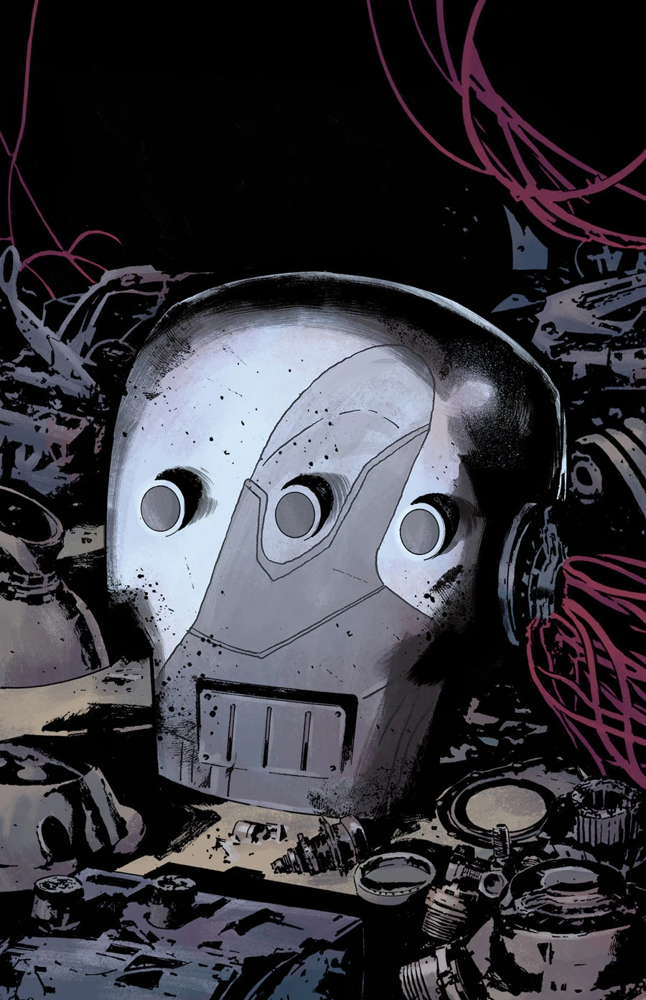
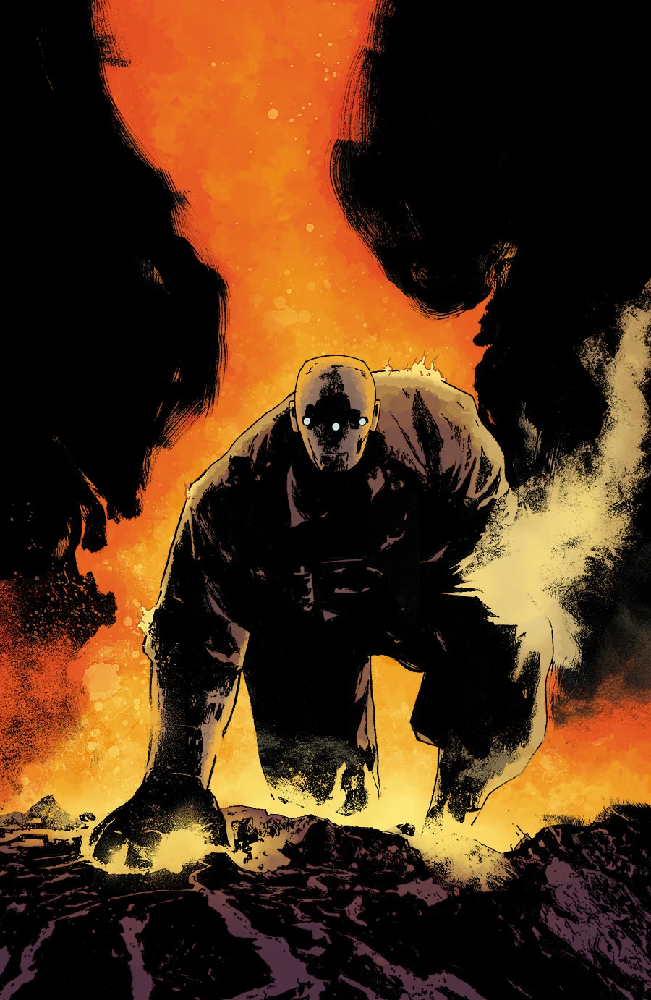

***《现代普罗米修斯》（Modern Prometheus）**是一个两期故事弧，由 Julián Totino Tedesco 绘制。

## 剧情梗概

### 第一部分

[约翰](/entry/Johann_Kraus)对[重锤装甲](/entry/Vril_Energy_Suit)的痴迷，引出了一段踏入过去的奇异旅程，以及「厄庇墨透斯计划」（Project Epimetheus）的起源。

### 第二部分

约翰迷失在重锤计划的记忆之中……他能否及时找回自我、夺回装甲的控制权，拯救 [BPRD](/entry/Bureau_for_Paranormal_Research_and_Defense)？

## 画廊

