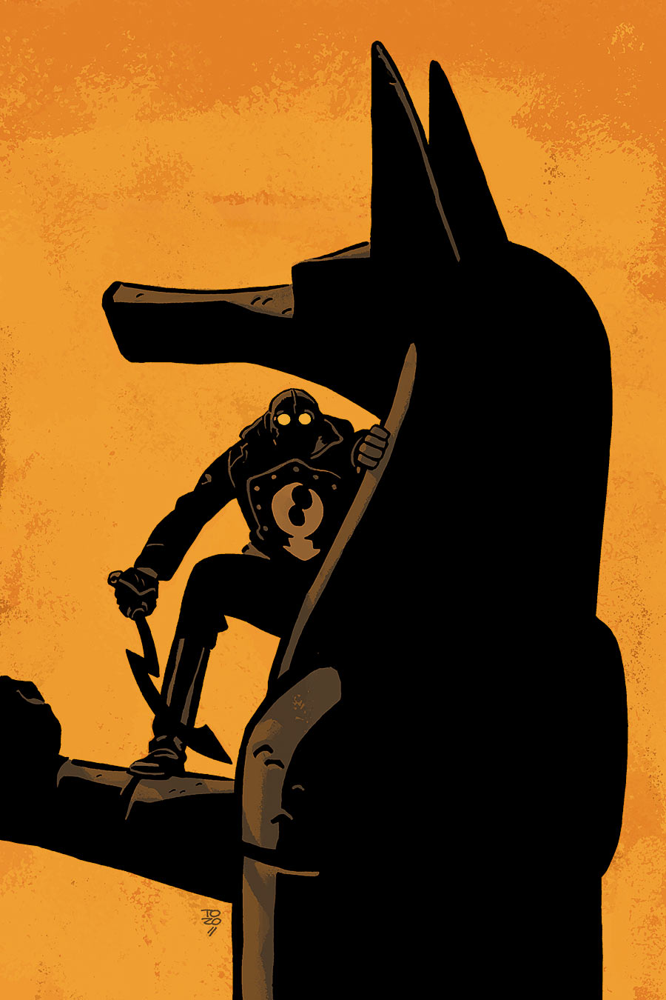

《**玻璃螳螂**》（The Glass Mantis）是一个故事，发生在 1930 年代[龙虾人](/entry/The_Lobster)作为犯罪斗士生涯的中期。

## 出版历史

这部单刊于 2015 年 12 月出版，封面由 [Tonči Zonjić](/entry/Ton%C4%8Di_Zonji%C4%87) 绘制。

## 剧情简介

一场谋杀打断了大都会艺术博物馆一件新展品的开幕。龙虾·约翰逊展开调查，要弄清一件吹制玻璃雕塑为何值得为之杀人。

## 画廊

