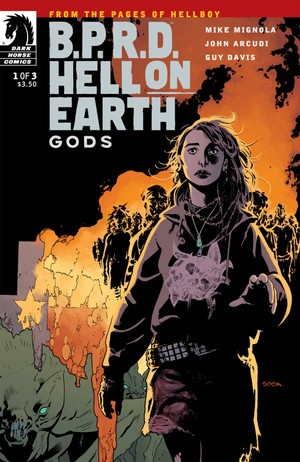
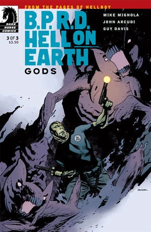
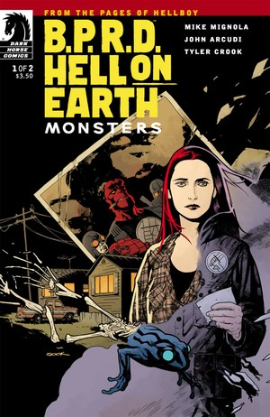
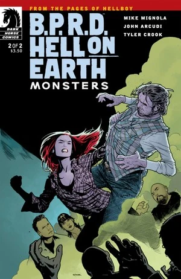
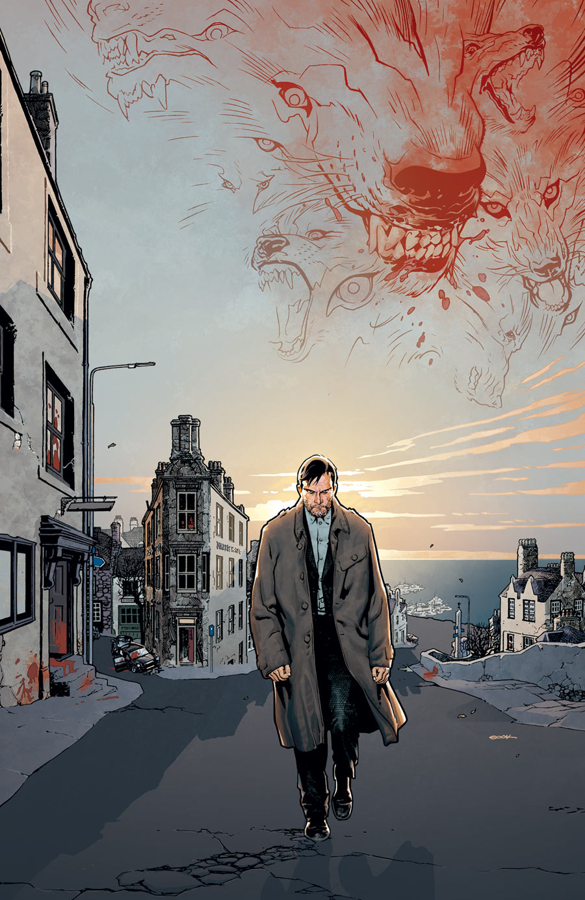
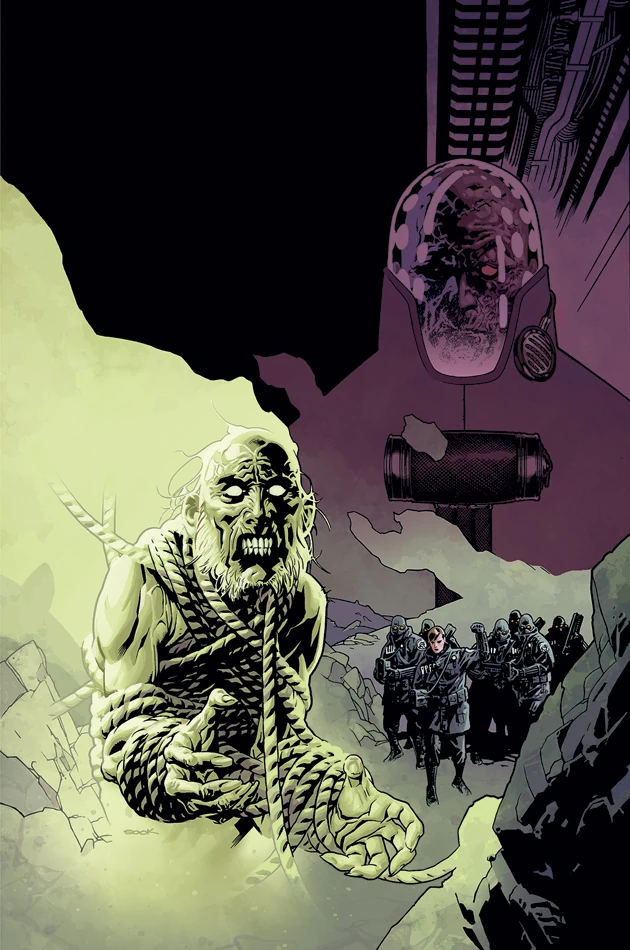
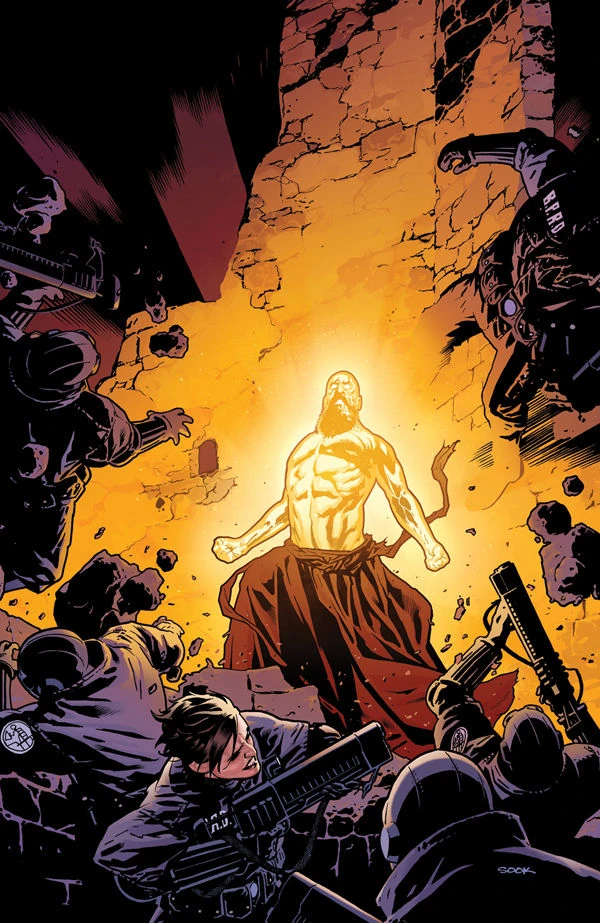
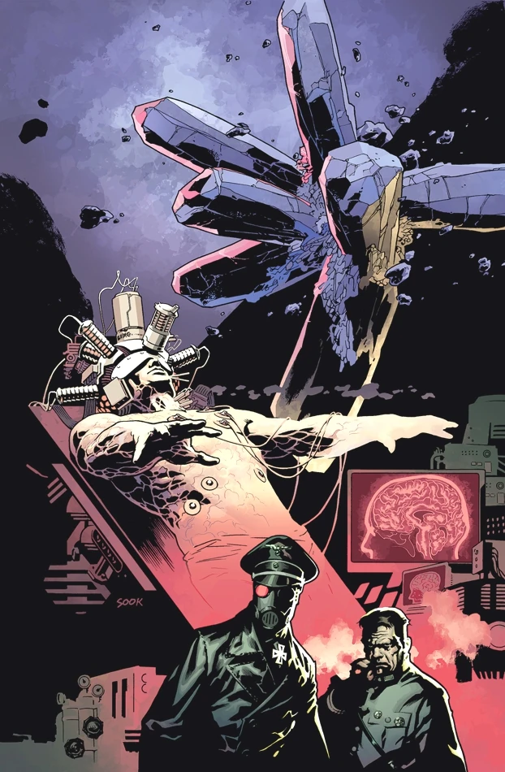
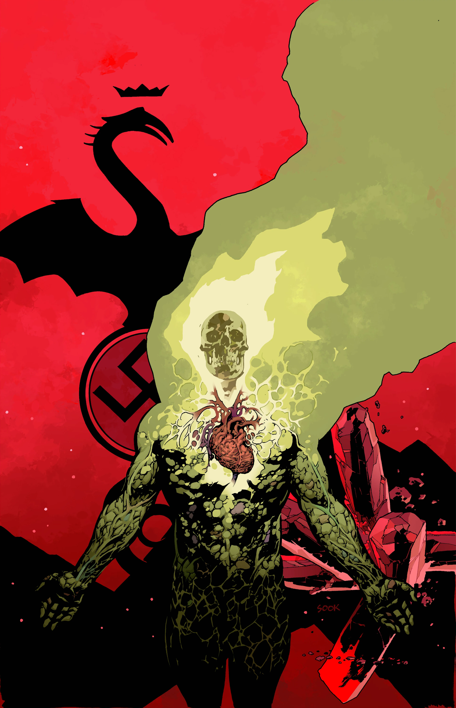
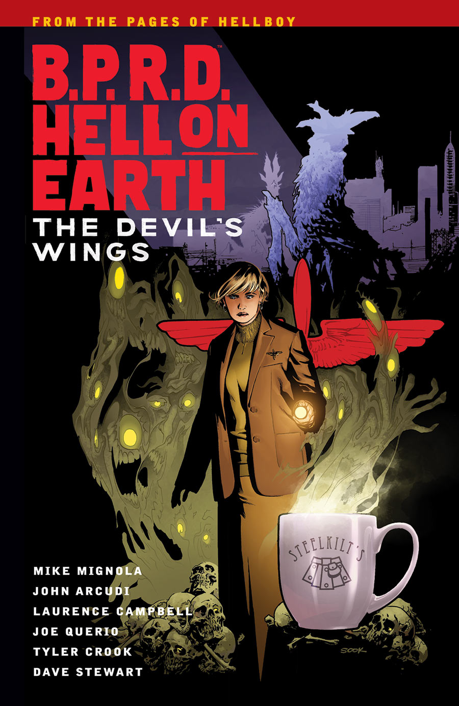

**Ryan Sook** 是来自加利福尼亚州圣何塞的美国漫画画师。他曾参与创作 *Arkham Asylum: Living Hell*、*The Spectre*、*Hawkman*、*Seven Soldiers: Zatanna*、*Buffy the Vampire Slayer* 和 *Angel*。他还为 Marvel Comics 旗下、由 Peter David 编剧的 *X-Factor* 绘制插画。他的画风与 [Mike Mignola](/entry/Mike_Mignola) 和 Adam Hughes 极为相似。

## 内页作画

- [《Lobster Johnson：我头颅中的杀手》（Lobster Johnson: The Killer in My Skull）](/entry/The_Killer_in_My_Skull)（勾线）
- [《B.P.R.D.：空洞地球》（B.P.R.D.: Hollow Earth）](/entry/Hollow_Earth)（铅笔稿；勾线与 [Curtis Arnold](/entry/Curtis_Arnold) 合作）

## 封面画作

|《B.P.R.D. 人间地狱：众神》（B.P.R.D. Hell on Earth: Gods）#1

|《B.P.R.D. 人间地狱：众神》（B.P.R.D. Hell on Earth: Gods）#2

|《B.P.R.D. 人间地狱：众神》（B.P.R.D. Hell on Earth: Gods）#3

|《B.P.R.D. 人间地狱：怪物》（B.P.R.D. Hell on Earth: Monsters）#1

|《B.P.R.D. 人间地狱：怪物》（B.P.R.D. Hell on Earth: Monsters）#2

|《B.P.R.D. 人间地狱：主人归来》（B.P.R.D. Hell on Earth: The Return of the Master）#1

|《B.P.R.D. 人间地狱：主人归来》（B.P.R.D. Hell on Earth: The Return of the Master）#2

|《B.P.R.D. 人间地狱：主人归来》（B.P.R.D. Hell on Earth: The Return of the Master）#3

|《B.P.R.D. 人间地狱：主人归来》（B.P.R.D. Hell on Earth: The Return of the Master）#4

|《B.P.R.D. 人间地狱：主人归来》（B.P.R.D. Hell on Earth: The Return of the Master）#5

|《B.P.R.D. 人间地狱——第 10 卷：恶魔之翼》（B.P.R.D. Hell on Earth – Volume 10: The Devil's Wings）

## 外部链接

- [**维基百科：Ryan Sook**](https://en.wikipedia.org/wiki/Ryan_Sook)
- [**Comic Book DB：Ryan Sook**](http://comicbookdb.com/creator.php?ID=195)
- [官方网站](http://www.ryansook.com/)
