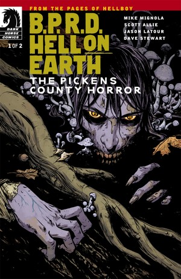
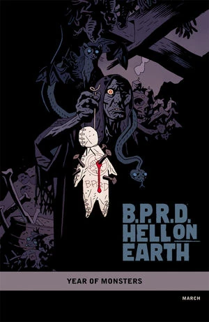

《**皮肯斯郡恐怖故事**》（The Pickens County Horror）是一部两期满完的迷你系列，于 2012 年 3 月至 4 月出版。

## 出版历史

这是[《人间地狱》（Hell on Earth）系列周期](/entry/BPRD%3A%E4%BA%BA%E9%97%B4%E5%9C%B0%E7%8B%B1))的第六个故事弧，但它是一个支线故事，情节并不承接《[漫长的死亡](/entry/The_Long_Death)》。各期由 [Becky Cloonan](/entry/Becky_Cloonan) 绘制封面，第 1 期还附有一款「[怪兽之年](/entry/Year_of_Monsters)」变体封面，由 [Mike Mignola](/entry/Mike_Mignola) 绘制。

## 剧情简介

### 第一部分

当世界滑向地狱之际，一个偏僻乡野的吸血鬼家族躲进了他们南方哥特式的老宅——浓雾弥漫、真菌滋生的恐怖之地——准备给闯入此地的 B.P.R.D. 小队制造一场浩劫。

### 第二部分

一个与世隔绝的吸血鬼家族，加上一片致命的迷雾，造就了我们的英雄们所面对过的最惨败的任务之一。

## 画廊

 \#1

 \#1 variant

 \#2
