**Guy Davis（盖·戴维斯）**是一位美国漫画画师，最为人熟知的作品包括《Sandman Mystery Theatre》以及《[B.P.R.D.](/entry/B.P.R.D._%28series%29)》。他于 2003 年 7 月凭借《[B.P.R.D.: Dark Waters](/entry/Dark_Waters)》（《B.P.R.D.：暗水》）首次进入地狱男爵宇宙。2004 年 3 月至 2011 年 3 月期间，他担任《B.P.R.D.》的常驻画师。

## 内页美术

- [《B.P.R.D.：暗水》（*B.P.R.D.: Dark Waters*）](/entry/Dark_Waters)
- [《B.P.R.D.：重生》（*B.P.R.D.: Born Again*）](/entry/Born_Again)
- [《B.P.R.D.：蛙瘟》（*B.P.R.D.: Plague of Frogs*）](/entry/Plague_of_Frogs_%28story%29)
- [《B.P.R.D.：亡者》（*B.P.R.D.: The Dead*）](/entry/The_Dead)
- [《B.P.R.D.：黑焰》（*B.P.R.D.: The Black Flame*）](/entry/The_Black_Flame_%28story%29)
- [《B.P.R.D.：万象机器》（*B.P.R.D.: The Universal Machine*）](/entry/The_Universal_Machine)
- [《B.P.R.D.：灵魂花园》（*B.P.R.D.: Garden of Souls*）](/entry/Garden_of_Souls)
- [《B.P.R.D.：杀戮之地》（*B.P.R.D.: Killing Ground*）](/entry/Killing_Ground)
- [《B.P.R.D.：复苏》（*B.P.R.D.: Revival*）](/entry/Revival)
- [《B.P.R.D.：遥不可及》（*B.P.R.D.: Out of Reach*）](/entry/Out_of_Reach)
- [《B.P.R.D.：蛙族之战》（*B.P.R.D.: War on Frogs*）\#1](/entry/War_on_Frogs)（仅勾线）
- [《B.P.R.D.：警告》（*B.P.R.D.: The Warning*）](/entry/The_Warning)
- [《柯歇伊如何获得不死之身》（*How Koshchei Became Deathless*）](/entry/How_Koshchei_Became_Deathless)
- [《B.P.R.D.：黑色女神》（*B.P.R.D.: The Black Goddess*）](/entry/The_Black_Goddess)
- [《雅加婆婆的盛宴》（*Baba Yaga's Feast*）](/entry/Baba_Yaga%27s_Feast)
- [《B.P.R.D.：恐惧之王》（*B.P.R.D.: King of Fear*）](/entry/King_of_Fear_%28story%29)
- [《B.P.R.D.：人间地狱——新世界》（*B.P.R.D.: Hell on Earth—New World*）](/entry/New_World_%28B.P.R.D._story_arc%29)
- [《B.P.R.D.：人间地狱——西雅图》（*B.P.R.D.: Hell on Earth—Seattle*）](/entry/Seattle)
- [《B.P.R.D.：人间地狱——诸神》（*B.P.R.D.: Hell on Earth—Gods*）](/entry/Gods)
- [《B.P.R.D.：伤亡》（*B.P.R.D.: Casualties*）](/entry/Casualties)

## 封面美术

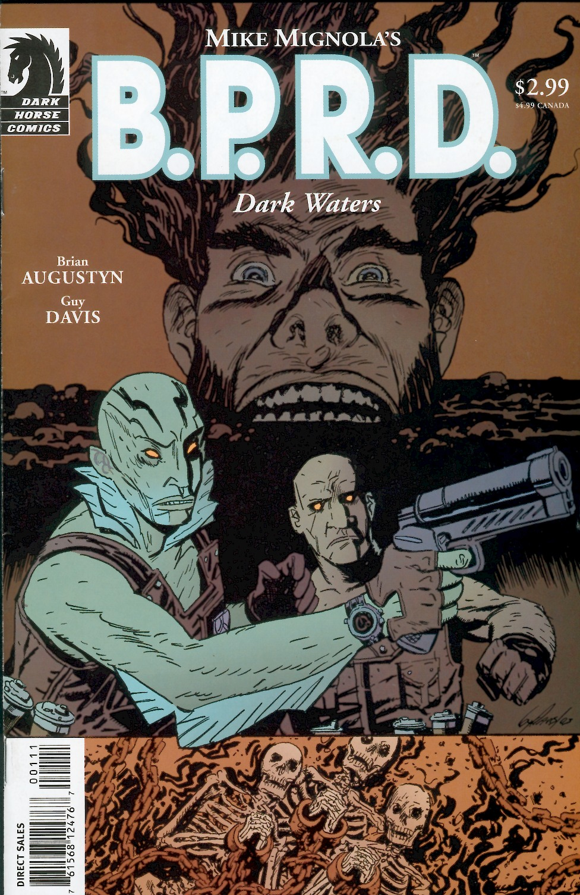

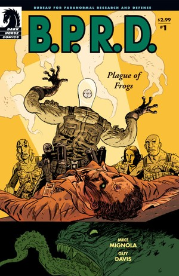

|《B.P.R.D.：蛙瘟》（*B.P.R.D.: Plague of Frogs*）\#1

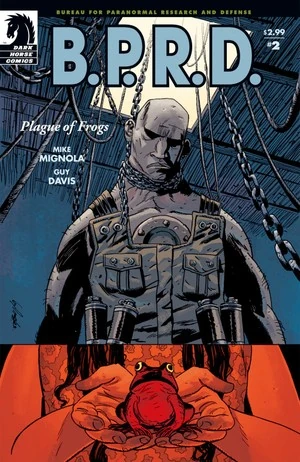

|《B.P.R.D.：蛙瘟》（*B.P.R.D.: Plague of Frogs*）\#2

|《B.P.R.D.：蛙瘟》（*B.P.R.D.: Plague of Frogs*）\#3

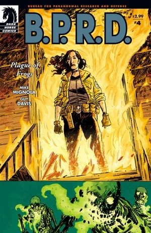

|《B.P.R.D.：蛙瘟》（*B.P.R.D.: Plague of Frogs*）\#4

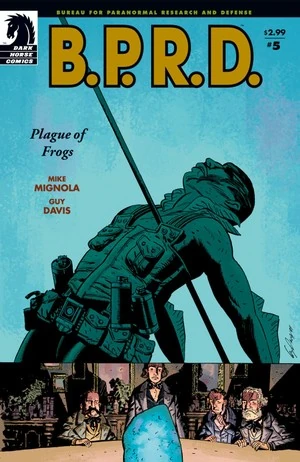

|《B.P.R.D.：蛙瘟》（*B.P.R.D.: Plague of Frogs*）\#5

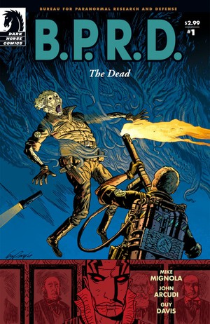

|《B.P.R.D.：亡者》（*B.P.R.D.: The Dead*）\#1

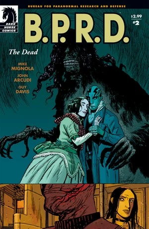

|《B.P.R.D.：亡者》（*B.P.R.D.: The Dead*）\#2

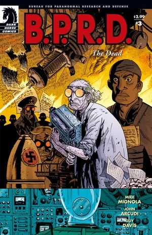

|《B.P.R.D.：亡者》（*B.P.R.D.: The Dead*）\#3

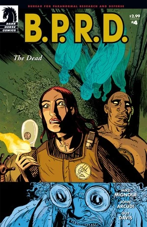

|《B.P.R.D.：亡者》（*B.P.R.D.: The Dead*）\#4

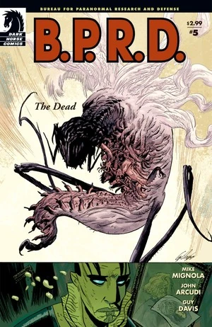

|《B.P.R.D.：亡者》（*B.P.R.D.: The Dead*）\#5

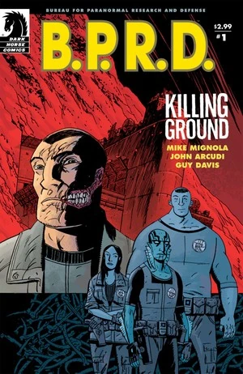

|《B.P.R.D.：杀戮之地》（*B.P.R.D.: Killing Ground*）\#1

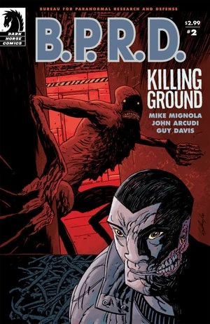

|《B.P.R.D.：杀戮之地》（*B.P.R.D.: Killing Ground*）\#2

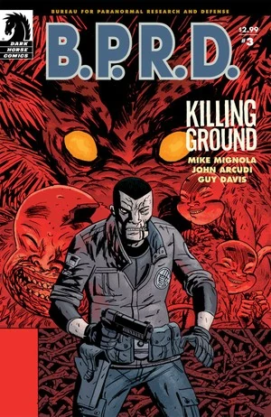

|《B.P.R.D.：杀戮之地》（*B.P.R.D.: Killing Ground*）\#3

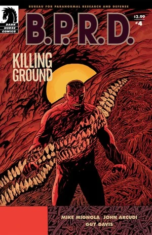

|《B.P.R.D.：杀戮之地》（*B.P.R.D.: Killing Ground*）\#4

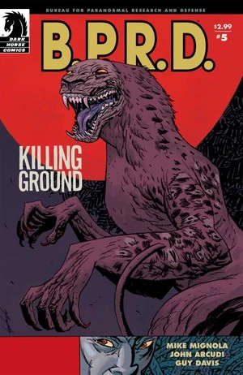

|《B.P.R.D.：杀戮之地》（*B.P.R.D.: Killing Ground*）\#5

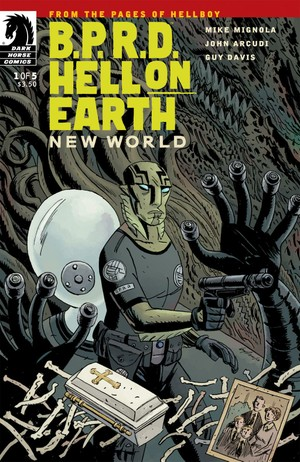

|《B.P.R.D.：人间地狱——新世界》（*B.P.R.D.: Hell on Earth—New World*）\#1

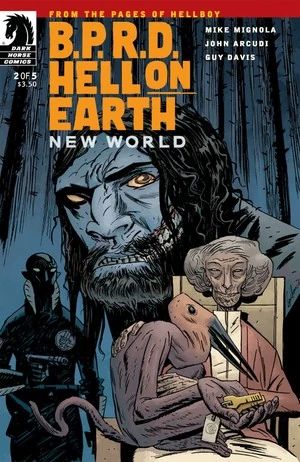

|《B.P.R.D.：人间地狱——新世界》（*B.P.R.D.: Hell on Earth—New World*）\#2

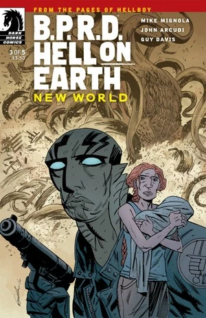

|《B.P.R.D.：人间地狱——新世界》（*B.P.R.D.: Hell on Earth—New World*）\#3

|《B.P.R.D.：人间地狱——新世界》（*B.P.R.D.: Hell on Earth—New World*）\#4

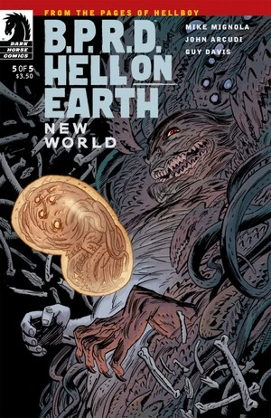

|《B.P.R.D.：人间地狱——新世界》（*B.P.R.D.: Hell on Earth—New World*）\#5

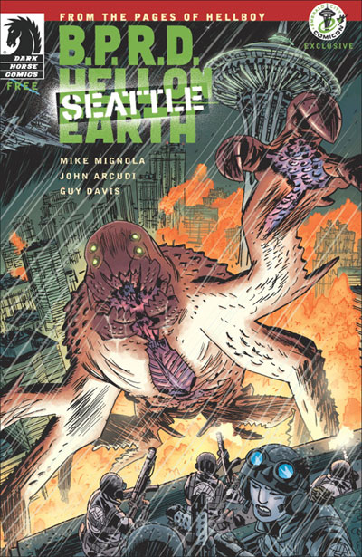

|《B.P.R.D.：人间地狱——西雅图》（*B.P.R.D.: Hell on Earth—Seattle*）

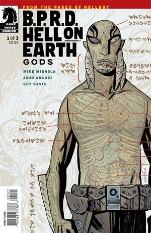

## 外部链接

- [**Wikipedia：** Guy Davis](http://en.wikipedia.org/wiki/Guy_Davis_(comics))
- [**Comic Book DB：** Guy Davis](http://www.comicbookdb.com/creator.php?ID=27)
- [Guy Davis Artworks](http://www.guydavisartworks.com/)
