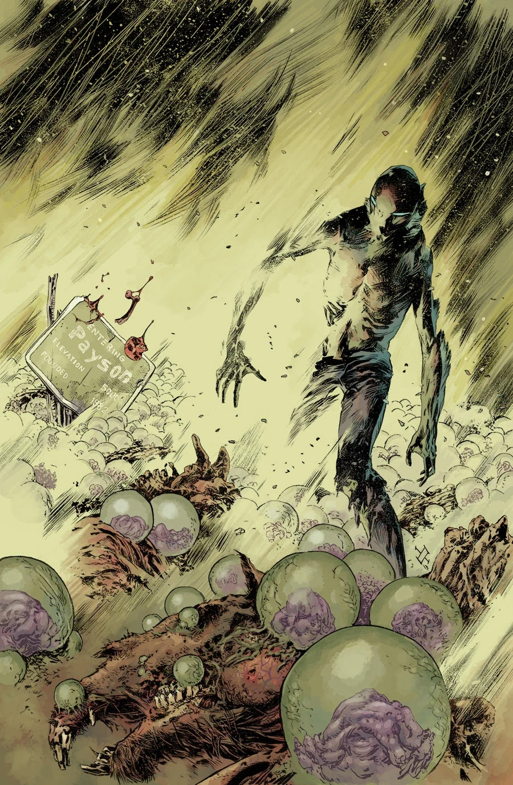
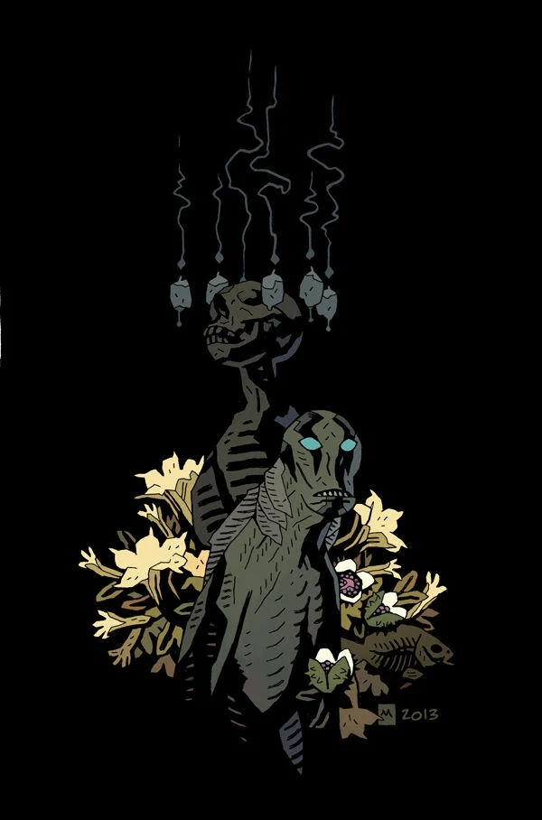
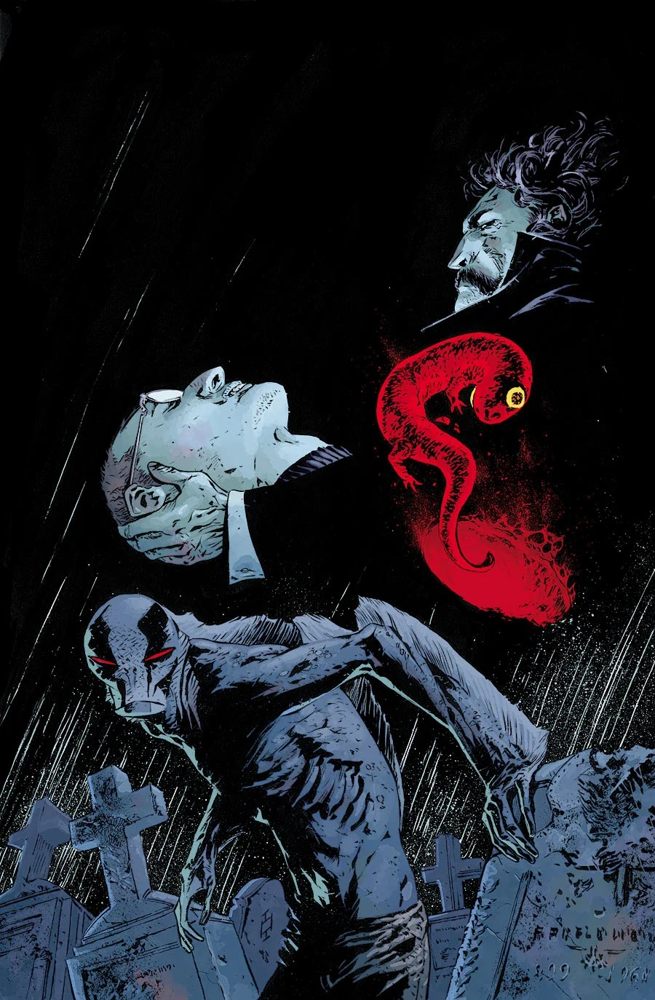
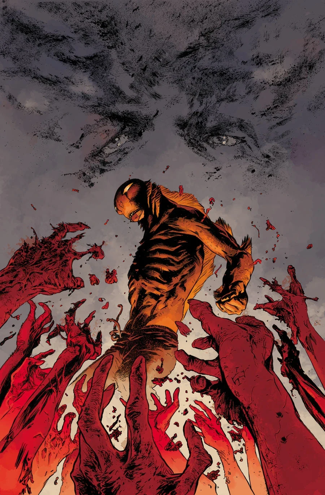

《**直至最后一人**》（To the Last Man）是一条三期故事线，于 2014 年 1 月至 3 月连载，由 Max Fiumara 作画。

## 剧情简介

### 第一部分

[亚伯](/entry/Abraham_Sapien)在亚利桑那州一座小镇躲避天启，镇子里闯进了一帮眼熟的小混混——但更迫在眉睫的麻烦，是一片田地里长出了奇怪的怪物，它们像麦子一样从死者身上冒出来！

### 第二部分

亚伯把亚利桑那州一座小镇从一个洛夫克拉夫特式的威胁手中救了下来，但一个新的杀手即将吞噬最后的幸存者！

### 第三部分

当一群僵尸威胁亚利桑那州一座小镇时，一个疯狂的死灵法师在怪物横行的西雅图废墟之上崛起。

## 画廊

Mike Mignola 变体封面

