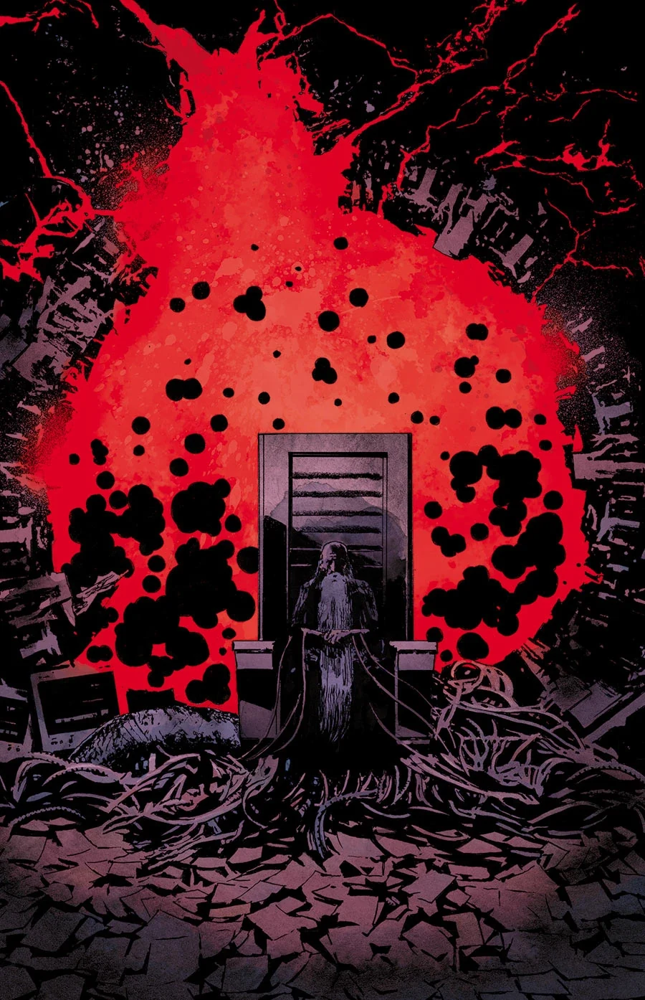
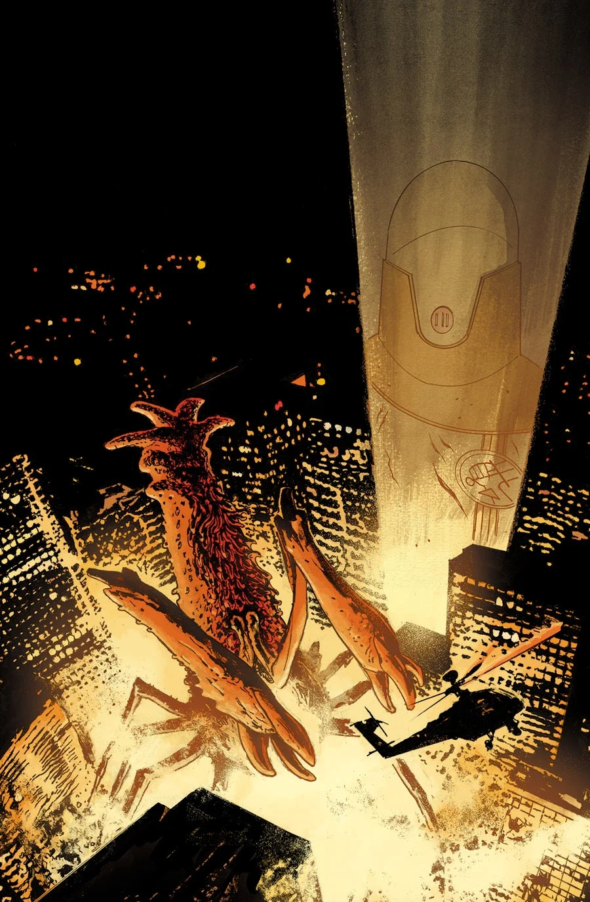

《**破裂的方程**》（The Broken Equation）是两回故事线，讲述[约翰·克劳斯](/entry/Johann_Kraus)与[伊诺斯探员](/entry/Russell_Enos)在日本的故事，由 Joe Querio 作画。

## 剧情简介

### 第一部分

[约翰](/entry/Johann_Kraus)前往日本与巨型怪物作战，但他发现的东西更加令人不安。一个没有大脑的男人一直在画画……而那些画讲述着一个可怕的故事。

### 第二部分

一头[B.P.R.D.](/entry/B.P.R.D.)前所未见的巨型怪物，为争夺日本的统治权与[奥格德鲁·赫姆](/entry/Ogdru_Hem)展开大战！

## 画廊

封面作者：[Laurence Campbell](/entry/Laurence_Campbell)。

