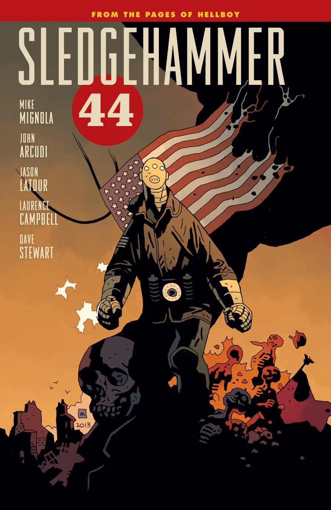

 ***《碎骨锤44》（Sledgehammer 44）*** 是一系列漫画，主角是第二套[维尔能量装甲（Vril Energy Suit）](/entry/Vril_Energy_Suit)——厄庇米修斯（Epimetheus，绰号*碎骨锤*）。

## 出版历史

*碎骨锤44* 故事的完整列表可参见 *[**碎骨锤44** 故事列表](/entry/%3ACategory%3ASledgehammer_44_story)*

当 [约翰·塞维林](/entry/John_Severin) 完成他在 *[《猎巫人：迷失永逝》（Witchfinder: Lost and Gone Forever）](/entry/Lost_and_Gone_Forever)* 上的工作后，[迈克·米格诺拉](/entry/Mike_Mignola) 问他接下来想创作什么。塞维林想要一个以二战为背景的故事，但米格诺拉在那个年代活跃的角色并不多：[地狱男爵](/entry/Hellboy_%28character%29)直到战争接近尾声时才降临，而[龙虾人](/entry/The_Lobster)恰好在战争爆发时死去。

不过，还有维尔能量装甲的原型机"普罗米修斯"（Prometheus），它在以 1937 年为背景的故事 [*《龙虾约翰逊：钢铁普罗米修斯》（Lobster Johnson: The Iron Prometheus）*](/entry/The_Iron_Prometheus) 中登场并被摧毁。自从第二套 V.E.S.（维尔能量装甲）"厄庇米修斯"的预告图出现在 *[《B.P.R.D.：亡者》（B.P.R.D.: The Dead）](/entry/The_Dead)* 中以来，米格诺拉早就计划让它登场。塞维林开始了这本书的创作，但不幸的是，在作品完成之前他就去世了。这个故事被搁置，直到找到合适的画师。

### *碎骨锤44*

*碎骨锤44* 最终于 2013 年 3 月以两期限定迷你系列的形式发行，由 [杰森·拉图尔](/entry/Jason_Latour) 绘画。

### *《闪电战》（Lightning War）*

4 月，[约翰·阿库迪宣布将推出第二部迷你系列](http://www.darkhorse.com/Blog/1353/sledgehammer-44-interview-mike-mignola-and-john-ar)，共三期，由劳伦斯·坎贝尔（Laurence Campbell）绘画。后来在 [Hellmail](/entry/Hellmail) 中连同标题一起得到确认，即 *[《闪电战》（Lightning War）](/entry/Lightning_War)*。

### 未来

截至 2017 年，尚不清楚该标题下是否还会发行更多期数。前两个系列的事件在 *[人间地狱](/entry/BPRD%3A%E4%BA%BA%E9%97%B4%E5%9C%B0%E7%8B%B1))* 连载故事的"[现代普罗米修斯](/entry/Modern_Prometheus)"期间产生了关联。

## 编号

 尽管 *碎骨锤44* 是以一系列迷你系列的形式发行的，但除了每个迷你系列内部的期号外，整个系列在封二上还有一套连续编号系统。

1.  [*《碎骨锤44》* #1](/entry/Sledgehammer_44_%28story%29)
2.  *碎骨锤44* #2
3.  [*《闪电战》* #1](/entry/Lightning_War)
4.  *闪电战* #2
5.  *闪电战* #3

## 合订本

### 平装合订本（Trade Paperbacks）

*另见 [碎骨锤44 平装合订本合集](/entry/Trade_Collections)*

第一本平装合订本于 2014 年 5 月 28 日发行。
