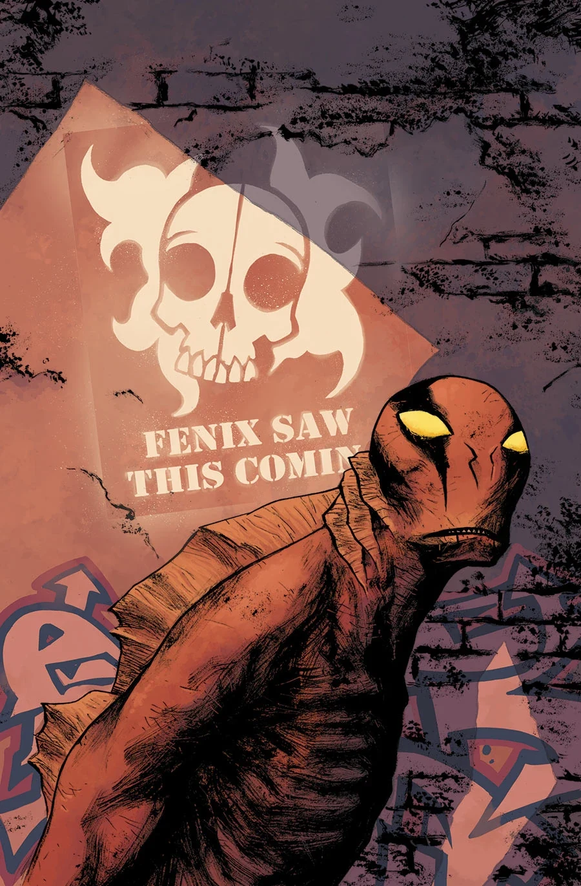
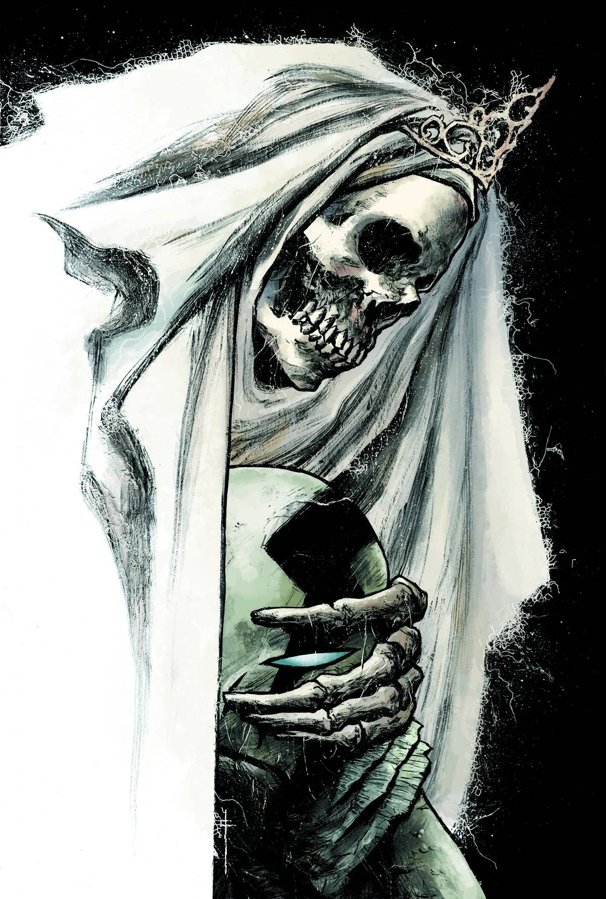

***《神圣领域》（Sacred Places）**是一个全新故事弧，作画由 Sebastián Fiumara 担任。

## 剧情梗概

### 第一部分

亚伯回到菲尼克斯开枪击中他的地方，情况却愈发糟糕：一种神秘气体开始从地下泄漏。一队奉命拿下他的人紧追不舍，他又接连撞上两个截然不同的末日教团——其中一个竟然崇拜亚伯本人！

### 第二部分

人们认为亚伯·塞皮恩的蜕变意味着他与正在占领世界的怪物存在关联。如今，亚伯回到他中枪、蜕变开始的那座小镇，向一群离奇的幸存者寻求庇护。

## 画廊

