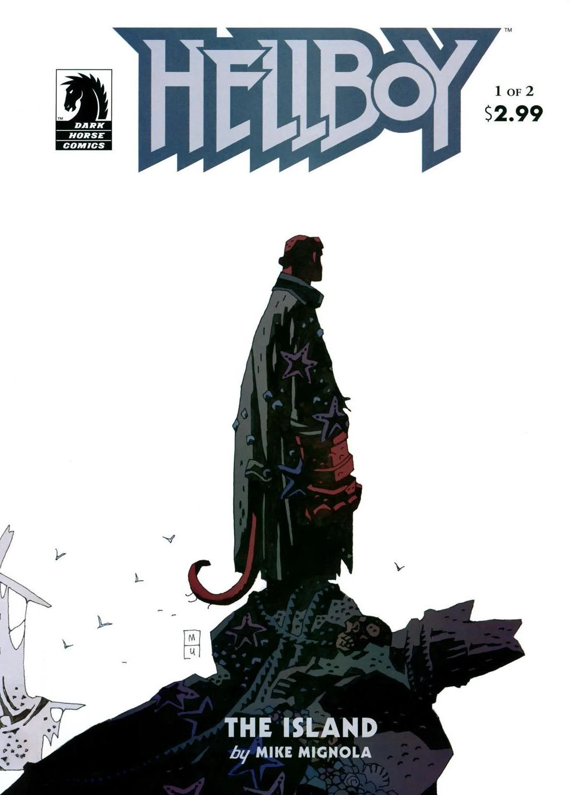
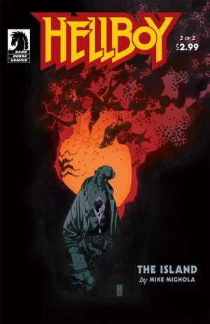

《**神秘海域**》（The Island）中，地狱男爵被冲上一座岛屿，在那里他面对一个死去已久的人，并得知了世界的真实历史。

## 出版历史

《神秘海域》最初于2005年6月至7月作为两期迷你系列首次出版。该故事于2006年8月与《[三个愿望](/entry/The_Third_Wish)》以及一段全新的六页尾声一起重新出版于[《地狱男爵——第6卷：奇异之地》](/entry/Trade_Collections)。

## 剧情简介

### 第一部

在《[三个愿望](/entry/The_Third_Wish)》的事件之后，[地狱男爵](/entry/Hellboy)被冲上一片布满搁浅船只的海岸。地狱男爵走进其中一艘船，与一群水手一起喝酒。他听到一声巨响，向窗外望去。等他回过头时，地狱男爵发现这些水手其实早已死去。地狱男爵走到外面，[赫卡忒](/entry/Hecate)出现在他面前。她庆幸[博格·鲁什](/entry/Bog_Roosh)没有杀死他，并再次邀请地狱男爵加入她、终结这个世界。地狱男爵再次拒绝。

地狱男爵在岛上发现一座城堡，尽管直觉不妙，还是决定前去探查。

画面转到一名祭司和一群骑士，他们正在谴责并处决一个老人。他们用许多长矛刺穿老人。他黄色的血液流出城堡。当地狱男爵踏入黄色的血液中时，一个巨大的生物从中升起。地狱男爵攻击怪物，但最终他被怪物的一只巨爪刺穿。

垂死的老人告诉祭司，他会死，但500年后将再度复活。地狱男爵被怪物甩出，毫无生气地落在老人早已死去的尸体旁。老人在地狱男爵鲜血的滋养下开始复活。

### 第二部

地狱男爵站在一片平淡无奇的平原上，身旁是[莫赫洛米](/entry/Mohlomi)。地狱男爵问莫赫洛米自己是不是死了。地狱男爵说他还没准备好去死，莫赫洛米回答："那你就应该活下去。"

地狱男爵在老人的脚边醒来。老人告诉地狱男爵，他靠地狱男爵流出的所有鲜血重生了。老人向地狱男爵讲述自己的故事。16世纪时，他是新大陆一名年轻的祭司。在特诺奇提特兰城地下，他得知了世界的秘密历史，就刻在三块金板上。金板被毁，老人被移交给宗教裁判所。最终他逃了出来，并被带到这座岛上，作为万物起源的一个人类贮藏所。

老人向地狱男爵背诵真实的历史。[守望者](/entry/The_Watchers)之一从空气中取来火种，用它创造了[奥格德鲁·贾哈德](/entry/Ogdru_Jahad)。从奥格德鲁·贾哈德中生出了369个[奥格德鲁·海姆](/entry/Ogdru_Hem)。守望者们与奥格德鲁·海姆交战，直到只剩下奥格德鲁·贾哈德。创造它们的那个守望者把它们囚禁在深渊中。其他守望者出于对他所作所为的恐惧杀死了他，摧毁了他的身体，只留下他的右手。后来，最初的人类——金色的民族——在[许珀耳玻瑞亚](/entry/Hyperborea)建造城市，并把这只手奉为圣物。透特王命人建造了一尊雕像，把这只手放入其中。当许珀耳玻瑞亚因[黑色女神](/entry/Hecate)的行径而覆灭时，雕像被毁，但那只手留存了下来。

老人告诉地狱男爵，奥格德鲁·海姆被击败了，但仍然活着。终有一天它们会苏醒，重新夺回大地。[青蛙怪物](/entry/Frog_monster)是人类的最终种族，它们将把奥格德鲁·海姆从地下唤起。老人透露，地狱男爵与之战斗的怪物是从他的血中诞生的[乌尔戈-海姆](/entry/Urgo-Hem)。

老人变形成一个恶魔般的生物，与地狱男爵搏斗。地狱男爵被甩到外面，乌尔戈-海姆向他猛扑过来。怪物被断裂的船桅刺穿，死去。祭司的鬼魂将这个死去已久的老人判入地狱。

莫赫洛米与[戴面具的兜帽男人](/entry/Sir_Edward_Grey)站在空旷的平原上。男人问莫赫洛米是否知道自己做了什么。莫赫洛米回答："没有风险的人生算什么人生。"莫赫洛米说他已准备好跟这个男人走了。

地狱男爵登上一条小船扬帆离去，赫卡忒在岸上注视着。

### 尾声

一个[老妇人](/entry/Mab)和[格鲁阿加赫](/entry/Gruagach)谈论着地狱男爵。格鲁阿加赫问地狱男爵是不是死了，妇人回答说他活着，正驾船驶向英格兰。格鲁阿加赫说必须阻止地狱男爵，但女巫们在等待她们的女王[赫卡忒](/entry/Hecate)。格鲁阿加赫询问他的身世，妇人说他的父亲是一位"阴间的王子"，母亲是个女巫。地狱男爵曾努力像一个人一样生活，但如今随着自己的"死亡"，他知道他做不到。他知道了自己注定要成为什么。

她告诉格鲁阿加赫，他打不过地狱男爵。格鲁阿加赫回答说，他要为地狱男爵对他所做的一切复仇。哪怕意味着"终结"，格鲁阿加赫也渴望战争。

## 与其他故事的关联

老人变形为恶魔的过程，与《[卡普博士的实验](/entry/Dr._Carp%27s_Experiment)》中黑猩猩的变形相似。在两个故事中，[地狱男爵](/entry/Hellboy)的血都是变形的催化剂。

## 故事年表

这个故事的确切日期不详。它发生在《[三个愿望](/entry/The_Third_Wish)》之后、《[黑暗召唤](/entry/Darkness_Calls)》之前的某个时候。

《三个愿望》发生在2001年《[征服者蠕虫](/entry/Conqueror_Worm_%28story%29)》之后的某个时候。《神秘海域》的事件发生在《三个愿望》"两年多"之后。因此《神秘海域》的发生时间不早于2003年。

《[黑暗召唤](/entry/Darkness_Calls)》发生在2006年的某个时候。

因此《神秘海域》发生在2002年至2006年之间的某个时候。

## 内容

### 角色

#### 一般

- [地狱男爵](/entry/Hellboy_%28character%29)
- 水手们
- 西班牙老人（前祭司）
- [奥格德鲁·海姆](/entry/Ogdru_Hem)
  - [乌尔戈-海姆](/entry/Urgo-Hem)
- [莫赫洛米](/entry/Mohlomi)
- [青蛙怪物](/entry/Frog_monster)（被提及）
- [爱德华·格雷](/entry/Edward_Grey)

#### [女巫](/entry/Witches)

- [赫卡忒](/entry/Hecate)
- [博格·鲁什](/entry/Bog_Roosh)

#### 西班牙老人的往事

- 西班牙宗教裁判所
  - 祭司（闪回）
  - 士兵（闪回）
- 阿兹特克人（闪回）

#### [末日右手](/entry/Right_Hand_of_Doom)的历史

- [上帝](/entry/God)（闪回）
- [守望者](/entry/Watchers)
  - [阿努姆](/entry/Anum)（闪回）
- [奥格德鲁·贾哈德](/entry/Ogdru_Jahad)（闪回）
- 各种[奥格德鲁·海姆](/entry/Ogdru_Hem)（闪回）
- [透特](/entry/Thoth)（雕像，闪回）

#### 尾声

- [达因·西迪](/entry/Daoine_Sidhe)
  - [格鲁阿加赫](/entry/Gruagach)
  - [玛布女王](/entry/Queen_Mab)
- [恶魔](/entry/Demon)
  - [阿扎尔](/entry/Azzael)（闪回）
- [女巫](/entry/Witches)
  - [萨拉·休斯](/entry/Sarah_Hughes)（闪回）

### 地点

- 葡萄牙海岸外的岛屿
  - 搁浅的船
  - 城堡
- 特诺奇提特兰（今墨西哥）（闪回）
- 西班牙（闪回）
- [地狱](/entry/Hell)（被提及）
  - [深渊](/entry/Abyss)（闪回）
- [许珀耳玻瑞亚](/entry/Hyperboreans)（闪回）
  - [戈里尼乌姆](/entry/Gorinium)（闪回）

### 值得注意的物品

- [莫赫洛米](/entry/Mohlomi)的铃铛
- [赫卡忒](/entry/Hecate)的铁处女
- [末日右手](/entry/Right_Hand_of_Doom)（与地狱男爵分离）（闪回）

## 画廊

封面由[迈克·米格诺拉](/entry/Mike_Mignola)绘制。

\#1

\#2
