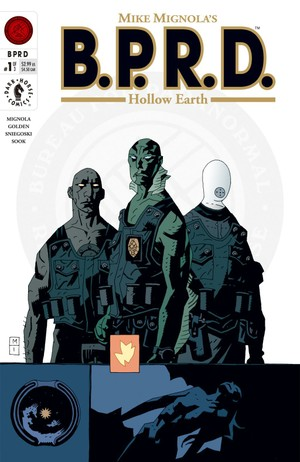
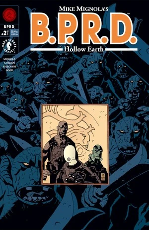
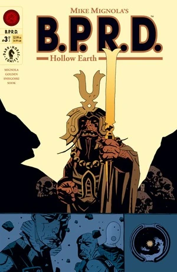

在《**空心地球**》（Hollow Earth）中，[丽兹·舍曼](/entry/Elizabeth_Sherman)离开[B.P.R.D.](/entry/B.P.R.D.)寻求内心的平静，却遭到囚禁。[亚伯·塞皮恩](/entry/Abe_Sapien)、[凯特·考瑞根](/entry/Kate_Corrigan)、[罗杰](/entry/Roger)与新成员[约翰·克劳斯](/entry/Johann_Kraus)前往北极营救她。

## 出版历史

在[地狱男爵](/entry/Hellboy)离开[B.P.R.D.](/entry/B.P.R.D.)（事见《[征服之虫](/entry/Conqueror_Worm_%28story%29)》结尾）之后，[Mike Mignola](/entry/Mike_Mignola)决定让调查防御署的故事在属于它自己的漫画系列中继续下去。

这篇故事于 2002 年 1 月、4 月和 7 月作为三期限定迷你系列出版。2003 年 1 月，故事收入平装合订本《[B.P.R.D.：空心地球及其他故事](/entry/Trade_Collections)》。

## 剧情简介

### 第一部分

[丽兹·舍曼](/entry/Elizabeth_Sherman)离开[B.P.R.D.](/entry/B.P.R.D.)，前往位于北极圈以北乌拉尔山脉中的神殿阿加尔塔，寻求控制自身火焰的帮助。

在康涅狄格州的 B.P.R.D. 总部，[凯特·考瑞根](/entry/Kate_Corrigan)见到了新成员[约翰·克劳斯](/entry/Johann_Kraus)。他说自己希望能见见[地狱男爵](/entry/Hellboy)，却被告知地狱男爵已经休假离开（见《[征服之虫](/entry/Conqueror_Worm_%28story%29)》）。[托马斯·曼宁](/entry/Thomas_Manning)与凯特谈话，担心其他队员也会相继离开。

回到阿加尔塔，丽兹发现地板上有一道巨大的裂缝，便去告诉僧侣们。他们说此事正在处理之中。

凯特探望[亚伯·塞皮恩](/entry/Abe_Sapien)，向他讲述了约翰的经历：他本是一位实体灵媒，一场灾难摧毁了他的肉体，使他只剩一具灵质投影。当晚，丽兹的幻影出现在亚伯面前，请求他救她。

凯特、亚伯、[罗杰](/entry/Roger)和约翰前往阿加尔塔寻找丽兹。他们进入神殿，发现所有僧侣都已遇害。他们找到了丽兹，但她已没有呼吸。约翰说她并没有死，而是某种意义上空了。亚伯在废墟中发现了[一只红色小生物](/entry/Servants_of_the_Left_Hand)的尸体。

### 第二部分

罗杰吸收了那生物的一部分能量，得知这些生物抓走了丽兹，以及它们所在的位置。亚伯、罗杰和约翰沿着地板上的一道大裂缝向下走，希望能找到丽兹的灵魂。

行进途中，约翰问起地狱男爵离开后的情况。另外两人都说日子不好过，亚伯讲起他刚到 B.P.R.D. 的那段日子，当时是地狱男爵主动与他结交。

他们停下休息时，一群生物从天花板上落下发动攻击。约翰设法把它们吓退，三人继续前行。他们经过古老机器的废墟，发现其中一些看起来像是正在被修理。更多的生物和一头巨蟾般的野兽拦住了他们的去路。

### 第三部分

丽兹的灵魂被地下生物囚禁，闪回到她小时候初到 B.P.R.D. 的那一天，当时地狱男爵帮助她承受失去家人的痛苦。

三人奔逃躲避那群生物，亚伯扔出一枚手榴弹阻止它们追赶。三人加快脚步，来到囚禁丽兹灵魂的装置前。约翰和罗杰认为应该能够救出她，就在这时，生物们的[首领](/entry/King_of_Fear_%28character%29)向他们发起攻击。首领告诉臣民，他们将动用创造者的机器接管地表世界。亚伯开枪击中首领，罗杰砸碎机器救出丽兹。洞穴开始坍塌，四人奔逃而出。受伤的首领连同他的一些机器坠入地球更深处。

四人在苏格兰回到地面，被凯特·考瑞根接走。丽兹决定重新加入 B.P.R.D.。

## 故事时间线

故事本身从未说明发生于何时，但其他故事提供了一些线索。

在《[恐惧之王](/entry/King_of_Fear_%28story%29)》#1 中可以看到，那些生物于 2001 年袭击了[丽兹·舍曼](/entry/Elizabeth_Sherman)和阿加尔塔。但这似乎与其他信息相矛盾。（平装合订本中已将时间改为 2002 年。）

故事强烈暗示小队是在袭击发生后不久便前往阿加尔塔的。然而根据《[灵质人](/entry/The_Ectoplasmic_Man)》，[约翰·克劳斯](/entry/Johann_Kraus)直到 2002 年 2 月才成为灵质投影。此外，假设 [B.P.R.D.（预告短篇）](/entry/B.P.R.D._%28teaser%29)中的事件发生在《空心地球》主线之前，约翰在事故后至少过了七个月才加入[B.P.R.D.](/entry/B.P.R.D.)，所以最早也要到 2002 年 9 月。

因此，《空心地球》要么如《恐惧之王》#1 所述发生在 2001 年，要么如《灵质人》所暗示的发生在 2002 年。

无论哪种情况，相对时间线都是清楚的：

- 丽兹·舍曼最后一次露面是 1997 年的《[近乎巨人](/entry/Almost_Colossus)》故事期间
- 丽兹·舍曼在主线故事两年前离开 B.P.R.D. 前往阿加尔塔，即 1999 年或 2000 年
- [地狱男爵](/entry/Hellboy)在《[征服之虫](/entry/Conqueror_Worm_%28story%29)》事件之后于 2000 年离开 B.P.R.D.（此事发生在丽兹离开之后——《空心地球》#1 中[亚伯·塞皮恩](/entry/Abe_Sapien)与[凯特·考瑞根](/entry/Kate_Corrigan)的谈话有述）
- 阿加尔塔遭袭、B.P.R.D. 前往营救丽兹·舍曼是在 2001 年或 2002 年

## 内容

### 角色

#### [B.P.R.D.](/entry/Bureau_for_Paranormal_Research_and_Defense)

- [丽兹·舍曼](/entry/Elizabeth_Sherman)
- [凯特·考瑞根](/entry/%E5%87%AF%E7%89%B9%C2%B7%E8%80%83%E7%91%9E%E6%A0%B9)
- [约翰·克劳斯](/entry/Johann_Kraus)
- [地狱男爵](/entry/Hellboy_%28character%29)（闪回）
- [托马斯·曼宁](/entry/Thomas_Manning)
- [亚伯拉罕·塞皮恩](/entry/Abraham_Sapien)
- [罗杰](/entry/Roger)
- 科布医生（闪回）
- 罗德尔医生（闪回）
- [特雷佛·布鲁姆](/entry/Trevor_Bruttenholm)（闪回）
- 其他雇员

#### 其他

- 阿加尔塔居民
  - 盖根大师
  - 其他僧侣
- 各种[左手仆从](/entry/Servants_of_the_Left_Hand)
- [恐惧之王](/entry/King_of_Fear_%28character%29)
- [女巫](/entry/Witches)
  - [赫卡特](/entry/Hecate)（被提及，以"Heca-Emem-Ra"和"黑色女神"之名）
- [极北族人](/entry/Hyperboreans)
  - [透特](/entry/Thoth)（被提及）
- [奥古·桀哈](/entry/Ogdru_Jahad)（被提及）
- [奥格德鲁·赫姆](/entry/Ogdru_Hem)（被引用）
- 成都事件遇难者（闪回）

### 地点

- [俄罗斯](/entry/Russia)
  - 阿加尔塔（乌拉尔山脉，北极圈以北）
- 美国
  - [B.P.R.D.](/entry/Bureau_for_Paranormal_Research_and_Defense)总部（康涅狄格州法菲尔德（Farfield））
- 奥地利（闪回）
- 德国（闪回）
  - 克劳斯宅邸（海德堡）（闪回）
  - [B.P.R.D.](/entry/Bureau_for_Paranormal_Research_and_Defense)设施（闪回）
- 地下洞穴系统
- 苏格兰高地

### 重要器物

- 各种[极北](/entry/Hyperboreans)器物
  - 剑
  - 战争机器
  - 生产机器
  - 能量汲取装置
- [纳粹](/entry/%3ACategory%3ANazi)潜艇

## 画廊

封面作者：[Mike Mignola](/entry/Mike_Mignola)。

