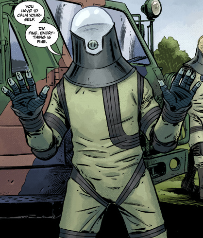

## 历史

**约翰·克劳斯（Johann Kraus）**1946 年出生于德国斯图加特。十岁那年，他开始察觉到自己拥有灵能：他能看到别人看不到的人，并慢慢意识到那些是鬼魂。约翰因无法与鬼魂交流而苦恼，这种挫败感最终促使他拜一位名叫 Anneliese Stiener 的德国老妇人为师，学习通灵术。通过 Stiener，克劳斯结识了许多其他通灵者，接触到各式各样的秘术研究。但他最终不认同这个团体的发展方向，便与导师断绝了来往。此后他自学与死者沟通，并最终掌握了将自身灵质形态送出肉体、进入灵界层面的能力。1971 年，克劳斯在慕尼黑开了一间小事务所，在迁往海德堡镇之前，他已是当地备受尊敬的灵媒。他曾一度爱上一位客户已故的妻子，为此不择手段地怂恿那位客户再来找他，只为操纵两人敞开心扉、加深丧亲之痛，让他们彼此放下——这样他就能趁虚而入向那女人表白。那女人当即拒绝了克劳斯，她厌恶一个活人竟想在死者之中寻求爱情。

### 成都灾难

2002 年 2 月，中国成都一座存放被中国政府查缴的秘术文物的仓库遭人闯入。窃贼无意中打开了一尊小玉像，释放出巨大的灵能冲击波，方圆一百英里内的人全部丧命，震荡波还横扫了整个灵界层面。当时克劳斯正在海德堡为已故的 Heinrich Wagner 一家主持降神会。一个刚死不久的中国男孩的灵魂穿过灵界层面，向约翰求助，诉说成都灾难。震荡波经男孩传导，再传入克劳斯体内，Wagner 一家当场全部死亡，约翰·克劳斯的肉体也被摧毁。凯特·考瑞根曾这样评价克劳斯："他没有死，只是不再拥有身体了。"

### [超自然调查防御署（B.P.R.D.）](/entry/Bureau_for_Paranormal_Research_and_Defense)

约翰的灵质形态在肉体焚毁后幸存下来。他知道没有肉身，自己很快就会消散，于是向地球上最顶尖的超自然智囊求助：B.P.R.D.。起初约翰内心矛盾，拿不定主意是该以鬼魂的形态留下，还是前往来世。后来他试图拯救一个迷途灵魂免于被恶魔吞噬，却惨遭失败，这才改变了主意。那恶魔把一把上了膛的枪留在桌上嘲讽他，挑衅这个鬼魂开枪打它。约翰意识到自己作为灵体是多么无力，于是同意让 B.P.R.D. 把他安置进一套收容服中。穿上新衣服后，他做的第一件事就是直奔那恶魔的住处，将它一枪击毙。

### 加入调查防御署

地狱男爵离开后，克劳斯受命为署里的"超常人才"队伍补充新鲜血液。由于失去了肉身（类似于乐师失去视力后听觉反而更敏锐），他的灵能比以往任何时候都强大。从前他只能与死者对话，如今他能赋予死者暂时的实体。他加入得正是时候，随即参加了 B.P.R.D. 营救[丽兹·舍曼](/entry/Elizabeth_Sherman)的行动——后者在两年前退出了调查防御署。克劳斯很快证明了自己的价值，在与绑架她的奇异穴居人的战斗中运用了自己独特的能力。

尽管获得了新能力，约翰仍容易被强大的灵魂附身，比如他们在芝加哥遭遇的一种"活化石"的灵魂。不过，由于不再需要休息，他多少变成了工作狂，还成了一名精通秘术传说的学者。在接下来几年的并肩作战中，他很快赢得了署里其他超常人才的接纳。

### 蛙疫

2004 年蛙疫爆发后，B.P.R.D. 迁往调查防御署位于科罗拉多山区的新基地，以便在蛙群向西蔓延时抢得先机。他把时间都用来研究从地下层库房清出的堆积如山的档案，其中大部分与该基地在二战期间作为研发设施的历史有关。起初，他被设施昔日居住者的鬼魂附身——那是一群德国科学家，他们没能阻止同僚 [Gunter Eiss](/entry/Gunter_Eiss) 进行一场打开天堂之门的秘术实验。在他们的指引下，他被迫制造了一台机器，阻止了 Eiss 的传送门，并将其永久关闭。

蛙类战争期间，约翰曾遇到一群蛙灵，这是一种前所未见的现象：他们杀死的一群蛙怪刚完成变形，灵魂中还保留着些许人性，于是化为鬼魂。这些鬼魂一路跟着他回到基地，他也不知该如何帮助它们超度。在它们试图附身医务室里的一名士兵和一台冰箱里的有机物质之后，约翰把它们带上天空，举行了一场降神会，帮助它们离开这个世界。迎接他的是一幅恐怖景象——一道通往它们所谓"天堂"的大门，虫形天使在那里将灵魂接走。尽管他乐于帮助蛙灵超度，那道生满触须的传送门却试图把他也带走，他于是迅速返回了人间。

当罗杰被[黑焰](/entry/The_Black_Flame_%28character%29)杀害、复活他的一切希望都落空后，约翰前去与罗杰的灵魂相见——作为人造的何蒙克鲁斯，他既上不了天堂也下不了地狱，因此灵魂一直留在自己的遗体旁。但由于罗杰在他们早年的一桩案子中英勇救下女神 [Cloacina](/entry/Cloacina)，他获赐了一小片乐园，于是约翰在一个类似伊特鲁里亚神殿的来世中找到了他。这个何蒙克鲁斯告诉他自己已得安宁，并请求把他的遗体像人一样安葬，他和战友们欣然满足了这个最后的请求。

### 一度复生，含恨而死

本和亚伯在印度尼西亚执行任务期间，他在旧档案中发现了本与二战时期臭名昭著的刺客[赤莲（The Crimson Lotus）](/entry/Yumiko_Daimio)之间的秘密关系。这一消息起初令人担忧，但他们决定暂不评判，等本回来解释清楚。然而本和亚伯带回来的是多具人造超人躯体。约翰为自己挑了其中最完整的一具，尽情重享人生的乐趣，比如美食与女人。这导致他玩忽职守，有一次甚至擅自动用一辆吉普车，进城与女人花天酒地了一夜。约翰回到总部时发现那里已陷入危机：本被附身，变成了一头凶残的豹人。尽管超人躯体力大无穷，这头豹怪仍把他撕咬致死。令所有人吃惊的是，从尸体中走出的不是约翰的灵魂，而是[大螯虾强生](/entry/Lobster_Johnson)的灵魂——他冲到躺在床上的丽兹身边，将她从宿敌 [Memnan Saa](/entry/Martin_Gilfryd) 的精神控制中解救出来。大螯虾强生很快离去，约翰再次变回了灵体。他询问了两名死在基地里的陌生人——一个是试图帮助本压制诅咒的中国人，另一个是本以前的战友，他潜入基地是因为知道豹人诅咒而想杀死本。约翰将刺客的神秘匕首据为己有，而达米奥则与温迪戈一起逃离了 B.P.R.D.。

约翰设法想把最后一具超人躯体完工，但 B.P.R.D. 无力完成；尽管他急切想参与搜寻本的行动，亚伯却一口回绝。约翰还去找新近入署的木乃伊[潘雅](/entry/Panya_%28character%29)帮忙追踪本的下落，但她不动声色地拒绝了，一眼就从他的话里看穿了他的报复之心。

之后他们举行降神会，试图再次联系大螯虾强生，打探 Memnan Saa 的情报。他回应时点出了"Gilfryd"这个名字，潘雅认出这与她的过去有关。她随后追踪到他在丛林中的藏身处，克劳斯也加入了被派去与他对峙的小队。Saa 在他们眼皮底下劫走丽兹时，所有人都束手无策，一行人险些丧命，勉强逃脱。

### 慕尼黑陷落

还没来得及追查丽兹被带往何处的线索，B.P.R.D. 先随约翰回到他的家乡慕尼黑，追查蛙怪可能在欧洲出现的线索。他们惊恐地发现，地下深处潜伏着他们在阿加尔塔遇到过的地底生物，它们正在制造古老的战争机器并将其送到地面。尽管军队奋力抵抗，巨型机器人还是在被击毁前将慕尼黑夷为废墟。约翰乘车前去查看，发现他的故居和老邻居们都未能幸存。他让司机把车开慢些，从车窗伸出一只手，把自己的灵质分给惨遭屠杀的老友与邻居们的灵魂——他要让整座城市安息。

### 寻找丽兹

约翰、亚伯和 Devon 调查了大螯虾强生的旧藏身处，想找到任何关于 Saa 下落的线索，但最终是凯特那一路的调查给出了一个可能的地点。随后他参加了在俄中边界经过翻新的古城 Thadrethes 营救丽兹的联合军事行动。然而约翰被列入留守人员名单，亚伯、凯特和 Devon 则获准进入城墙内。蛙群及其地底盟友涌出，城外爆发战斗。克劳斯趁乱溜进城去帮助丽兹，因为战局似乎开始有利，他觉得自己在外面派不上用场。他甚至割断了一名试图阻止他与朋友们会合的僧侣的喉咙。他掏出手枪想从背后射击 Saa，却被对方用念力甩到墙上，收容服当场碎裂。大螯虾强生的灵魂再一次从收容服中现身继续攻击，却被点燃后扔出了巫师的高塔。即便在丽兹最终杀死 Memnan Saa 之后，大螯虾强生仍控制着克劳斯的灵质。

丽兹获救后，凯特·考瑞根和她的新男友 Bruno 带着大螯虾的鬼魂驱车前往奥地利。他们爬上山，回到他的殒命之地 Hunte 城堡。在一片荒芜之中，大螯虾终于放这位灵媒自由。克劳斯透露，在那位义警控制他身体期间，他始终神志清醒；他对同伴们说，大螯虾很乐意在来世继续与仍在城堡中作祟的纳粹鬼魂和不死实验品战斗。

约翰陪同凯特和署长 Tom Manning 出席联合国听证会。由于近期的一系列事件——尤其是丽兹在中空地球引发的震撼世界的大爆炸造成了新一轮全球性灾难——联合国召集会议，打算训斥 B.P.R.D.。他们走出大楼时却惊讶地得知，该机构反而获得了升格，在应对当前危机时将得到联合国的全力支持。

### BPRD:人间地狱

约翰对本·达米奥的怨恨仍未消散，他把大量空闲时间花在继续逃避基地勤务、研究从印度尼西亚带回的最后一具超人躯体上，希望能重新成为有血有肉的人。潘雅察觉到了这一点，便让自己的一只杂交动物偷走那间屋子的钥匙，以此捉弄约翰。约翰和潘雅把争执闹到忙得不可开交的丽兹那里，丽兹受够了他们的胡闹，命令两人各回各位。除此之外，约翰还在亚伯的笔记本电脑里植入了一个间谍软件节点，监控他的上网记录，以防亚伯试图追查本的下落。尽管他从亚伯最近去不列颠哥伦比亚省的任务中发现了一条可能的线索，亚伯却发现了植入物，并因两人近来不睦而怪罪于同事 [Andrew Devon](/entry/Andrew_Devon)。约翰对此保持沉默，不愿平息两人之间渐起的嫌隙，也对自己知道间谍软件一事守口如瓶。后来他参加了寻找一位名叫[菲尼克斯·埃斯佩霍](/entry/Fenix_Espejo)的流浪灵媒的任务，此人因能预言灾难而聚集了一批追随者。尽管菲尼克斯溜走了，她还朝亚伯脸上开了一枪，克劳斯便陪亚伯回到总部，帮助后者从这致命伤中恢复。克劳斯至少确认了亚伯的灵魂仍在体内，但已经陷入休眠。

### 俄罗斯

亚伯失去行动能力、Devon 另有任务在身，凯特便带上约翰去会见俄罗斯[特殊科学局](/entry/Special_Sciences_Service)，在不断升级的全球危机中开启合作。在那里，特殊科学局那位僵尸化的局长 [Iosif Nichayko](/entry/Iosif_Nichayko) 热情接待了他们——他早就盼望与克劳斯见面，一个不死之人见另一个不死之人。Iosif 带上约翰，请他帮忙处理一个被奥古灵体附身的灵媒，因为他自己的手下在这件事上已束手无策。约翰担心自己暴露在奥古灵体面前，但他发现，由于自己没有身体，奥格德鲁·赫姆无法操纵他——它控制人需要依赖人的生物机能。驱散那个实体后，他随 Iosif 前去对付那只盘踞在地下的怪物：它集结了一支僵尸大军，为自己筑巢生长。他请 Iosif 对凯特隐瞒他参与此事，因为他知道凯特一定会反对。在地下深处，约翰得到了特种部队的协助，而他们甘愿为任务赴死，这让约翰能够利用他们的尸体比他们生前走得更远。抵达奥格德鲁·赫姆面前后，那怪物试图再生他正用来建立对其控制的尸体，但他引爆了一枚核装置，将它彻底湮灭。随后他的灵魂与特殊科学局人员会合，他换上了一套新收容服，令凯特大吃一惊。与旧服不同，这套新服源自 Iosif 的一套服装，给他带来了天壤之别的感受。原来的收容服让他觉得自己像待在一个袋子里，而俄式设计的独到之处让他感觉自己重新拥有了身体——仿佛又有了指关节和膝盖——他拒绝再穿回原来的收容服。从今往后他就住在这具身体里，旧服则留作备用。

### 追踪达米奥

穿上新服后，约翰重新开始做梦，仿佛新收容服让他再次体验到了生命的感觉。当他收到消息说不列颠哥伦比亚省亚伯那桩案子要展开后续调查时，克劳斯立刻抓住机会，率领一队特工北上，希望能找到本·达米奥。怨恨驱使他做出了违背团队利益的事：他把队员们丢在小木屋，独自钻进树林搜寻。由于他的疏忽，他的小队遭到豹人凶猛袭击，全靠[卡拉·贾罗科](/entry/Carla_Giarocco)奋力抵抗，他们才赶走了怪物。约翰在医院向卡拉坦白自己追踪本的意图后，她厉声让他离开，对他们因他的复仇欲而蒙受伤亡怒不可遏。约翰带着手头仅剩的几名特工进林猎杀达米奥，结果只找到了与本同行的[温迪戈达里尔](/entry/Daryl_Tynon)。在一处营地撞见最新一起屠杀后，约翰询问了遇害者，又手持神秘匕首——唯一能刺穿豹神诅咒的武器——附身在一具尸体上搜寻达米奥。他在一处新鲜的驼鹿猎杀现场找到了本，对本离队的理由置之不理，愤怒于他没有试着留在调查防御署，让大家一起想出解决办法。两人交锋，约翰成功把匕首刺进豹人身体，随后附身死驼鹿，想结果本的性命。然而豹人还是获胜逃走了。第二天，他和特工们在一片冰封的湖面上找到了本浑身血污的尸体，温迪戈不见踪影，他宣布任务结束。

由于他的行动让小队付出了代价，约翰随即被暂停外勤职务一段时间。在与 Devon 的一次谈话中，他说这惩罚比他应得的要轻。不过他收到了一条关于超人躯体的好消息：研究该躯体的一名工作人员告诉他，Zinco 公司正在开发一种新药，可能有助于躯体的研发与完工。凯特约见 Zinco 公司的代表 Evelyn，想说服她把躯体带去用他们的药物试验，凯特几乎是在恳求对方收下。Evelyn 同意把躯体带走。凯特做这个决定时心里并不情愿，她承认约翰用上一具躯体救过几条人命，而且既然本已死了，她现在可以接受这件事。但她不让约翰许下任何承诺，因为她深知他在这件事上可能、而且很可能再次表现得多么不负责任。与此同时，她还计划解除对约翰的停职处分，派他去芝加哥执行一次搜救任务。

两人都不知道的是，Zinco 计划利用这具躯体施行他们的计划：召回公司前 CEO [Landis Pope](/entry/Landis_Pope)的灵魂，而且他们成功了。约翰本将得到的第三具身体，如今成了复活的[黑焰](/entry/The_Black_Flame_%28character%29)的容器，而且比以往任何时候都更加强大。

### 队长

约翰的小队飞往芝加哥途中，一场大地震袭来，一只奥格德鲁·赫姆从地底钻出——黑焰的归来在全球唤醒了数十只这样的怪物，这是其中之一。那恐怖怪物喷出诱变气体，小队大多数人戴上了防毒面具，但飞行员中毒倒下，直升机坠毁。小队在迫降中幸存，现在只能徒步前往芝加哥，一路上还遭到[锤头怪](/entry/Hammerheads)的追猎。尽管约翰沉着指挥，他仍与态度粗暴的特工伊诺斯摩擦不断，后者对活着走出去的机会日益绝望。他们最终骑马抵达芝加哥，发现击落他们直升机的那种怪物已经在整座城市扎根。尽管威胁迫在眉睫，他仍催促小队继续寻找他们要搜救的特工，并在当地人带领下进入了曾属于[拉神赫利奥庇斯兄弟会](/entry/Heliopic_Brotherhood_of_Ra)的密室。他们刚发现里面的屠杀现场，就被一群变异僵尸围攻。昏迷的[泰德·霍华德](/entry/Ted_Howards)——他们要营救的特工之一——在狂暴中苏醒，手持[极北之剑](/entry/Hyperborean_Sword)杀出一条血路，劈开挡路的尸群，而且他似乎对诱变气体免疫，而其他特工全靠戴着防毒面具才撑住。确认霍华德是他们要营救的小队中唯一的幸存者后，他们带着他返回总部，丝毫没有察觉他们的战友已发生了多大的变化。

### 逾越界限

### 解放的厄庇墨透斯

## 能力

早在肉体被毁之前，约翰·克劳斯就是一位天赋异禀、经验丰富的灵媒，既能与灵魂交流，也能将自身的灵质形态投射出肉身之外。被化为收容服中的一缕灵魂后，这两项能力都没有减弱；在许多方面，正因如此，克劳斯干起本职工作来反而更加出色。

在当前状态下，克劳斯能赋予鬼魂暂时的实体，让它们与非灵媒对话。没有身体意味着他不需要吃喝、睡觉或呼吸。得益于收容服，他对恶劣天气等不利环境也有更强的耐受力。

与电影中一样，漫画里的约翰也表现出附身能力的迹象：他能够附身在任何没有灵魂的形体上。克劳斯的收容服受损时，他曾暂时栖身于一条死狗体内；后来他又在特工[伊诺斯](/entry/Enos)死去仅几秒后附到他身上，控制程度足以通过尸体说话并操作榴弹发射器。

克劳斯还展现出许多实用的非超自然才能，包括出色的人际交往与组织能力，他能说流利的德语和"生了锈的"日语，这些过去都派上过用场。克劳斯深受身边人的喜爱，被认为非常可靠。

克劳斯的主要弱点是对收容服的依赖。没有收容服，他的灵质形态就会消散；若太长时间没有宿主躯体或收容服，克劳斯的灵质就有彻底消散的危险。即使收容服只是轻微受损，也可能出现这种情况。

## 盟友与敌人

### 盟友：

- [地狱男爵](/entry/Hellboy_%28character%29)
- [丽兹·舍曼](/entry/Liz_Sherman)
- [亚伯·塞皮恩](/entry/Abraham_Sapien)
- [Tom Manning](/entry/Tom_Manning)
- [凯特·考瑞根](/entry/Kate_Corrigan)
- [潘雅](/entry/Panya_%28character%29)

### 敌人：

- [格里高利·拉斯普廷](/entry/Grigori_Rasputin)
- [Klaus Werner von Krupt](/entry/Klaus_Werner_von_Krupt)
- [Ilsa Haupstein](/entry/Ilsa_Haupstein)
- [克焰人](/entry/Karl_Ruprect_Kroenen)
- [利奥波德·克茨](/entry/Leopold_Kurtz)
- [奥古·桀哈](/entry/Ogdru_Jahad)
  - [Nunn-Jahad](/entry/Nunn-Jahad)
- [奥格德鲁·赫姆](/entry/Ogdru_Hem) 

## 电影

### [《地狱男爵 2：黄金军团》](/entry/Hellboy_II%3A_The_Golden_Army)

由于[地狱男爵](/entry/Hellboy_%28character%29)的存在被曝光于世人面前，华盛顿派克劳斯接管外勤行动的指挥权。根据从一只被克劳斯复活的死[牙仙](/entry/Tooth_Fairies)口中得到的情报，他锁定了[巨魔集市](/entry/Troll_Market)的位置。他跟踪一只[巨魔](/entry/Fragglewump)以图进入集市，在如何说服巨魔说出巨魔集市入口的问题上，克劳斯与地狱男爵产生了分歧。地狱男爵用暴力手段没能逼问出开启入口的方法，克劳斯便以灵质形态附身门锁机关，打开了大门。进入之后，克劳斯训斥地狱男爵过于频繁地用无线电与丽兹联络。克劳斯低声骂了地狱男爵一句"Schmutziger Affe"，这是德语，意思是"肮脏的猿猴"。不久之后，约翰想盘问两个巨魔和他们身上的肿瘤，却徒劳无功，结果地狱男爵靠拳头把情报打了出来。

后来，在 [B.P.R.D.](/entry/Bureau_for_Paranormal_Research_and_Defense)总部的淋浴间里，克劳斯告诉地狱男爵他最大的弱点：他的脾气，这话点燃了地狱男爵的怒火。地狱男爵一拳挥出，失手打碎了克劳斯的头盔。克劳斯化为灵质形态，附身整排储物柜，用柜门喜剧般地追打地狱男爵。

[Nuada](/entry/Nuada)从 B.P.R.D. 绑走妹妹 [Nuala](/entry/Nuala)，并把地狱男爵打成致命重伤后，B.P.R.D. 决心找到[黄金军团](/entry/The_Golden_Army)。发现一张地图后，克劳斯把位置追踪到了北爱尔兰。克劳斯命令小队撇下地狱男爵前往该地时，[丽兹·舍曼](/entry/Liz_Sherman)对克劳斯勃然大怒，指责他已经失去了人性。听到这话，克劳斯改变了心意，想起自己也曾与一个女人相知相爱，后来却在一次事故中失去了她（以及自己的肉体）。他拿出一个袋子，里面装着他和爱人的结婚戒指，随后加入舍曼、地狱男爵和[亚伯·塞皮恩](/entry/Abe_Sapien)的未经授权的行动，一同去寻找黄金军团。战斗中，克劳斯附身一名黄金士兵攻击其他士兵，直到那台机器被另一台机器劈成两半。

战斗以 Nuada 与 Nuala 双双身亡告终，此后克劳斯与其他特工一起从 B.P.R.D. 辞职。

### 与漫画版的差异

电影中，约翰·克劳斯是（据推测）在试图夺回亡妻时失去了身体（他告诉亚伯和丽兹，这段故事他以后再讲）。此外与漫画不同，约翰在收容服之外也能维持灵质形态不散，还可以离开收容服、附身到机器上。虽然影片从未明说，但暗示电影版克劳斯与[克焰人](/entry/Karl_Ruprect_Kroenen)有过旧怨；另外，电影中"Krauss"的名字用双写的"s"拼写，而漫画中的拼写只有一个"s"。
