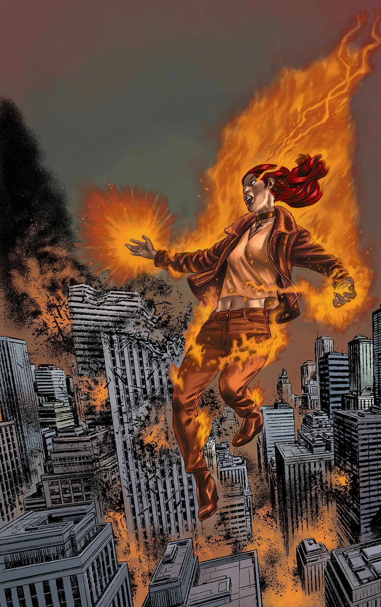
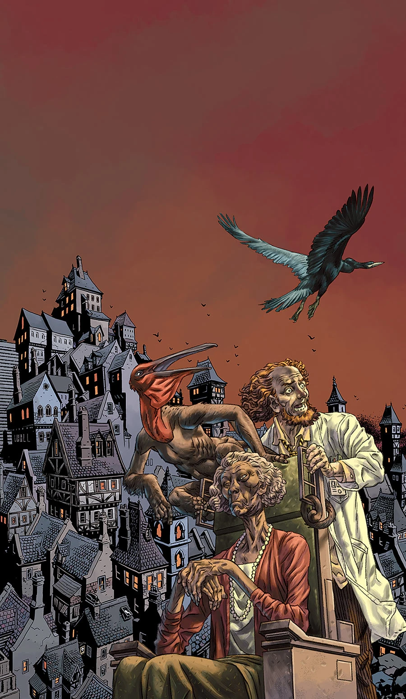
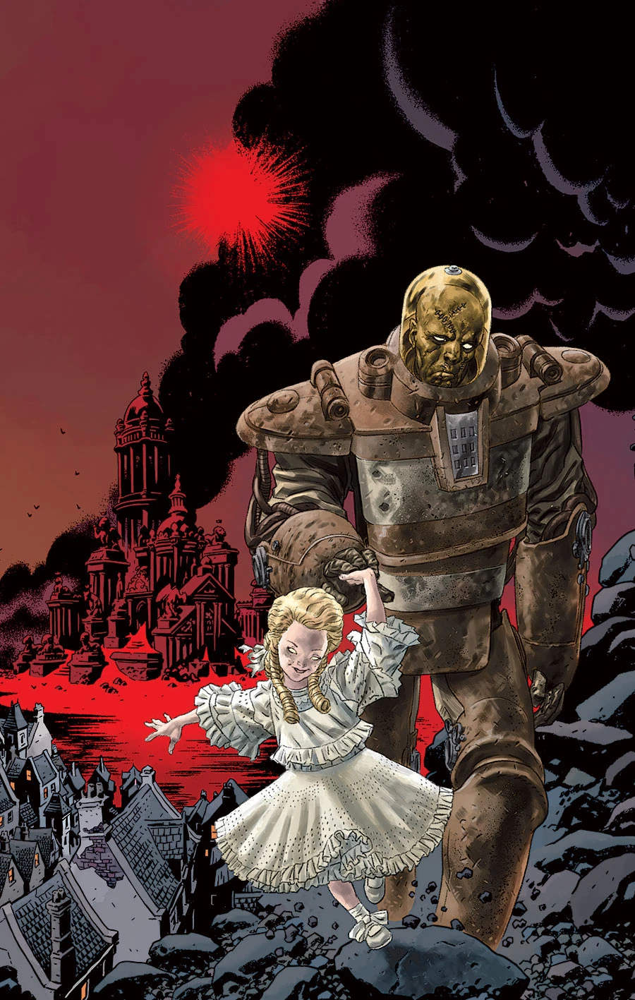
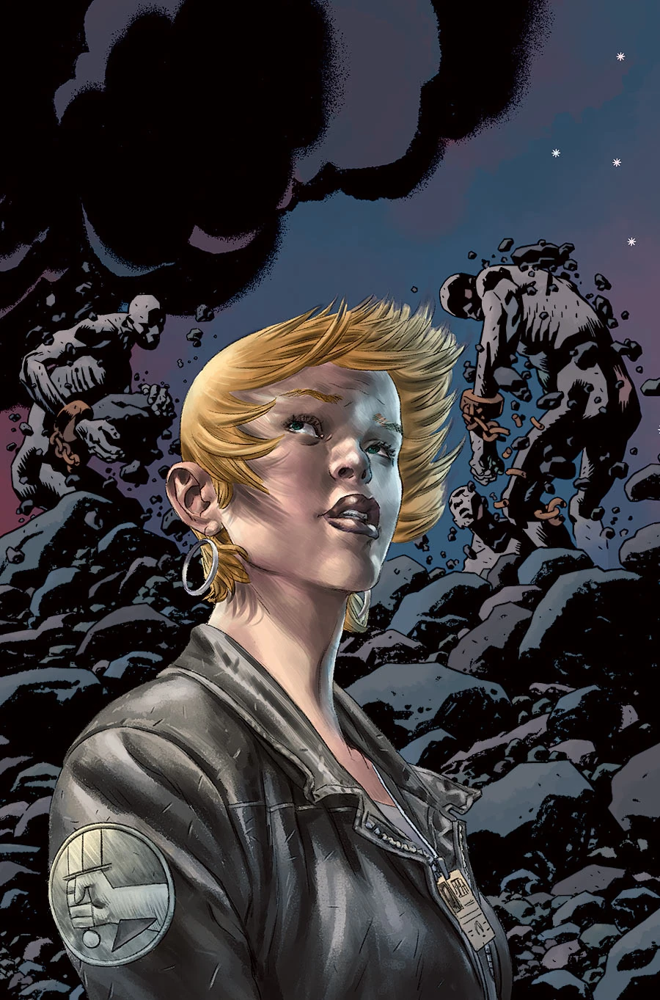
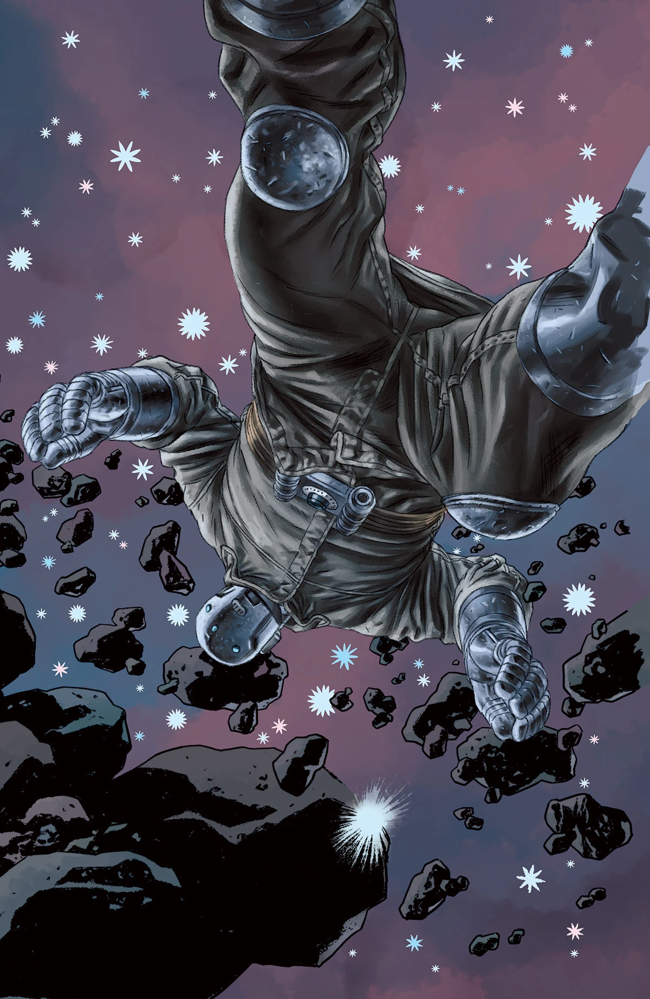

《**终结时刻**》（Cometh the Hour）是一个五期故事弧，是[《B.P.R.D.：人间地狱》故事环](/entry/BPRD%3F%E4%BA%BA%E9%97%B4%E5%9C%B0%E7%8B%B1))的结局，同时也为 [*B.P.R.D.*](/entry/B.P.R.D._%28series%29)的[最后一个故事环](/entry/The_Devil_You_Know_%28story_cycle%29)埋下伏笔。

## 剧情简介

### 第一部

凯特和潘雅就是否放弃 B.P.R.D. 总部争执不下；与此同时在纽约市，约翰和丽兹迎战一个似乎不可阻挡的对手——奥古·桀哈每小时都在繁殖出数十只新怪物。

### 第二部

丽兹和约翰奋力抵挡奥格德鲁·赫姆，凯特则赶在高耸入云的奥古·桀哈把总部夷为平地之前组织撤离——瓦尔瓦拉则引领着约瑟夫深入地狱。

### 第三部

丽兹和约翰筋疲力尽，再也跟不上奥古·桀哈的势头。在科罗拉多州，凯特试图赶在怪物杀死所有人之前撤离 B.P.R.D. 总部。

### 第四部

在与宇宙邪恶的化身奥古·桀哈的战斗中，美国西部各州化为废墟，B.P.R.D. 伤亡惨重。摧毁这头巨兽的唯一希望，或许就藏在恶魔小女孩瓦尔瓦拉那邪恶的计划里。

### 第五部

为阻止黑焰用以淹没世界的蛙人蔓延，丽兹·舍曼炸掉了地心。她虽然杀死了那个黑焰，但她造成的毁灭却催生了一位新的黑焰，以及更可怕的全球怪物浪潮。面对不确定的未来，B.P.R.D. 清点着伤亡人数，*人间地狱*（Hell on Earth）就此落幕。

## 《瓦尔瓦拉：那个邪恶的俄国小女孩》

这篇二页后备短篇由 [Matt Strackbein](/entry/Matt_Strackbein)自编自绘，刊载于 *B.P.R.D.: Hell on Earth—Cometh the Hour* \#2，回顾了[瓦尔瓦拉](/entry/Varvara)的历史。本短篇未被收录进任何合订本。

## 画廊

