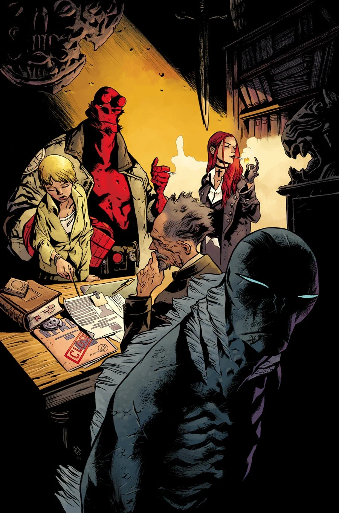
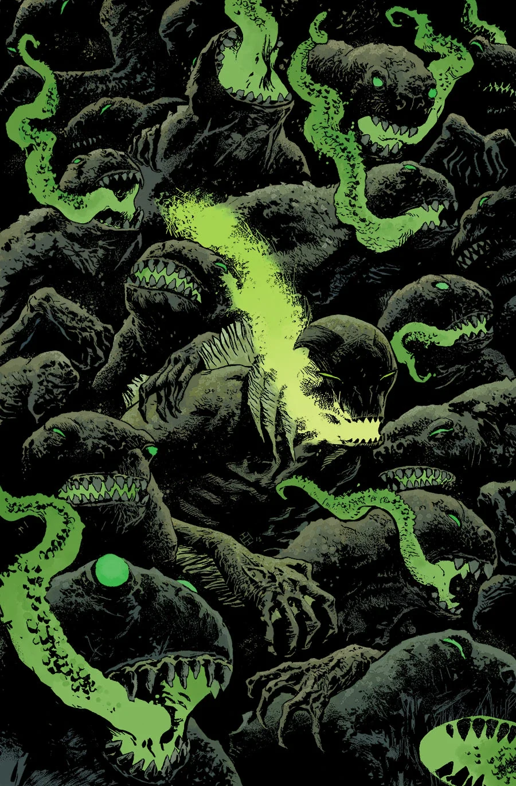
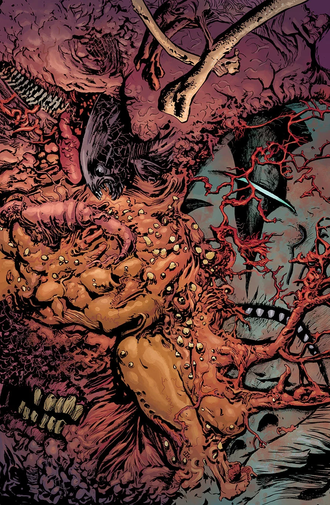

《**苏瓦尼上空的阴影**》（*The Shadow Over Suwanee*）是一个三期满载的故事弧，于 2015 年 7 月开篇。

## 剧情梗概

### 第一部分

被地狱男爵的记忆纠缠着的亚伯，在一座被水淹没的城镇中与一头可怕的怪物狭路相逢，而这头怪物揭开了有关他自身前人类起源的秘密。

### 第二部分

佛罗里达的一座小镇，在一头巨型怪物的阴影之下维持着一种诡异的存续；亚伯在此发现了关于自己的起源，以及他在世界末日中所扮演角色的秘密。

本期包含一段闪回，重现 *[Witchfinder：昂兰之谜](/entry/The_Mysteries_of_Unland)* 的最后几场戏。

### 第三部分

亚伯离开了 B.P.R.D.，去直面那些人们声称与他有所关联的怪物。如今他真的找到了一头——它高耸在一座注定毁灭的佛罗里达小镇之上。随着亚伯一头扎进关于自身起源与使命的问题，一场惊心动魄的意念交会就此展开。

## 画廊

