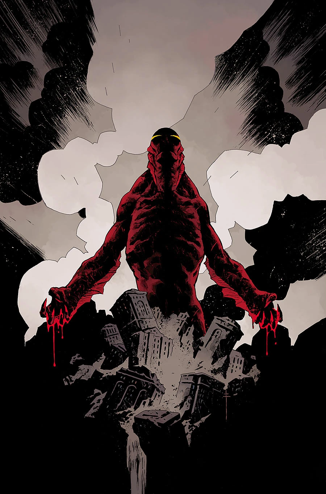

《**荒凉海岸**》（The Desolate Shore）是一部单期完结故事，由 Sebastián Fiumara 作画，也是[《Dark and Terrible》故事系列](/entry/Dark_and_Terrible_%28story_cycle%29)的最终章。

## 剧情概要

人类的未来悬于一线：亚伯·塞皮恩终于登上陆地，直面那位死灵法师——此人已经摸清如何利用亚伯在末日中所扮演的角色来为自己谋利。

## 画廊

