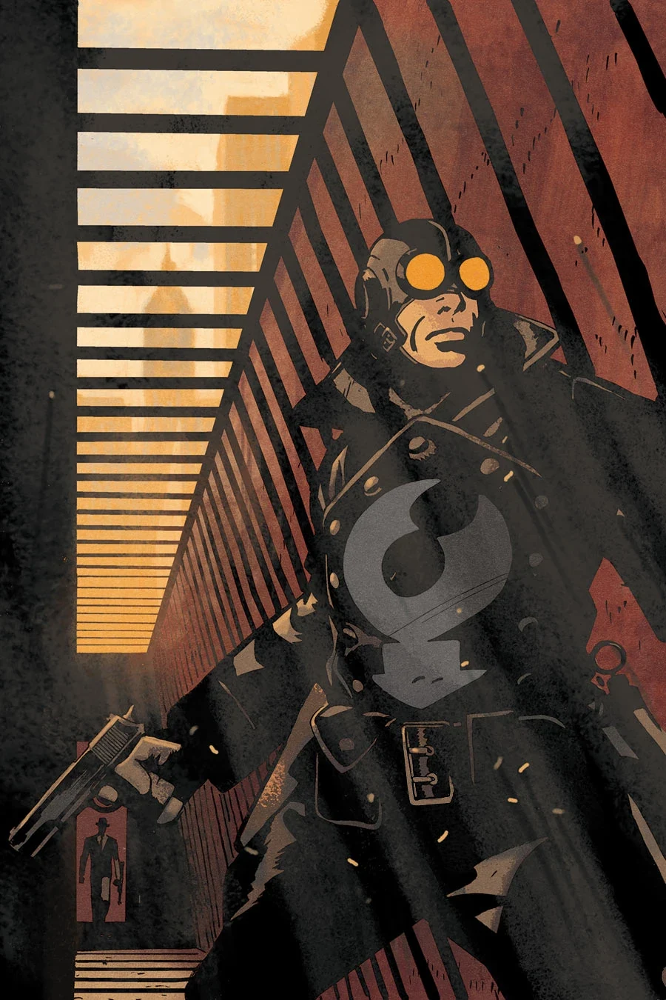
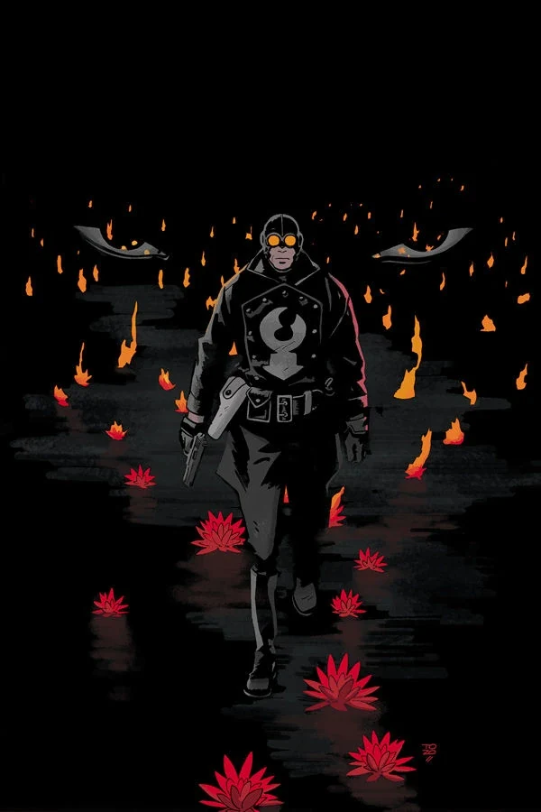

《**莲花香**》（A Scent of Lotus）发生在1933年1月底至2月初[龙虾人](/entry/The_Lobster)打击犯罪生涯的早期。

## 出版历史

这部两期限定连载于2013年出版，绘画由 Sebastián Fiumara 创作，封面由 [Tonči Zonjić](/entry/Ton%C4%8Di_Zonji%C4%87) 绘制。

## 剧情简介

### 第一部

[龙虾人约翰逊](/entry/The_Lobster)在前去会见一名青帮（Tong）联络人的路上，却发现他已被谋杀，这是针对青帮组织一系列袭击中的最新一起。奇怪的是，青帮似乎没有采取任何报复性袭击。

[埃克德警探](/entry/Detective_Eckerd)正在调查这些谋杀案，但实际上他更专注于追查龙虾人。他开始跟踪记者[辛迪·泰南](/entry/Cynthia_Tynan)，希望能收集到有关龙虾人身份的信息。埃克德循线找到[哈里·麦克泰尔](/entry/Harry_McTell)，但无法获得更多信息。

青帮派出一名新信使，带着两名保镖去运送一只装满现金的箱子。他们很快遭到神秘袭击者的伏击。龙虾人出面干预，信使趁机逃到一处安全屋。龙虾人不久后赶到，却发现安全屋已陷入火海。听到人声、以为里面还有人，龙虾人冲进大楼，却发现[红莲](/entry/Crimson_Lotus)正在等他。

### 第二部

龙虾人被红莲的[能剧猴](/entry/Noh_monkey)枪击并遭到身体攻击。他被剩下的那名保镖关甲（Guan Jia）所救，后者指引龙虾人带他去见青帮头目赛荣（Sai Wing）。赛荣解释说，青帮正在把钱输送给满洲的革命者，以抗击日本的占领。然而，他们的信使路线一直被日本刺客红莲截获。

为了引出红莲，龙虾人充当了下一名信使。他被能剧猴截住，双方爆发枪战。他从一栋建筑上跌落，再次与红莲面对面。[莱斯特](/entry/Lester)就在附近，他拍下了红莲的照片，然后跑走去发表这张照片。红莲意识到自己的掩护已被揭穿且正遭到龙虾人的攻击，便消失了，从此不再骚扰青帮信使。

由于涉及一名日本间谍，调查部从埃克德警探手中接管了龙虾人一案的管辖权。他们没收了所有证据，包括一只保存在罐子里的能剧猴。

## 画廊

